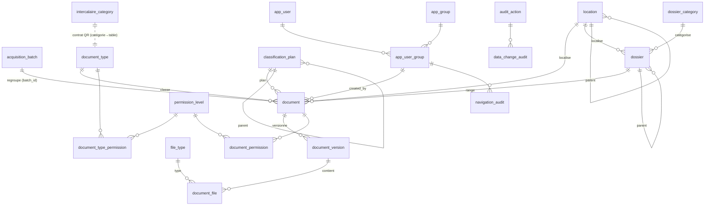

# PRD — Reprise « Archivage par QR » (3 pages)

> **Produit :** sous-ensemble autonome reprenant 3 écrans de DocuPro Suite V7
> **Statut :** Draft **v1.1** — décisions métier intégrées
> **Date :** 2026-06-11
> **Source :** rétro-ingénierie du code legacy (`D:\wwwroot`) + schéma réel de `db_DocuPro_Aconda` (SQL Server). Les choix de modèle sont fondés sur l'inspection des tables, procédures stockées et code-behind existants.

> **Changelog v1.1** : (1) métadonnées d'indexation **retirées** du périmètre (R3) ; (2) contrat QR **redéfini** sans compatibilité legacy, format robuste versionné (EF-P1-5 / R2) ; (3) **les 4 catégories** d'intercalaire sont gérées à l'acquisition (R1/D9, exigence ferme) ; (4) QR **mono-page** acté (R5) ; (5) **pile open source** recommandée (R6, §13). Modèle ramené de 27 à **21 tables**.

---

## 1. Contexte & objectif

DocuPro Suite V7 est une GED/SAE monolithique (ASP.NET WebForms VB.NET, ~200 contrôles, routage de pages piloté par la base). On souhaite **réimplémenter dans une application neuve, isolée, uniquement trois fonctionnalités** qui forment ensemble une **chaîne d'archivage par numérisation de masse pilotée par QR codes** :

| # | Écran legacy | Rôle |
|---|---|---|
| **P1** | `create_intercallaires.ascx` (`Menu_id=27`) | Générer des **feuilles d'intercalaires à QR codes** à imprimer et insérer dans les liasses papier. |
| **P2** | `get_archives_par_dossier.ascx` (`Menu_id=50`) | **Acquisition par lot** : téléverser des PDF numérisés, les **découper en documents** via les QR, OCR, et rattacher à un **dossier**. |
| **P3** | `Recherche_MiltiNew.ascx` (`Menu_id=3267`) | **Recherche / consultation** de tous les documents dans une grille (filtre, regroupement, tri) avec **export** Excel/PDF/Word/CSV. |

**Objectif** : disposer d'une application moderne, maintenable, avec un **modèle de données propre et normalisé** (clés étrangères réellement contraintes, référentiels clairs), sans la dette du legacy (procédures stockées fragiles, absence de FK, hiérarchies nested-set lock-heavy, colonnes TINYINT saturables) **et sur une pile 100 % open source**.

### Enchaînement fonctionnel cible

```
P1  Génère intercalaires QR ─▶ Impression + insertion dans la liasse papier
                                        │
                                  Numérisation (scanner)
                                        │
P2  Acquisition par lot : lecture QR (page de séparation) ─▶ découpage en documents
        ─▶ OCR ─▶ stockage fichier sur disque ─▶ rattachement dossier ─▶ lot (batch)
                                        │
P3  Recherche multi-critères : grille filtrable + export + ouverture document
```

---

## 2. Périmètre

### Dans le périmètre
- Les 3 écrans ci-dessus et leur logique métier complète.
- Les **référentiels / tables de paramétrage** nécessaires : types de document, plan de classement, localisation, dossiers (+ catégories, motifs de sortie), types de fichiers, contrat d'intercalaire QR.
- Gestion des **lots d'acquisition** (matérialisation du `StrGuid` legacy).
- Génération de QR, lecture de QR (mono-page), OCR (extraction texte pour la recherche plein-texte), stockage fichier.
- Sécurité : utilisateurs/profils, et **habilitations par document / par type** (corrige une faille du legacy, cf. §6).
- Audit/journal des actions.

### Hors périmètre
- **Métadonnées d'indexation** (champs personnalisés, listes de valeurs) — **explicitement écartées** (décision R3). La recherche P3 s'appuie sur les attributs natifs du document + le texte OCR.
- Le routage de page piloté par la base (`tbl_Common_Menu*`) → remplacé par des routes applicatives standard.
- Indexation/validation QA fine (`dossier_viewer_qa.ascx`, `Menu_id=49`) — **mais** le modèle prévoit les colonnes nécessaires (`is_archived`, `validated_*`, `document_date`) pour l'ajouter ultérieurement.
- Workflow, courrier/mail, évaluation RH, espaces collaboratifs, taxonomie/folksonomie, prêts de dossiers — colonnes de liaison conservées en FK nullable « réservées ».
- Signature électronique, sécurité PDF (mot de passe/redaction) — colonnes conservées mais non exploitées.

---

## 3. Personas / rôles

| Rôle | Besoins |
|---|---|
| **Agent de numérisation** | P1 (imprimer les intercalaires), P2 (téléverser les lots scannés). |
| **Documentaliste / archiviste** | P2 (choix dossier, contrôle), P3 (recherche, export). |
| **Consultant / utilisateur métier** | P3 (recherche, consultation des documents autorisés). |
| **Administrateur** | gestion des référentiels (types, plan, localisation, dossiers) et des habilitations. |

---

## 4. Hypothèses & décisions structurantes

| # | Décision | Justification |
|---|---|---|
| **D1** | **Stockage des binaires sur disque**, nom de fichier = `{file_id}{extension}` sous la racine `ARCHIVES`. Pas de blob en base. | La colonne `File_bytes` legacy existe mais l'insert est commenté ; le viewer streame depuis le disque. |
| **D2** | **Hiérarchies (plan, localisation, dossier) = liste d'adjacence (`parent_id`) + chemin matérialisé (`path`) + `depth`.** Abandon du nested-set `BG/BD`. | Le nested-set legacy était la partie la plus fragile (transactions `SERIALIZABLE` renumérotant toute la table). `path LIKE '/x/%'` couvre les sous-arbres ; `ORDER BY path` le rendu indenté. |
| **D3** | **Toutes les FK sont contraintes.** | Le legacy n'avait quasiment aucune FK. |
| **D4** | **`file_type.file_type_id` en `INT`** + **unicité sur `extension`**. | Legacy `TINYINT` (plafond 255) + auto-création de type sur extension inconnue = risque de saturation/doublons. |
| **D5** | **Le lot de scan (`StrGuid`) devient une entité de 1er rang** `acquisition_batch` ; `document.batch_id` la référence. | `StrGuid` legacy répété sur chaque ligne. |
| **D6** | **Distinguer date métier (`document.document_date`, = legacy `Document_datetime`, affichée par P3) et date système (`created_at`).** Conserver `archive_year`. | P3 (`SP_COMMON_GET_ALL_DOCUMENT_INFO`) affiche `Document_datetime`. |
| **D7** | **Identité applicative = `app_user_group.user_group_id`** (= legacy `users_groupId`). Toutes les FK acteur pointent ici. | Seule FK réelle du legacy. |
| **D8** | **Habilitation par document et par type ajoutée et appliquée sur P3.** | Le legacy `Recherche_MiltiNew` expose **tous** les documents sans contrôle. |
| **D9** | **P2 honore les 4 catégories d'intercalaire** (type doc, plan, localisation, dossier) — **exigence ferme** (décision R1). | Le legacy n'activait que le type document (branches plan/dossier commentées) : dette corrigée. |
| **D10** | Horodatages en `DATETIME2`/UTC (`SYSUTCDATETIME()`). | Modernisation ; ajuster si l'app suppose l'heure locale. |
| **D11** | **Aucune métadonnée d'indexation** (décision R3) : pas de tables EAV ; la recherche repose sur les attributs natifs + OCR. | Choix métier. |
| **D12** | **Contrat QR neuf, sans compat legacy** : format ASCII versionné (cf. §5.4). | Décision EF-P1-5 + R2 (fiabilité d'encodage/lecture). |
| **D13** | **QR mono-page** : chaque intercalaire est une page unique portant un seul QR ; la lecture se fait sur cette page de séparation. | Décision R5. |
| **D14** | **Pile 100 % open source gratuite** (cf. §13). | Décision R6. |

**Stack cible** : application .NET (C#) — voie de migration naturelle depuis le legacy VB.NET — sur SQL Server, avec une pile open source (§13). Le modèle de données est **portable** (PostgreSQL : `path` → `ltree`).

---

## 5. Exigences fonctionnelles

> Convention : **EF** = exigence fonctionnelle ; **CA** = critère d'acceptation.

### 5.1 P1 — Création d'intercalaires (génération QR)

**Récit** : en tant qu'agent de numérisation, je sélectionne une catégorie d'éléments puis un ou plusieurs éléments, et j'obtiens un document imprimable contenant une feuille séparatrice par élément, chacune portant un QR code, pour intercaler la liasse avant scan.

- **EF-P1-1** — Sélecteur de **catégorie d'élément** : `Type de document`, `Plan de classement`, `Localisation`, `Dossier`, `Séparateur vierge (blank)`.
- **EF-P1-2** — Selon la catégorie, charger la liste des éléments depuis le référentiel correspondant :
  - Type de document → `document_type` (liste plate).
  - Plan de classement → `classification_plan` (arbre, rendu indenté par `depth`, trié par `path`, racine virtuelle exclue).
  - Localisation → `location` (arbre, même rendu).
  - Dossier → `dossier`.
  - Séparateur vierge → aucun chargement (élément synthétique).
- **EF-P1-3** — Sélection **multiple** (cases à cocher).
- **EF-P1-4** — Pour chaque élément sélectionné, générer une page A4 (une seule page par intercalaire, D13) contenant : le **libellé de la catégorie**, un **QR code unique**, et le **libellé de l'élément**.
- **EF-P1-5** — **Contrat du QR** : charge utile au **nouveau format `§5.4`** (le format legacy `INTER-CAL-LAIRE¦{colonne}¦{id}` n'est **pas** repris). La catégorie encodée est validée contre le référentiel `intercalaire_category`.
- **EF-P1-6** — Sortie : document imprimable (PDF) renvoyé *inline* au navigateur.
- **CA-P1-a** — Aucune sélection ⇒ bouton désactivé / message (corrige le bug legacy qui produisait un document vide).
- **CA-P1-b** — Le QR d'un élément, une fois relu par P2, permet de retrouver sans ambiguïté la catégorie, la table cible et l'identifiant.

### 5.2 P2 — Acquisition par lot par dossier

**Récit** : en tant qu'agent, je choisis un dossier de destination (existant ou nouveau), je téléverse un lot de PDF scannés ; le système les découpe en documents d'après les intercalaires QR, en extrait le texte (OCR), stocke les fichiers et rattache le tout au dossier.

- **EF-P2-1** — **Choix du dossier** : soit un dossier existant (sélection en cascade parent → enfant), soit **« Nouveau dossier »** (créé automatiquement).
- **EF-P2-2** — **Téléversement multi-fichiers** (PDF), avec barre de progression.
- **EF-P2-3** — **Création du lot** : à l'ouverture, générer un `batch_guid` ; persister une ligne `acquisition_batch` (opérateur, date de scan, dossier cible).
- **EF-P2-4** — **Tri des fichiers par nom** (respect de l'ordre de scan).
- **EF-P2-5** — **Découpage par QR** : pour chaque fichier, lire le QR de la **page de séparation** (mono-page, D13). Le système gère **les 4 catégories** (D9) :
  - QR `intercalaire` **non-blank** → **ouvre un nouveau document** et applique l'attribut correspondant selon la catégorie : `document_type_id`, `plan_id`, `location_id` **ou** `dossier_id`. La prochaine page réelle commencera ce document.
  - QR `blank` → **séparateur** : clôt le document courant, sans changer d'attribut.
  - Page sans QR → **rattachée au document courant** (page/fichier supplémentaire) ; si aucun document n'est ouvert, ouvre un document « sans type ».
  - *Note* : un intercalaire `dossier` rattache le(s) document(s) suivant(s) au dossier encodé, qui **prévaut** sur le dossier choisi en EF-P2-1 pour ces documents.
- **EF-P2-6** — Pour chaque fichier réel : extraire le **texte OCR**, résoudre/auto-créer le **type de fichier** par extension, créer la ligne `document_file`, et **écrire le binaire sur disque** sous `{file_id}{extension}`.
- **EF-P2-7** — Chaque document créé : `is_archived = 0` (en attente de validation QA), rattaché au dossier et au lot ; `created_by` = opérateur.
- **EF-P2-8** — À la fin, mettre à jour les compteurs/statut du lot et rediriger vers l'écran de validation/indexation (hors périmètre ; lien et données prévus).
- **CA-P2-a** — Un lot de N fichiers avec K intercalaires de catégorie « ouvrante » produit K documents (ou K+1 si des pages précèdent le 1er intercalaire), chacun avec le bon attribut.
- **CA-P2-b** — Création de **nouveau dossier** : refuser un libellé en doublon (règle métier legacy `SP_ARCHIVES_CONTROL_DOUBLON_DOSSIER`).
- **CA-P2-c** — Tous les documents/fichiers d'un même upload partagent le même `batch_id`.
- **CA-P2-d** — Un type d'extension inconnu crée un `file_type` **sans** dupliquer un type existant (contrainte d'unicité).
- **CA-P2-e** — Un intercalaire `plan`, `localisation` ou `dossier` produit bien l'affectation correspondante sur les documents suivants (vérifie D9, non régressif vs legacy).

### 5.3 P3 — Recherche multi-critères + export

**Récit** : en tant qu'utilisateur, je consulte la liste des documents dans une grille que je filtre/regroupe/trie, j'ouvre un document, et j'exporte le résultat.

- **EF-P3-1** — Grille listant les documents avec colonnes : **Libellé** (lien vers la consultation), **Type de document**, **Référence (cote)**, **Date document** (`document_date`), **Dossier**, **Plan de classement**, **Localisation**. *(Pas de colonne « Métadonnées » — D11.)*
- **EF-P3-2** — **Filtrage / recherche / regroupement / tri** côté UI ; pagination. La **recherche plein-texte** porte sur le libellé, la cote et le **texte OCR** des fichiers (`document_file.ocr_text`).
- **EF-P3-3** — **Ouverture d'un document** : lien vers la fiche/visionneuse, résolvant la version courante → fichiers.
- **EF-P3-4** — **Export** du contenu de la grille en **Excel / PDF / Word / CSV**.
- **EF-P3-5** — **Habilitation** (D8) : seuls les documents pour lesquels l'utilisateur a au moins le droit de consultation sont visibles (via `document_permission` + `document_type_permission`). *Le legacy n'appliquait aucun contrôle ici — exigence nouvelle de sécurité.*
- **CA-P3-a** — L'export reflète exactement le filtre/tri courant.
- **CA-P3-b** — Un utilisateur sans droit sur un document ne le voit pas dans la grille ni ne peut l'ouvrir.

### 5.4 Contrat QR (proposition — D12 / R2)

Le format legacy (`INTER-CAL-LAIRE` + délimiteur **`¦` U+00A6**) est **abandonné** : ce caractère « broken bar » est hors ASCII, sensible à l'encodage (page de code, mode QR), et fragilise la lecture. Proposition :

**Format recommandé — délimité, ASCII, versionné (compact)**
```
DOCUPRO|1|INTERCALAIRE|{categorie}|{id}
```
- `DOCUPRO` — espace de noms (permet d'ignorer tout QR étranger présent sur la feuille) ;
- `1` — version du format (évolutivité) ;
- `INTERCALAIRE` — type d'objet ;
- `{categorie}` ∈ `TYPE_DOCUMENT | PLAN | LOCALISATION | DOSSIER | BLANK` ;
- `{id}` — entier (`0` pour `BLANK`) ;
- **délimiteur `|`** (pipe, ASCII 0x7C) — sûr, sans encodage spécial ; payload purement ASCII ⇒ encodage QR **alphanumeric** (plus dense) possible.

**Format alternatif — JSON (extensible)**
```json
{"ns":"docupro","v":1,"k":"intercalaire","cat":"type_document","id":42}
```
Auto-descriptif, tolérant à l'ajout futur de champs, au prix d'un QR un peu plus dense. À privilégier si le contrat doit porter davantage d'attributs.

**Paramètres d'impression / lecture recommandés**
- Niveau de **correction d'erreur Q (25 %)** — résiste aux taches, pliures, photocopies.
- **Zone de silence** (quiet zone) ≥ 4 modules ; **taille de module** ≥ ~0,5 mm à l'impression.
- **Validation au scan** : rejeter si le namespace ≠ `DOCUPRO` ou version inconnue ; `{categorie}` validée contre `intercalaire_category` (qui porte la table cible).

> Le choix final (délimité vs JSON) est tranché à l'implémentation ; le **modèle de données ne dépend pas** du format retenu (il ne stocke que la catégorie et l'id cible via `intercalaire_category`).

---

## 6. Exigences non fonctionnelles

- **Volumétrie** (observée en base) : ~42 000 documents, ~42 000 versions, ~93 400 fichiers (≈ 2,2 fichiers/version), ~10 400 lots historiques, ~285 000 lignes de journal. Le modèle et les index doivent tenir cette échelle et croître.
- **Performance P3** : index couvrants sur `document` (dossier, type, date) et **catalogue full-text** sur `document_file.ocr_text` pour la recherche de contenu. Option d'échelle : vue indexée / table dénormalisée `document_search_index`.
- **Performance P2** : OCR et lecture QR sont coûteux → traitement idéalement asynchrone/par tâche de fond avec progression ; idempotence par lot (re-rejouable).
- **Sécurité** : authentification, autorisation par document/type, journalisation des accès, **hachage des mots de passe** (le legacy stockait des longueurs de clair — à moderniser).
- **Intégrité** : toutes les FK contraintes ; contraintes d'unicité métier (libellé dossier, libellé type, extension de type de fichier) ; `CHECK` sur les domaines (statut lot).
- **i18n** : libellés FR par défaut, Unicode ; le contrat QR reste **ASCII** (D12) pour la fiabilité.
- **Portabilité** : SQL Server cible ; modèle transposable PostgreSQL.

---

## 7. Modèle de données

**21 tables, 4 catégories.** Décisions intégrées : pas de métadonnées (D11), lot de 1er rang (D5), QA fusionnée dans `document` (`is_archived`/`validated_*`), FK contraintes (D3), hiérarchies par chemin (D2).

### 7.1 Vue d'ensemble (ER simplifié)



### 7.2 Catégories de tables

| Catégorie | Tables |
|---|---|
| **Cœur métier** (4) | `document`, `document_version`, `document_file`, `acquisition_batch` |
| **Référentiel / Paramétrage** (8) | `document_type`, `classification_plan`, `location`, `dossier`, `dossier_category`, `dossier_exit_motive`, `file_type`, `intercalaire_category` |
| **Sécurité** (6) | `app_user`, `app_group`, `app_user_group`, `permission_level`, `document_type_permission`, `document_permission` |
| **Audit / Journal** (3) | `audit_action`, `navigation_audit`, `data_change_audit` |

> **Ordre de création** : référentiels & sécurité d'abord (`app_user`→`app_group`→`app_user_group`, `document_type`, `classification_plan`, `location`, `dossier_category`→`dossier`, `file_type`, `intercalaire_category`, `permission_level`, `audit_action`), puis cœur métier (`acquisition_batch`→`document`→`document_version`→`document_file`), puis ACL et audit.

### 7.3 DDL — Cœur métier

```sql
CREATE TABLE acquisition_batch (
    batch_id        INT IDENTITY(1,1) NOT NULL,
    batch_guid      UNIQUEIDENTIFIER  NOT NULL CONSTRAINT DF_batch_guid DEFAULT (NEWID()), -- legacy StrGuid
    dossier_id      INT               NULL,            -- dossier cible (auto-créé si besoin)
    scanned_by      INT               NULL,            -- app_user_group.user_group_id
    scan_date       DATETIME2(0)      NOT NULL CONSTRAINT DF_batch_scan_date DEFAULT (SYSUTCDATETIME()),
    source_label    NVARCHAR(255)     NULL,            -- nom dossier/scanner
    file_count      INT               NOT NULL CONSTRAINT DF_batch_files DEFAULT (0),
    document_count  INT               NOT NULL CONSTRAINT DF_batch_docs  DEFAULT (0),
    status          TINYINT           NOT NULL CONSTRAINT DF_batch_status DEFAULT (0), -- 0=ouvert,1=terminé,2=échec
    created_at      DATETIME2(0)      NOT NULL CONSTRAINT DF_batch_created_at DEFAULT (SYSUTCDATETIME()),
    CONSTRAINT PK_acquisition_batch PRIMARY KEY CLUSTERED (batch_id),
    CONSTRAINT UQ_batch_guid UNIQUE (batch_guid),
    CONSTRAINT FK_batch_dossier FOREIGN KEY (dossier_id) REFERENCES dossier(dossier_id),
    CONSTRAINT FK_batch_user    FOREIGN KEY (scanned_by) REFERENCES app_user_group(user_group_id),
    CONSTRAINT CK_batch_status  CHECK (status IN (0,1,2))
);
CREATE INDEX IX_batch_dossier   ON acquisition_batch(dossier_id);
CREATE INDEX IX_batch_scan_date ON acquisition_batch(scan_date);

CREATE TABLE document (
    document_id            INT IDENTITY(1,1) NOT NULL,
    label                  NVARCHAR(500)     NOT NULL,            -- legacy Document_Libelle
    document_type_id       INT               NULL,
    plan_id                INT               NULL,
    location_id            INT               NULL,
    dossier_id             INT               NULL,
    batch_id               INT               NULL,                -- lot d'acquisition (P2)
    cote                   NVARCHAR(50)      NULL,                -- référence / cote d'archivage
    document_date          DATE              NULL,                -- DATE MÉTIER (legacy Document_datetime) — affichée par P3
    archive_year           INT               NULL,                -- legacy annee_id / @annee
    is_archived            BIT               NOT NULL CONSTRAINT DF_doc_archived DEFAULT (0), -- 0=en attente QA, 1=validé/archivé
    is_frozen              BIT               NOT NULL CONSTRAINT DF_doc_frozen   DEFAULT (0), -- legacy geler (gel/legal hold)
    overview               NVARCHAR(MAX)     NULL,                -- legacy arbitrary_overview
    validated_by           INT               NULL,                -- QA: validateur
    validated_at           DATETIME2(0)      NULL,                -- QA: date validation
    workflow_instance_id   INT               NULL,                -- réservé (hors périmètre)
    workflow_task_id       INT               NULL,                -- réservé (hors périmètre)
    created_by             INT               NULL,                -- app_user_group.user_group_id
    created_at             DATETIME2(0)      NOT NULL CONSTRAINT DF_doc_created_at DEFAULT (SYSUTCDATETIME()),
    modified_by            INT               NULL,
    modified_at            DATETIME2(0)      NULL,
    CONSTRAINT PK_document PRIMARY KEY CLUSTERED (document_id),
    CONSTRAINT FK_document_type     FOREIGN KEY (document_type_id) REFERENCES document_type(document_type_id),
    CONSTRAINT FK_document_plan     FOREIGN KEY (plan_id)          REFERENCES classification_plan(plan_id),
    CONSTRAINT FK_document_location FOREIGN KEY (location_id)      REFERENCES location(location_id),
    CONSTRAINT FK_document_dossier  FOREIGN KEY (dossier_id)       REFERENCES dossier(dossier_id),
    CONSTRAINT FK_document_batch    FOREIGN KEY (batch_id)         REFERENCES acquisition_batch(batch_id),
    CONSTRAINT FK_document_created  FOREIGN KEY (created_by)       REFERENCES app_user_group(user_group_id),
    CONSTRAINT FK_document_modified FOREIGN KEY (modified_by)      REFERENCES app_user_group(user_group_id),
    CONSTRAINT FK_document_validated FOREIGN KEY (validated_by)    REFERENCES app_user_group(user_group_id)
);
CREATE INDEX IX_document_dossier  ON document(dossier_id)       INCLUDE (label, document_type_id, cote, document_date);
CREATE INDEX IX_document_type     ON document(document_type_id) INCLUDE (label, cote, document_date);
CREATE INDEX IX_document_plan     ON document(plan_id);
CREATE INDEX IX_document_location ON document(location_id);
CREATE INDEX IX_document_date     ON document(document_date)    INCLUDE (label, document_type_id, cote);
CREATE INDEX IX_document_batch    ON document(batch_id);
CREATE INDEX IX_document_archived ON document(is_archived, is_frozen) INCLUDE (dossier_id, document_type_id);

CREATE TABLE document_version (
    document_version_id  INT IDENTITY(1,1) NOT NULL,
    document_id          INT               NOT NULL,
    version_number       INT               NOT NULL CONSTRAINT DF_docver_number    DEFAULT (1),
    is_current           BIT               NOT NULL CONSTRAINT DF_docver_current   DEFAULT (1),
    is_validated         BIT               NOT NULL CONSTRAINT DF_docver_validated DEFAULT (0),
    comment              NVARCHAR(MAX)     NULL,
    created_by           INT               NULL,
    created_at           DATETIME2(0)      NOT NULL CONSTRAINT DF_docver_created_at DEFAULT (SYSUTCDATETIME()),
    CONSTRAINT PK_document_version PRIMARY KEY CLUSTERED (document_version_id),
    CONSTRAINT FK_docver_document FOREIGN KEY (document_id) REFERENCES document(document_id) ON DELETE CASCADE,
    CONSTRAINT FK_docver_user     FOREIGN KEY (created_by)  REFERENCES app_user_group(user_group_id),
    CONSTRAINT UQ_docver_number   UNIQUE (document_id, version_number)
);
CREATE INDEX IX_docver_document ON document_version(document_id) INCLUDE (is_current, version_number);
CREATE UNIQUE INDEX UX_docver_current ON document_version(document_id) WHERE is_current = 1; -- une seule version courante

CREATE TABLE document_file (
    file_id              INT IDENTITY(1,1) NOT NULL,
    document_version_id  INT               NOT NULL,
    file_type_id         INT               NOT NULL,             -- INT (legacy TINYINT supprimé)
    original_name        NVARCHAR(500)     NULL,                 -- legacy File_name_string
    file_extension       NVARCHAR(16)      NOT NULL,             -- nom disque = file_id + extension
    byte_length          BIGINT            NULL,                 -- legacy File_length
    page_count           INT               NULL,
    ocr_text             NVARCHAR(MAX)     NULL,                 -- texte OCR — recherche plein-texte P3
    redaction            NVARCHAR(MAX)     NULL,                 -- réservé
    pdf_owner            NVARCHAR(256)     NULL,                 -- réservé
    pdf_password         NVARCHAR(256)     NULL,                 -- réservé
    sort_order           INT               NOT NULL CONSTRAINT DF_file_sort DEFAULT (0), -- ordre des pages dans le lot
    created_at           DATETIME2(0)      NOT NULL CONSTRAINT DF_file_created_at DEFAULT (SYSUTCDATETIME()),
    CONSTRAINT PK_document_file PRIMARY KEY CLUSTERED (file_id),
    CONSTRAINT FK_file_version FOREIGN KEY (document_version_id) REFERENCES document_version(document_version_id) ON DELETE CASCADE,
    CONSTRAINT FK_file_type    FOREIGN KEY (file_type_id)        REFERENCES file_type(file_type_id)
);
CREATE INDEX IX_file_version ON document_file(document_version_id) INCLUDE (file_type_id, original_name, sort_order);
-- Recherche de contenu P3 : CREATE FULLTEXT INDEX ON document_file(ocr_text) KEY INDEX PK_document_file ON ft_archivage;
```

### 7.4 DDL — Référentiels / Paramétrage

```sql
CREATE TABLE document_type (
    document_type_id INT IDENTITY(1,1) NOT NULL,
    label            NVARCHAR(500)     NOT NULL,
    code             NVARCHAR(50)      NULL,
    is_active        BIT               NOT NULL CONSTRAINT DF_doctype_active DEFAULT (1),
    CONSTRAINT PK_document_type PRIMARY KEY CLUSTERED (document_type_id)
);
CREATE UNIQUE INDEX UX_doctype_label_active ON document_type(label) WHERE is_active = 1;

-- Plan de classement : adjacence + chemin matérialisé (remplace le nested-set BG/BD legacy)
CREATE TABLE classification_plan (
    plan_id    INT IDENTITY(1,1) NOT NULL,
    parent_id  INT               NULL,                 -- NULL = racine
    label      NVARCHAR(MAX)     NOT NULL,
    code       NVARCHAR(50)      NULL,
    is_public  BIT               NOT NULL CONSTRAINT DF_plan_public DEFAULT (0), -- legacy PUBLIQUE
    depth      INT               NOT NULL CONSTRAINT DF_plan_depth  DEFAULT (0), -- legacy NIVEAU
    path       VARCHAR(900)      NOT NULL,             -- ex. '/1/14/57/' → sous-arbre via LIKE
    is_active  BIT               NOT NULL CONSTRAINT DF_plan_active DEFAULT (1),
    CONSTRAINT PK_classification_plan PRIMARY KEY CLUSTERED (plan_id),
    CONSTRAINT FK_plan_parent FOREIGN KEY (parent_id) REFERENCES classification_plan(plan_id)
);
CREATE INDEX IX_plan_parent ON classification_plan(parent_id);
CREATE INDEX IX_plan_path   ON classification_plan(path);

CREATE TABLE location (
    location_id INT IDENTITY(1,1) NOT NULL,
    parent_id   INT               NULL,
    label       NVARCHAR(500)     NOT NULL,
    code        NVARCHAR(50)      NULL,
    depth       INT               NOT NULL CONSTRAINT DF_loc_depth  DEFAULT (0),
    path        VARCHAR(900)      NOT NULL,
    is_active   BIT               NOT NULL CONSTRAINT DF_loc_active DEFAULT (1),
    CONSTRAINT PK_location PRIMARY KEY CLUSTERED (location_id),
    CONSTRAINT FK_loc_parent FOREIGN KEY (parent_id) REFERENCES location(location_id)
);
CREATE INDEX IX_loc_parent ON location(parent_id);
CREATE INDEX IX_loc_path   ON location(path);

CREATE TABLE dossier_category (
    dossier_category_id INT IDENTITY(1,1) NOT NULL,
    label               NVARCHAR(100)     NOT NULL,
    is_active           BIT               NOT NULL CONSTRAINT DF_doscat_active DEFAULT (1),
    CONSTRAINT PK_dossier_category PRIMARY KEY CLUSTERED (dossier_category_id)
);

CREATE TABLE dossier (
    dossier_id          INT IDENTITY(1,1) NOT NULL,
    parent_id           INT               NULL,         -- NULL = racine (legacy sentinelle PARENT_ID=1 supprimée)
    label               NVARCHAR(500)     NOT NULL,
    code                NVARCHAR(50)      NULL,
    dossier_category_id INT               NULL,
    location_id         INT               NULL,
    service_code_suffix NVARCHAR(50)      NULL,         -- legacy surfixe_code_service
    depth               INT               NOT NULL CONSTRAINT DF_dossier_depth  DEFAULT (0),
    path                VARCHAR(900)      NOT NULL,
    is_active           BIT               NOT NULL CONSTRAINT DF_dossier_active DEFAULT (1),
    created_at          DATETIME2(0)      NOT NULL CONSTRAINT DF_dossier_created_at DEFAULT (SYSUTCDATETIME()),
    CONSTRAINT PK_dossier PRIMARY KEY CLUSTERED (dossier_id),
    CONSTRAINT FK_dossier_parent   FOREIGN KEY (parent_id)           REFERENCES dossier(dossier_id),
    CONSTRAINT FK_dossier_category FOREIGN KEY (dossier_category_id) REFERENCES dossier_category(dossier_category_id),
    CONSTRAINT FK_dossier_location FOREIGN KEY (location_id)         REFERENCES location(location_id)
);
CREATE INDEX IX_dossier_parent ON dossier(parent_id);
CREATE INDEX IX_dossier_path   ON dossier(path);
CREATE UNIQUE INDEX UX_dossier_label_active ON dossier(label) WHERE is_active = 1; -- règle métier anti-doublon

CREATE TABLE dossier_exit_motive (   -- motifs de sortie (sous-système prêt de dossier, réservé)
    exit_motive_id INT IDENTITY(1,1) NOT NULL,
    label          NVARCHAR(150)     NOT NULL,
    is_active      BIT               NOT NULL CONSTRAINT DF_motive_active DEFAULT (1),
    CONSTRAINT PK_dossier_exit_motive PRIMARY KEY CLUSTERED (exit_motive_id)
);

CREATE TABLE file_type (
    file_type_id   INT IDENTITY(1,1) NOT NULL,           -- legacy TINYINT → INT
    extension      NVARCHAR(16)      NOT NULL,
    friendly_name  NVARCHAR(100)     NOT NULL,
    max_size_bytes BIGINT            NOT NULL CONSTRAINT DF_ft_maxsize DEFAULT (0),
    icon           NVARCHAR(100)     NOT NULL CONSTRAINT DF_ft_icon    DEFAULT (''),
    is_media       BIT               NOT NULL CONSTRAINT DF_ft_media   DEFAULT (0),
    is_active      BIT               NOT NULL CONSTRAINT DF_ft_active  DEFAULT (1),
    CONSTRAINT PK_file_type PRIMARY KEY CLUSTERED (file_type_id),
    CONSTRAINT UQ_file_type_ext UNIQUE (extension)        -- empêche les doublons auto-créés
);

-- Contrat QR P1↔P2 : mappe la catégorie encodée dans le QR vers la table cible (D9/D12)
CREATE TABLE intercalaire_category (
    intercalaire_category_id INT IDENTITY(1,1) NOT NULL,
    category_code     NVARCHAR(20)  NOT NULL,   -- 'TYPE_DOCUMENT','PLAN','LOCALISATION','DOSSIER','BLANK'
    target_table      NVARCHAR(128) NULL,       -- 'document_type'|'classification_plan'|'location'|'dossier' (NULL si BLANK)
    target_column     NVARCHAR(64)  NULL,       -- 'document_type_id'|'plan_id'|'location_id'|'dossier_id'
    is_blank          BIT           NOT NULL CONSTRAINT DF_intercat_blank   DEFAULT (0),
    is_ingest_handled BIT           NOT NULL CONSTRAINT DF_intercat_handled DEFAULT (1), -- D9 : toutes gérées
    label             NVARCHAR(100) NOT NULL,
    CONSTRAINT PK_intercalaire_category PRIMARY KEY CLUSTERED (intercalaire_category_id),
    CONSTRAINT UQ_intercat_code UNIQUE (category_code)
);
```

### 7.5 DDL — Sécurité

```sql
CREATE TABLE app_user (
    user_id        INT IDENTITY(1,1) NOT NULL,
    username       NVARCHAR(400)     NOT NULL,
    first_name     NVARCHAR(50)      NOT NULL,
    last_name      NVARCHAR(50)      NOT NULL,
    full_name      AS (first_name + N' ' + last_name) PERSISTED,
    email          NVARCHAR(200)     NULL,
    phone          NVARCHAR(50)      NULL,
    password_hash  NVARCHAR(256)     NULL,           -- moderniser (legacy = clair)
    must_change_pwd BIT              NOT NULL CONSTRAINT DF_user_chgpwd DEFAULT (0),
    service_id     INT               NULL,           -- org. (hors périmètre)
    matricule      NVARCHAR(50)      NULL,
    is_disabled    BIT               NOT NULL CONSTRAINT DF_user_disabled DEFAULT (0),
    created_at     DATETIME2(0)      NOT NULL CONSTRAINT DF_user_created DEFAULT (SYSUTCDATETIME()),
    CONSTRAINT PK_app_user PRIMARY KEY CLUSTERED (user_id),
    CONSTRAINT UQ_app_user_username UNIQUE (username)
);

CREATE TABLE app_group (   -- profils / fonctions
    group_id  INT IDENTITY(1,1) NOT NULL,
    name      NVARCHAR(200)     NOT NULL,
    is_active BIT               NOT NULL CONSTRAINT DF_group_active DEFAULT (1),
    CONSTRAINT PK_app_group PRIMARY KEY CLUSTERED (group_id)
);

CREATE TABLE app_user_group (   -- PK = identité applicative effective (legacy users_groupId / Utilisateur_id)
    user_group_id INT IDENTITY(1,1) NOT NULL,
    user_id       INT               NOT NULL,
    group_id      INT               NOT NULL,
    is_default    BIT               NOT NULL CONSTRAINT DF_ug_default DEFAULT (1),
    CONSTRAINT PK_app_user_group PRIMARY KEY CLUSTERED (user_group_id),
    CONSTRAINT FK_ug_user  FOREIGN KEY (user_id)  REFERENCES app_user(user_id) ON DELETE CASCADE,
    CONSTRAINT FK_ug_group FOREIGN KEY (group_id) REFERENCES app_group(group_id),
    CONSTRAINT UQ_ug_user_group UNIQUE (user_id, group_id)
);
CREATE INDEX IX_ug_user ON app_user_group(user_id);
CREATE INDEX IX_ug_group ON app_user_group(group_id);

CREATE TABLE permission_level (   -- 1 Consultation,2 Création,3 Modification,4 Validation/Publication,5 Prêts/Communication
    permission_level_id INT NOT NULL,
    name                NVARCHAR(50) NOT NULL,
    CONSTRAINT PK_permission_level PRIMARY KEY CLUSTERED (permission_level_id)
);

CREATE TABLE document_type_permission (  -- ACL par TYPE (gabarit) : un profil OU un utilisateur
    document_type_permission_id INT IDENTITY(1,1) NOT NULL,
    document_type_id    INT NOT NULL,
    permission_level_id INT NOT NULL,
    group_id            INT NULL,
    user_group_id       INT NULL,
    CONSTRAINT PK_document_type_permission PRIMARY KEY CLUSTERED (document_type_permission_id),
    CONSTRAINT FK_dtp_type  FOREIGN KEY (document_type_id)    REFERENCES document_type(document_type_id) ON DELETE CASCADE,
    CONSTRAINT FK_dtp_level FOREIGN KEY (permission_level_id) REFERENCES permission_level(permission_level_id),
    CONSTRAINT FK_dtp_group FOREIGN KEY (group_id)            REFERENCES app_group(group_id),
    CONSTRAINT FK_dtp_user  FOREIGN KEY (user_group_id)       REFERENCES app_user_group(user_group_id),
    CONSTRAINT CK_dtp_grantee CHECK ((group_id IS NULL) <> (user_group_id IS NULL)) -- exactement un
);
CREATE INDEX IX_dtp_type ON document_type_permission(document_type_id);

CREATE TABLE document_permission (  -- ACL par DOCUMENT (instance)
    document_permission_id INT IDENTITY(1,1) NOT NULL,
    document_id         INT NOT NULL,
    permission_level_id INT NOT NULL,
    user_group_id       INT NOT NULL,
    granted_by          INT NULL,
    granted_at          DATETIME2(0) NOT NULL CONSTRAINT DF_docperm_granted DEFAULT (SYSUTCDATETIME()),
    CONSTRAINT PK_document_permission PRIMARY KEY CLUSTERED (document_permission_id),
    CONSTRAINT FK_docperm_document FOREIGN KEY (document_id)         REFERENCES document(document_id) ON DELETE CASCADE,
    CONSTRAINT FK_docperm_level    FOREIGN KEY (permission_level_id) REFERENCES permission_level(permission_level_id),
    CONSTRAINT FK_docperm_user     FOREIGN KEY (user_group_id)       REFERENCES app_user_group(user_group_id),
    CONSTRAINT UQ_docperm UNIQUE (document_id, user_group_id, permission_level_id)
);
CREATE INDEX IX_docperm_doc_user ON document_permission(document_id, user_group_id) INCLUDE (permission_level_id);
```

### 7.6 DDL — Audit / Journal

```sql
CREATE TABLE audit_action (
    audit_action_id INT IDENTITY(1,1) NOT NULL,
    description      NVARCHAR(500)     NOT NULL,
    CONSTRAINT PK_audit_action PRIMARY KEY CLUSTERED (audit_action_id)
);

CREATE TABLE navigation_audit (   -- trace de navigation (cible de saveJournal), gros volume
    audit_id        BIGINT IDENTITY(1,1) NOT NULL,
    user_group_id   INT            NULL,
    activity        NVARCHAR(MAX)  NULL,
    url             NVARCHAR(2000) NULL,
    menu_id         INT            NULL,
    activity_at     DATETIME2(0)   NOT NULL CONSTRAINT DF_navaudit_at DEFAULT (SYSUTCDATETIME()),
    actor_full_name NVARCHAR(200)  NULL,
    actor_role      NVARCHAR(200)  NULL,
    actor_service   NVARCHAR(400)  NULL,
    ip_address      NVARCHAR(64)   NULL,
    machine_name    NVARCHAR(128)  NULL,
    CONSTRAINT PK_navigation_audit PRIMARY KEY CLUSTERED (audit_id),
    CONSTRAINT FK_navaudit_user FOREIGN KEY (user_group_id) REFERENCES app_user_group(user_group_id)
);
CREATE INDEX IX_navaudit_user_date ON navigation_audit(user_group_id, activity_at);
CREATE INDEX IX_navaudit_date      ON navigation_audit(activity_at);

CREATE TABLE data_change_audit (   -- trace de modification de données (qui a changé quoi)
    data_change_audit_id BIGINT IDENTITY(1,1) NOT NULL,
    user_group_id   INT           NULL,
    audit_action_id INT           NULL,
    changed_at      DATETIME2(0)  NOT NULL CONSTRAINT DF_dca_at DEFAULT (SYSUTCDATETIME()),
    object_ref      NVARCHAR(256) NULL,                  -- ex. 'document:12345'
    old_value       NVARCHAR(MAX) NULL,
    new_value       NVARCHAR(MAX) NULL,
    CONSTRAINT PK_data_change_audit PRIMARY KEY CLUSTERED (data_change_audit_id),
    CONSTRAINT FK_dca_user   FOREIGN KEY (user_group_id)   REFERENCES app_user_group(user_group_id),
    CONSTRAINT FK_dca_action FOREIGN KEY (audit_action_id) REFERENCES audit_action(audit_action_id)
);
CREATE INDEX IX_dca_user_date ON data_change_audit(user_group_id, changed_at);
CREATE INDEX IX_dca_object    ON data_change_audit(object_ref);
```

---

## 8. Correspondance pages ↔ tables

| Page | Lecture | Écriture |
|---|---|---|
| **P1 — Intercalaires** | `document_type`, `classification_plan`, `location`, `dossier`, `intercalaire_category` | — (lecture seule) |
| **P2 — Acquisition lot** | `dossier`, `document_type`, `classification_plan`, `location`, `file_type`, `intercalaire_category` | `acquisition_batch`, `document`, `document_version`, `document_file`, (auto-création `file_type`, `dossier`), `navigation_audit`, `data_change_audit` |
| **P3 — Recherche** | `document`, `document_version`, `document_file`, `document_type`, `dossier`, `classification_plan`, `location`, `document_permission`, `document_type_permission` | — (consultation/export ; option : `navigation_audit` à l'ouverture) |

---

## 9. Règles de gestion & contraintes d'intégrité (récap)

1. **Découpage QR (P2)** : QR `intercalaire` non-blank → ouvre un document et applique l'attribut de la catégorie (type doc, plan, localisation **ou** dossier — D9) ; `blank` = séparateur ; page sans QR = rattachement au document courant.
2. **Lot** : tous les documents/fichiers d'un upload partagent `batch_id` ; compteurs et statut du lot mis à jour en fin de traitement.
3. **Cycle d'archivage** : `is_archived=0` à l'acquisition → `1` à la validation QA (`validated_by`/`validated_at` renseignés).
4. **Fichiers** : binaire sur disque `{file_id}{extension}` ; `document_file.file_type_id` contraint ; **1 type par extension**.
5. **Dossier** : libellé unique (parmi les actifs) ; racines = `parent_id IS NULL`.
6. **Hiérarchies** : `path` recalculé à l'insertion/déplacement ; sous-arbre = `path LIKE @ancestor + '%'` ; rendu = `ORDER BY path`, indentation = `depth`.
7. **Recherche P3** : plein-texte sur libellé + cote + `ocr_text` (full-text) ; filtres sur type, dossier, plan, localisation, date.
8. **Habilitation P3** : un document n'apparaît que si l'utilisateur a un droit (instance via `document_permission`, ou type via `document_type_permission`).
9. **Contrat QR** : namespace + version validés au scan ; catégorie validée contre `intercalaire_category` (D12).

---

## 10. Migration depuis le legacy (si reprise des données)

| Sujet | Action |
|---|---|
| **Nettoyage avant FK** | Purger/rattacher les `Type_Document_Id`/`Plan_id`/`Dossier_id` orphelins, les `File_Type_id` inconnus, les lignes AQ pointant des documents absents **avant** de créer les contraintes. |
| **Tables sources réelles** | `TBL_COMMON_DOCUMENT` → `document` ; `TBL_COMMON_DOCUMENT_VERSION` → `document_version` ; **`TBL_COMMON_DOCUMENT_VERSION_FILES`** (et non `..._FILES`) → `document_file` ; `TBL_COMMON_DOCUMENT_FILE_TYPES` → `file_type` ; `TBL_ARCHIVES_DOCUMENT_ASSURANCE_QUALITE` → fusionné dans `document` + `acquisition_batch`. |
| **`StrGuid` → lot** | Regrouper les lignes AQ par `StrGuid` pour matérialiser `acquisition_batch` ; reporter `Date_scan`/`Scanned_by`. |
| **Nested-set → path** | Convertir `BG/BD/NIVEAU` de `TBL_COMMON_DOCUMENT_PLAN`/`_LOCALISATION` en `parent_id` + `path` + `depth` (parcours pré-ordre `ORDER BY BG`). Sentinelle `PARENT_ID=1` → `NULL`. |
| **Date métier** | Reporter `Document_datetime` → `document.document_date` ; `annee_id`/`@annee` → `archive_year`. |
| **Type de fichier** | Dédoublonner par extension avant `UNIQUE(extension)` ; `Is_media` NULL → `0`. |
| **Métadonnées** | **Non migrées** (décision R3/D11). Le texte OCR est conservé pour la recherche. |

---

## 11. Risques & points ouverts (mis à jour)

| # | Point | Statut |
|---|---|---|
| ~~R1~~ | Contrat QR : gérer toutes les catégories d'intercalaire. | **Tranché — D9** : les 4 catégories sont gérées. |
| ~~R2~~ | Délimiteur `¦` fragile. | **Tranché — §5.4 / D12** : nouveau format ASCII versionné proposé (délimité ou JSON). |
| ~~R3~~ | Cardinalité métadonnées. | **Tranché — D11** : métadonnées hors périmètre. |
| ~~R5~~ | Lecture QR multi-page ? | **Tranché — D13** : QR mono-page. |
| ~~R6~~ | Choix librairies. | **Tranché — §13** : pile open source proposée. |
| **R4** | Habilitation P3 : politique par défaut (qui voit quoi) et mode d'attribution des droits à définir. | **Ouvert** (métier). |
| **R7** | Heure locale vs UTC (D10). | **Ouvert** (technique). |
| **R8** | Format QR définitif : délimité (compact) vs JSON (extensible). | **Ouvert** — à trancher à l'implémentation (sans impact sur le modèle). |

---

## 12. Glossaire

| Terme | Définition |
|---|---|
| **Intercalaire** | Feuille séparatrice imprimée (mono-page) portant un QR, insérée dans la liasse papier pour piloter le découpage au scan. |
| **Lot (batch)** | Ensemble des documents/fichiers issus d'une même session d'acquisition (legacy `StrGuid`). |
| **Cote** | Référence / numéro d'archivage d'un document. |
| **Dossier** | Conteneur hiérarchique de classement des documents. |
| **Plan de classement / Localisation** | Référentiels hiérarchiques d'indexation (thématique / physique). |
| **QA / validation** | Étape de contrôle qualité faisant passer `is_archived` de 0 à 1 (écran hors périmètre, données prévues). |
| **OCR** | Reconnaissance optique de caractères ; alimente `document_file.ocr_text` pour la recherche plein-texte. |

---

## 13. Pile technique open source recommandée (R6 / D14)

Cible **.NET (C#)** — voie de migration naturelle depuis le VB.NET legacy — entièrement remplaçable par des librairies **gratuites et open source** (équivalents des composants payants Aspose/DevExpress du legacy). Toutes les licences ci-dessous sont permissives (MIT/Apache/BSD) sauf mention.

| Besoin | Librairie OSS | Licence | Notes |
|---|---|---|---|
| **Génération de QR** (P1) | **QRCoder** | MIT | Simple, pur .NET ; génère le bitmap du QR. |
| **Lecture / décodage de QR** (P2) | **ZXing.Net** | Apache 2.0 | Décode QR depuis une image ; fait aussi la génération si on veut un seul outil. |
| **Rendu d'une page PDF en image** (pré-requis au décodage QR) | **Docnet.Core** (wrapper PDFium) ou **PDFtoImage** (SkiaSharp+PDFium) | MIT (PDFium : BSD-3) | Rasterise la page de séparation pour la passer au décodeur QR. |
| **Extraction de texte PDF** (si couche texte présente) | **PdfPig** | Apache 2.0 | Évite l'OCR quand le PDF contient déjà du texte. |
| **OCR** (PDF/images scannés) | **Tesseract** (moteur) + wrapper **`Tesseract` .NET (charlesw)** | Apache 2.0 | Données de langue `fra`/`eng` ; alimente `ocr_text`. |
| **Génération PDF imprimable** (feuilles d'intercalaires P1, export PDF P3) | **QuestPDF** *(recommandé)* ou **PDFsharp/MigraDoc** | QuestPDF : MIT **mais licence commerciale requise au-delà de 1 M$ de CA** ; PDFsharp : MIT | Si la contrainte de CA gêne, **PDFsharp** est 100 % MIT sans condition. |
| **Export Excel (.xlsx)** (P3) | **ClosedXML** | MIT | API simple ; ou **DocumentFormat.OpenXml** (MIT) pour du bas niveau. |
| **Export Word (.docx)** (P3) | **DocumentFormat.OpenXml** (Open XML SDK) | MIT | Génère les .docx ; alternative : Open-XML-PowerTools. |
| **Export CSV** (P3) | **CsvHelper** | MS-PL / Apache 2.0 | Robuste, gère l'échappement/UTF-8. |
| **Traitement d'image** (rotation, binarisation pré-OCR) | **SkiaSharp** *(recommandé)* ou **ImageSharp** | SkiaSharp : MIT (Skia BSD) ; ImageSharp : Apache 2.0 (≤ v2) puis *Six Labors Split License* (v3+, gratuit pour OSS/petites structures) | Préférer **SkiaSharp** pour une licence MIT sans condition. |
| **Accès données / ORM** | **Entity Framework Core** ou **Dapper** | MIT / Apache 2.0 | EF Core pour le mapping + migrations ; Dapper pour les requêtes performantes (grille P3). |
| **Grille web (P3)** | **AG Grid Community** ou table HTML + **DataTables** | MIT | Remplace la grille DevExpress ; filtre/tri/regroupement côté client. |
| **Recherche plein-texte** | **SQL Server Full-Text Search** (inclus) ; option **OpenSearch/Elasticsearch (Apache 2.0)** | — | Full-text natif suffisant pour `ocr_text` à l'échelle observée. |

**Combinaisons types :**
- *Génération intercalaire (P1)* : QRCoder (QR) → QuestPDF **ou** PDFsharp (mise en page A4 + impression).
- *Acquisition (P2)* : Docnet/PDFtoImage (rasterise page) → ZXing.Net (décode QR) → PdfPig (texte) **ou** Tesseract (OCR) → stockage disque.
- *Recherche/export (P3)* : EF Core/Dapper + SQL FTS → AG Grid → ClosedXML / OpenXML / CsvHelper / QuestPDF (exports).

> **Recommandation licence** : pour rester strictement sans condition de chiffre d'affaires, privilégier **PDFsharp** (PDF) et **SkiaSharp** (image). QuestPDF et ImageSharp restent gratuits dans la plupart des contextes mais comportent une clause à vérifier selon le CA / l'usage.

---

*Fin du PRD v1.1.*
```
