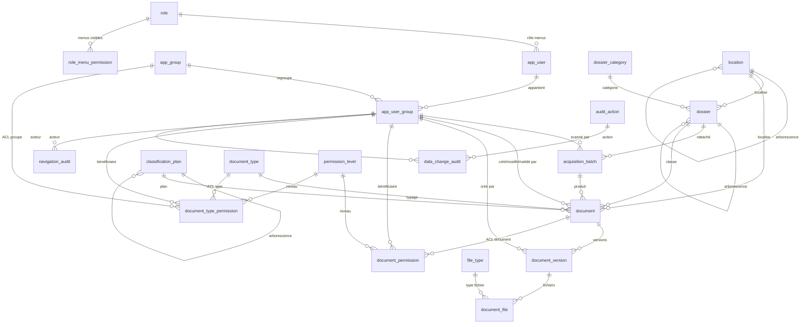

# Modèle de base de données — DocuPro / Archivage par QR

> Document généré à partir du schéma Prisma réel
> (`packages/db/prisma/models/*.prisma`) et des contraintes en SQL brut
> (`prisma/migrations/.../migration.sql`, `prisma/sql/analytics.sql`).
> Source de vérité : les fichiers `.prisma`. La migration `init` est un instantané
> du 2026-06-11 ; les évolutions ultérieures (`role`, `role_menu_permission`,
> `app_user.role_id`, `analytics_target`) ont été appliquées via `prisma db push`.

## 1. Généralités & stack technique

| Élément | Valeur |
| --- | --- |
| SGBD | PostgreSQL 16 (`postgres:16-alpine` en Docker) |
| ORM | Prisma 6 (schéma multi-fichiers, GA Prisma 6) |
| Datasource | `DATABASE_URL` (env) |
| Base applicative | Postgres `:5432` / `DocuPro` (compose : user `archivage`) |
| Horodatage | UTC, type `TIMESTAMPTZ(0)` (précision seconde) |
| Convention de nommage | tables/colonnes `snake_case` ; modèles/champs Prisma `camelCase` via `@map` |
| Conventions index/contraintes | unique partiel `ux_*`, CHECK `ck_*`, index `ix_*` |

### Stack technique

**Monorepo & outillage** — TypeScript `5.7`, monorepo **pnpm `9.15` + Turborepo `2.3`**
(workspaces `apps/*` + `packages/*`), Node `>=20`, ESLint `9` / Prettier `3`.

| Couche | Application / Package | Stack principale |
| --- | --- | --- |
| Frontend | `apps/web` (`@archivage/web`) | **Next.js 15** + **React 19**, **Ant Design 5** (`antd`, `@ant-design/icons`, `@ant-design/nextjs-registry`, patch React 19), **Tailwind CSS 3.4**, `@ant-design/plots 2` (dashboards), `motion`, `lucide-react`, `geist` |
| Backend API | `apps/api` (`@archivage/api`) | **NestJS 11** (REST : `common`/`core`/`config`/`platform-express`), **Prisma Client 6**, auth **JWT** (`@nestjs/jwt`, `passport-jwt`) + **bcrypt**, validation **Zod**, file de jobs **BullMQ 5** + `ioredis`, upload `multer`, logs **Pino** (`nestjs-pino`) |
| Worker async | `apps/worker` (`@archivage/worker`) | **BullMQ 5** + `ioredis`, ingestion par lot ; PDF (`pdf-lib`, `pdfjs-dist`), QR (`zxing-wasm`), OCR (`tesseract.js`), Pino, `tsx` en dev |
| Accès données | `packages/db` (`@archivage/db`) | Schéma Prisma (multi-fichiers), migrations, seed, client typé PostgreSQL |
| QR | `packages/qr` (`@archivage/qr`) | Génération `qrcode`, lecture/validation `zxing-wasm` (contrat `DOCUPRO|1|INTERCALAIRE|cat|id`) |
| PDF | `packages/pdf` (`@archivage/pdf`) | Composition intercalaires A4 + split (`pdf-lib`), rasterisation (`pdfjs-dist`, `@napi-rs/canvas`) |
| OCR | `packages/ocr` (`@archivage/ocr`) | Couche texte PDF d'abord, repli **Tesseract** (`tesseract.js`, fra/eng) |
| Exports P3 | `packages/exports` (`@archivage/exports`) | **ExcelJS** (xlsx), **docx**, **fast-csv** (csv), **PDFKit** (pdf) |
| Stockage | `packages/storage` (`@archivage/storage`) | `FileStore` + impl. disque local (`{file_id}{extension}` sous `ARCHIVES`) |
| Types / UI / Config | `packages/{types,ui,config}` | Types partagés, primitives UI, configs ESLint/TS communes |

**Infrastructure (Docker Compose)** — `postgres:16-alpine` (`:5432`, base `DocuPro`)
et `redis:7-alpine` (`:6379`, support BullMQ). Les services api/worker/web tournent en
local via `pnpm dev` (leurs Dockerfiles arriveront dans une phase ultérieure).

> 100 % bibliothèques OSS — aucune dépendance propriétaire ; cette stack JS/TS
> remplace la proposition .NET initiale du PRD (cf. `research.md`).

### Découpage par domaine (24 tables)

| Domaine | Fichier | Tables |
| --- | --- | --- |
| Cœur métier | `core.prisma` | `acquisition_batch`, `document`, `document_version`, `document_file` |
| Référentiel / Paramétrage | `referentials.prisma` | `document_type`, `classification_plan`, `location`, `dossier_category`, `dossier`, `dossier_exit_motive`, `file_type`, `intercalaire_category` |
| Sécurité | `security.prisma` | `app_user`, `role`, `role_menu_permission`, `app_group`, `app_user_group`, `permission_level`, `document_type_permission`, `document_permission` |
| Audit / Journal | `audit.prisma` | `audit_action`, `navigation_audit`, `data_change_audit` |
| Analytique | `analytics.prisma` | `analytics_target` |

## 2. Diagramme entité-association

> `analytics_target` et `dossier_exit_motive` et `intercalaire_category` sont
> autonomes (pas de clé étrangère sortante structurante) — voir §7 et §4.

## 3. Cœur métier (`core.prisma`)

### `acquisition_batch` — lot d'acquisition (scan)

| Colonne | Type | Contraintes | Notes |
| --- | --- | --- | --- |
| `batch_id` | `SERIAL` | **PK** | |
| `batch_guid` | `UUID` | **UNIQUE**, def. `gen_random_uuid()` | |
| `dossier_id` | `INTEGER` | FK → `dossier` (SET NULL) | indexé |
| `scanned_by` | `INTEGER` | FK → `app_user_group` (SET NULL) | |
| `scan_date` | `TIMESTAMPTZ(0)` | def. `now()` | indexé |
| `source_label` | `VARCHAR(255)` | | |
| `file_count` | `INTEGER` | def. 0 | |
| `document_count` | `INTEGER` | def. 0 | |
| `status` | `SMALLINT` | def. 0, **CHECK `ck_batch_status` ∈ (0,1,2)** | 0=ouvert, 1=terminé, 2=échec |
| `created_at` | `TIMESTAMPTZ(0)` | def. `now()` | |

### `document` — document archivé

| Colonne | Type | Contraintes | Notes |
| --- | --- | --- | --- |
| `document_id` | `SERIAL` | **PK** | |
| `label` | `VARCHAR(500)` | NOT NULL | |
| `document_type_id` | `INTEGER` | FK → `document_type` (SET NULL) | indexé |
| `plan_id` | `INTEGER` | FK → `classification_plan` (SET NULL) | indexé |
| `location_id` | `INTEGER` | FK → `location` (SET NULL) | indexé |
| `dossier_id` | `INTEGER` | FK → `dossier` (SET NULL) | indexé |
| `batch_id` | `INTEGER` | FK → `acquisition_batch` (SET NULL) | indexé |
| `cote` | `VARCHAR(50)` | | |
| `document_date` | `DATE` | | date métier (FR-036), indexé |
| `archive_year` | `INTEGER` | | |
| `is_archived` | `BOOLEAN` | def. false | false = en attente QA, true = validé |
| `is_frozen` | `BOOLEAN` | def. false | indexé `(is_archived, is_frozen)` |
| `overview` | `TEXT` | | |
| `validated_by` | `INTEGER` | FK → `app_user_group` (SET NULL) | |
| `validated_at` | `TIMESTAMPTZ(0)` | | |
| `workflow_instance_id` | `INTEGER` | | |
| `workflow_task_id` | `INTEGER` | | |
| `created_by` | `INTEGER` | FK → `app_user_group` (SET NULL) | indexé (analytique) |
| `created_at` | `TIMESTAMPTZ(0)` | def. `now()` | indexé (analytique) |
| `modified_by` | `INTEGER` | FK → `app_user_group` (SET NULL) | |
| `modified_at` | `TIMESTAMPTZ(0)` | | |

### `document_version` — version de document

| Colonne | Type | Contraintes | Notes |
| --- | --- | --- | --- |
| `document_version_id` | `SERIAL` | **PK** | |
| `document_id` | `INTEGER` | NOT NULL, FK → `document` (**CASCADE**) | indexé |
| `version_number` | `INTEGER` | def. 1 | **UNIQUE (`document_id`, `version_number`)** |
| `is_current` | `BOOLEAN` | def. true | **unique partiel `ux_document_version_current` WHERE `is_current`** (une seule version courante / document, FR-024) |
| `is_validated` | `BOOLEAN` | def. false | |
| `comment` | `TEXT` | | |
| `created_by` | `INTEGER` | FK → `app_user_group` (SET NULL) | |
| `created_at` | `TIMESTAMPTZ(0)` | def. `now()` | |

### `document_file` — fichier binaire d'une version

| Colonne | Type | Contraintes | Notes |
| --- | --- | --- | --- |
| `file_id` | `SERIAL` | **PK** | |
| `document_version_id` | `INTEGER` | NOT NULL, FK → `document_version` (**CASCADE**) | indexé |
| `file_type_id` | `INTEGER` | NOT NULL, FK → `file_type` (RESTRICT) | |
| `original_name` | `VARCHAR(500)` | | |
| `file_extension` | `VARCHAR(16)` | NOT NULL | |
| `byte_length` | `BIGINT` | | |
| `page_count` | `INTEGER` | | |
| `ocr_text` | `TEXT` | | recherche plein-texte P3 → **index GIN `ix_document_file_ocr_tsv`** sur `to_tsvector('french', coalesce(ocr_text,''))` |
| `redaction` | `TEXT` | | |
| `pdf_owner` | `VARCHAR(256)` | | |
| `pdf_password` | `VARCHAR(256)` | | |
| `sort_order` | `INTEGER` | def. 0 | |
| `created_at` | `TIMESTAMPTZ(0)` | def. `now()` | |

## 4. Référentiel / Paramétrage (`referentials.prisma`)

### `document_type` — type de document
| Colonne | Type | Contraintes | Notes |
| --- | --- | --- | --- |
| `document_type_id` | `SERIAL` | **PK** | |
| `label` | `VARCHAR(500)` | NOT NULL | **unique partiel `ux_document_type_label_active` WHERE `is_active`** (anti-doublon FR-009/FR-032) |
| `code` | `VARCHAR(50)` | | |
| `is_active` | `BOOLEAN` | def. true | |

### `classification_plan` — plan de classement (arbre)
| Colonne | Type | Contraintes | Notes |
| --- | --- | --- | --- |
| `plan_id` | `SERIAL` | **PK** | |
| `parent_id` | `INTEGER` | FK → `classification_plan` (SET NULL) | arbre, indexé |
| `label` | `TEXT` | NOT NULL | |
| `code` | `VARCHAR(50)` | | |
| `is_public` | `BOOLEAN` | def. false | |
| `depth` | `INTEGER` | def. 0 | |
| `path` | `VARCHAR(900)` | NOT NULL | indexé |
| `is_active` | `BOOLEAN` | def. true | |

### `location` — localisation physique (arbre)
| Colonne | Type | Contraintes | Notes |
| --- | --- | --- | --- |
| `location_id` | `SERIAL` | **PK** | |
| `parent_id` | `INTEGER` | FK → `location` (SET NULL) | arbre, indexé |
| `label` | `VARCHAR(500)` | NOT NULL | |
| `code` | `VARCHAR(50)` | | |
| `depth` | `INTEGER` | def. 0 | |
| `path` | `VARCHAR(900)` | NOT NULL | indexé |
| `is_active` | `BOOLEAN` | def. true | |

### `dossier_category` — catégorie de dossier
| Colonne | Type | Contraintes |
| --- | --- | --- |
| `dossier_category_id` | `SERIAL` | **PK** |
| `label` | `VARCHAR(100)` | NOT NULL |
| `is_active` | `BOOLEAN` | def. true |

### `dossier` — dossier (arbre)
| Colonne | Type | Contraintes | Notes |
| --- | --- | --- | --- |
| `dossier_id` | `SERIAL` | **PK** | |
| `parent_id` | `INTEGER` | FK → `dossier` (SET NULL) | arbre, indexé |
| `label` | `VARCHAR(500)` | NOT NULL | **unique partiel `ux_dossier_label_active` WHERE `is_active`** |
| `code` | `VARCHAR(50)` | | |
| `dossier_category_id` | `INTEGER` | FK → `dossier_category` (SET NULL) | |
| `location_id` | `INTEGER` | FK → `location` (SET NULL) | |
| `service_code_suffix` | `VARCHAR(50)` | | |
| `depth` | `INTEGER` | def. 0 | |
| `path` | `VARCHAR(900)` | NOT NULL | indexé |
| `is_active` | `BOOLEAN` | def. true | |
| `created_at` | `TIMESTAMPTZ(0)` | def. `now()` | |

### `dossier_exit_motive` — motif de sortie de dossier
| Colonne | Type | Contraintes |
| --- | --- | --- |
| `exit_motive_id` | `SERIAL` | **PK** |
| `label` | `VARCHAR(150)` | NOT NULL |
| `is_active` | `BOOLEAN` | def. true |

### `file_type` — type de fichier autorisé
| Colonne | Type | Contraintes |
| --- | --- | --- |
| `file_type_id` | `SERIAL` | **PK** |
| `extension` | `VARCHAR(16)` | **UNIQUE** |
| `friendly_name` | `VARCHAR(100)` | NOT NULL |
| `max_size_bytes` | `BIGINT` | def. 0 |
| `icon` | `VARCHAR(100)` | def. `''` |
| `is_media` | `BOOLEAN` | def. false |
| `is_active` | `BOOLEAN` | def. true |

### `intercalaire_category` — catégorie d'intercalaire (segmentation QR)
| Colonne | Type | Contraintes |
| --- | --- | --- |
| `intercalaire_category_id` | `SERIAL` | **PK** |
| `category_code` | `VARCHAR(20)` | **UNIQUE** |
| `target_table` | `VARCHAR(128)` | |
| `target_column` | `VARCHAR(64)` | |
| `is_blank` | `BOOLEAN` | def. false |
| `is_ingest_handled` | `BOOLEAN` | def. true |
| `label` | `VARCHAR(100)` | NOT NULL |

## 5. Sécurité (`security.prisma`)

### `app_user` — utilisateur
| Colonne | Type | Contraintes | Notes |
| --- | --- | --- | --- |
| `user_id` | `SERIAL` | **PK** | |
| `username` | `VARCHAR(400)` | **UNIQUE** | |
| `first_name` | `VARCHAR(50)` | NOT NULL | |
| `last_name` | `VARCHAR(50)` | NOT NULL | |
| `full_name` | `VARCHAR(101)` | | colonne **générée STORED** (raw SQL), exposée en lecture seule |
| `email` | `VARCHAR(200)` | | |
| `phone` | `VARCHAR(50)` | | |
| `password_hash` | `VARCHAR(256)` | | bcrypt (FR-034) |
| `must_change_pwd` | `BOOLEAN` | def. false | |
| `service_id` | `INTEGER` | | |
| `matricule` | `VARCHAR(50)` | | |
| `is_disabled` | `BOOLEAN` | def. false | |
| `is_admin` | `BOOLEAN` | def. false | l'admin contourne l'ACL (D-17) |
| `role_id` | `INTEGER` | FK → `role` | RBAC menus sidebar (null = aucun menu hors accueil) |
| `created_at` | `TIMESTAMPTZ(0)` | def. `now()` | |

### `role` — rôle d'accès aux menus (RBAC sidebar)
| Colonne | Type | Contraintes | Notes |
| --- | --- | --- | --- |
| `role_id` | `SERIAL` | **PK** | |
| `name` | `VARCHAR(200)` | NOT NULL | |
| `description` | `VARCHAR(400)` | | |
| `is_active` | `BOOLEAN` | def. true | |
| `is_system` | `BOOLEAN` | def. false | rôle système : toutes permissions, non supprimable |
| `created_at` | `TIMESTAMPTZ(0)` | def. `now()` | |

### `role_menu_permission` — menus visibles d'un rôle
| Colonne | Type | Contraintes | Notes |
| --- | --- | --- | --- |
| `role_menu_permission_id` | `SERIAL` | **PK** | |
| `role_id` | `INTEGER` | NOT NULL, FK → `role` (**CASCADE**) | indexé |
| `menu_key` | `VARCHAR(200)` | NOT NULL | **UNIQUE (`role_id`, `menu_key`)** ; clé de route (ex. `/admin/users`) |

### `app_group` — groupe
| Colonne | Type | Contraintes |
| --- | --- | --- |
| `group_id` | `SERIAL` | **PK** |
| `name` | `VARCHAR(200)` | NOT NULL |
| `is_active` | `BOOLEAN` | def. true |

### `app_user_group` — appartenance utilisateur ↔ groupe (pivot ACL)
| Colonne | Type | Contraintes | Notes |
| --- | --- | --- | --- |
| `user_group_id` | `SERIAL` | **PK** | identité « acteur » référencée par tout le métier/audit |
| `user_id` | `INTEGER` | NOT NULL, FK → `app_user` (**CASCADE**) | indexé |
| `group_id` | `INTEGER` | NOT NULL, FK → `app_group` (RESTRICT) | indexé |
| `is_default` | `BOOLEAN` | def. true | **UNIQUE (`user_id`, `group_id`)** |

### `permission_level` — niveau de permission (valeurs de domaine)
| Colonne | Type | Contraintes | Notes |
| --- | --- | --- | --- |
| `permission_level_id` | `INTEGER` | **PK** (non auto-incrément) | valeurs de domaine |
| `name` | `VARCHAR(50)` | NOT NULL | |

### `document_type_permission` — ACL par type de document
| Colonne | Type | Contraintes | Notes |
| --- | --- | --- | --- |
| `document_type_permission_id` | `SERIAL` | **PK** | |
| `document_type_id` | `INTEGER` | NOT NULL, FK → `document_type` (**CASCADE**) | indexé |
| `permission_level_id` | `INTEGER` | NOT NULL, FK → `permission_level` (RESTRICT) | |
| `group_id` | `INTEGER` | FK → `app_group` (SET NULL) | **CHECK `ck_dtp_grantee`** : exactement un de `group_id`/`user_group_id` non nul |
| `user_group_id` | `INTEGER` | FK → `app_user_group` (SET NULL) | |

### `document_permission` — ACL par document
| Colonne | Type | Contraintes | Notes |
| --- | --- | --- | --- |
| `document_permission_id` | `SERIAL` | **PK** | |
| `document_id` | `INTEGER` | NOT NULL, FK → `document` (**CASCADE**) | indexé `(document_id, user_group_id)` |
| `permission_level_id` | `INTEGER` | NOT NULL, FK → `permission_level` (RESTRICT) | |
| `user_group_id` | `INTEGER` | NOT NULL, FK → `app_user_group` (RESTRICT) | |
| `granted_by` | `INTEGER` | (pas de FK — PRD) | |
| `granted_at` | `TIMESTAMPTZ(0)` | def. `now()` | **UNIQUE (`document_id`, `user_group_id`, `permission_level_id`)** |

## 6. Audit / Journal (`audit.prisma`)

### `audit_action` — référentiel d'actions auditées
| Colonne | Type | Contraintes |
| --- | --- | --- |
| `audit_action_id` | `SERIAL` | **PK** |
| `description` | `VARCHAR(500)` | NOT NULL |

### `navigation_audit` — journal de navigation
| Colonne | Type | Contraintes | Notes |
| --- | --- | --- | --- |
| `audit_id` | `BIGSERIAL` | **PK** | |
| `user_group_id` | `INTEGER` | FK → `app_user_group` (SET NULL) | indexé `(user_group_id, activity_at)` |
| `activity` | `TEXT` | | |
| `url` | `VARCHAR(2000)` | | |
| `menu_id` | `INTEGER` | | |
| `activity_at` | `TIMESTAMPTZ(0)` | def. `now()` | indexé |
| `actor_full_name` | `VARCHAR(200)` | | snapshot acteur |
| `actor_role` | `VARCHAR(200)` | | |
| `actor_service` | `VARCHAR(400)` | | |
| `ip_address` | `VARCHAR(64)` | | |
| `machine_name` | `VARCHAR(128)` | | |

### `data_change_audit` — journal des changements de données
| Colonne | Type | Contraintes | Notes |
| --- | --- | --- | --- |
| `data_change_audit_id` | `BIGSERIAL` | **PK** | |
| `user_group_id` | `INTEGER` | FK → `app_user_group` (SET NULL) | indexé `(user_group_id, changed_at)` |
| `audit_action_id` | `INTEGER` | FK → `audit_action` (SET NULL) | |
| `changed_at` | `TIMESTAMPTZ(0)` | def. `now()` | |
| `object_ref` | `VARCHAR(256)` | | indexé |
| `old_value` | `TEXT` | | |
| `new_value` | `TEXT` | | |

## 7. Analytique (`analytics.prisma`)

Couche **additive, en lecture seule** : aucune table métier n'est modifiée. Objets
SQL bruts appliqués via `prisma db execute --file prisma/sql/analytics.sql`.

### `analytics_target` — cible chiffrée d'archivage (KPI « objectif vs réalisé »)
| Colonne | Type | Contraintes | Notes |
| --- | --- | --- | --- |
| `target_id` | `SERIAL` | **PK** | |
| `scope` | `VARCHAR(20)` | def. `'global'`, **CHECK `ck_target_scope` ∈ (global, programme, type)** | |
| `scope_ref_id` | `INTEGER` | | `dossier_id` (programme) ou `document_type_id` (type) ; null si global |
| `period_kind` | `VARCHAR(10)` | **CHECK `ck_target_period_kind` ∈ (month, quarter, year)** | |
| `period_start` | `DATE` | borne basse inclusive | indexé |
| `metric` | `VARCHAR(20)` | def. `'documents'`, **CHECK `ck_target_metric` ∈ (documents, pages)** | |
| `target_value` | `INTEGER` | **CHECK `ck_target_value_positive` ≥ 0** | |
| `note` | `VARCHAR(255)` | | |
| `created_by` | `INTEGER` | (pas de FK — journal léger) | |
| `created_at` | `TIMESTAMPTZ(0)` | def. `now()` | |
| `updated_at` | `TIMESTAMPTZ(0)` | `@updatedAt` | |

**Unicité :**
- composite `ux_target_scope_period` (`scope`, `scope_ref_id`, `period_kind`, `period_start`, `metric`) ;
- partielle `ux_target_global_period` (`period_kind`, `period_start`, `metric`) `WHERE scope = 'global'` (couvre le cas `scope_ref_id` NULL).

**Index analytiques additifs** (sur tables existantes, `prisma/sql/analytics.sql`) :
`ix_document_created_at`, `ix_document_created_by`, et index partiels d'anomalies
de complétude `ix_document_missing_type` / `ix_document_missing_dossier` /
`ix_document_missing_date` (`WHERE … IS NULL`).

## 8. Contraintes en SQL brut (non exprimables en Prisma)

| Objet | Type | Cible | Règle |
| --- | --- | --- | --- |
| `ux_document_version_current` | unique partiel | `document_version(document_id) WHERE is_current` | une seule version courante par document (FR-024) |
| `ux_document_type_label_active` | unique partiel | `document_type(label) WHERE is_active` | anti-doublon libellés actifs (FR-009/FR-032) |
| `ux_dossier_label_active` | unique partiel | `dossier(label) WHERE is_active` | anti-doublon libellés actifs |
| `ck_batch_status` | CHECK | `acquisition_batch.status` | ∈ (0,1,2) |
| `ck_dtp_grantee` | CHECK | `document_type_permission` | `(group_id IS NULL) <> (user_group_id IS NULL)` |
| `ix_document_file_ocr_tsv` | index GIN | `document_file` | `to_tsvector('french', coalesce(ocr_text,''))` — recherche plein-texte |
| `app_user.full_name` | colonne générée STORED | `app_user` | concaténation nom/prénom, lecture seule |
| `ck_target_*`, `ux_target_global_period` | CHECK / unique partiel | `analytics_target` | voir §7 |

---
*Fin du document.*
