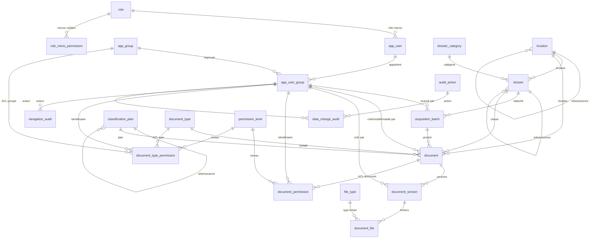

# Modèle de base de données — DocuPro / Archivage par QR

> Document généré à partir du schéma Prisma réel
> (`packages/db/prisma/models/*.prisma`) et des contraintes en SQL brut
> (`prisma/migrations/.../migration.sql`, `prisma/sql/analytics.sql`, `prisma/sql/ged.sql`).
> Source de vérité : les fichiers `.prisma`. La migration `init` est un instantané
> du 2026-06-11 ; les évolutions ultérieures (`role`, `role_menu_permission`,
> `app_user.role_id`, `analytics_target`) ont été appliquées via `prisma db push`.
> La GED IA (11 tables, extension `vector`) est livrée par la migration
> `20261120120000_add_ged_ia_foundations` (cf. §8).

## 1. Généralités & stack technique

| Élément | Valeur |
| --- | --- |
| SGBD | PostgreSQL 16 avec extension **pgvector** (`pgvector/pgvector:pg16` en dev, requise par la GED IA) |
| ORM | Prisma 6 (schéma multi-fichiers, GA Prisma 6) |
| Datasource | `DATABASE_URL` (env) |
| Base applicative | Postgres `:5432` / `DocuPro` (compose : user `archivage`) |
| Horodatage | UTC, type `TIMESTAMPTZ(0)` (précision seconde) |
| Convention de nommage | tables/colonnes `snake_case` ; modèles/champs Prisma `camelCase` via `@map` |
| Conventions index/contraintes | unique partiel `ux_*`, CHECK `ck_*`, index `ix_*` |

### Stack technique

**Monorepo & outillage** — TypeScript `5.7`, monorepo **pnpm `9.15` + Turborepo `2.3`**
(workspaces `apps/*` + `packages/*`), Node `>=20`, ESLint `9` / Prettier `3`.

| Couche | Application / Package | Stack principale |
| --- | --- | --- |
| Frontend | `apps/web` (`@archivage/web`) | **Next.js 15** + **React 19**, **Ant Design 5** (`antd`, `@ant-design/icons`, `@ant-design/nextjs-registry`, patch React 19), **Tailwind CSS 3.4**, `@ant-design/plots 2` (dashboards), `motion`, `lucide-react`, `geist` |
| Backend API | `apps/api` (`@archivage/api`) | **NestJS 11** (REST : `common`/`core`/`config`/`platform-express`), **Prisma Client 6**, auth **JWT** (`@nestjs/jwt`, `passport-jwt`) + **bcrypt**, validation **Zod**, file de jobs **BullMQ 5** + `ioredis`, upload `multer`, logs **Pino** (`nestjs-pino`) |
| Worker async | `apps/worker` (`@archivage/worker`) | **BullMQ 5** + `ioredis`, ingestion par lot ; PDF (`pdf-lib`, `pdfjs-dist`), QR (`zxing-wasm`), OCR (`tesseract.js`), Pino, `tsx` en dev |
| Accès données | `packages/db` (`@archivage/db`) | Schéma Prisma (multi-fichiers), migrations, seed, client typé PostgreSQL ; extension **pgvector** ≥ 0.5 (type `vector`, index HNSW) pour la GED IA |
| QR | `packages/qr` (`@archivage/qr`) | Génération `qrcode`, lecture/validation `zxing-wasm` (contrat `DOCUPRO|1|INTERCALAIRE|cat|id`) |
| PDF | `packages/pdf` (`@archivage/pdf`) | Composition intercalaires A4 + split (`pdf-lib`), rasterisation (`pdfjs-dist`, `@napi-rs/canvas`) |
| OCR | `packages/ocr` (`@archivage/ocr`) | Couche texte PDF d'abord, repli **Tesseract** (`tesseract.js`, fra/eng) |
| Exports P3 | `packages/exports` (`@archivage/exports`) | **ExcelJS** (xlsx), **docx**, **fast-csv** (csv), **PDFKit** (pdf) |
| Stockage | `packages/storage` (`@archivage/storage`) | `FileStore` + impl. disque local (`{file_id}{extension}` sous `ARCHIVES`) |
| Types / UI / Config | `packages/{types,ui,config}` | Types partagés, primitives UI, configs ESLint/TS communes |

**Infrastructure (Docker Compose)** — `pgvector/pgvector:pg16` (`:5432`, base `DocuPro` ; l'image `postgres:16-alpine` n'embarque pas l'extension `vector`)
et `redis:7-alpine` (`:6379`, support BullMQ). Les services api/worker/web tournent en
local via `pnpm dev` (leurs Dockerfiles arriveront dans une phase ultérieure).

> 100 % bibliothèques OSS — aucune dépendance propriétaire ; cette stack JS/TS
> remplace la proposition .NET initiale du PRD (cf. `research.md`).

### Découpage par domaine (35 tables)

| Domaine | Fichier | Tables |
| --- | --- | --- |
| Cœur métier | `core.prisma` | `acquisition_batch`, `document`, `document_version`, `document_file` |
| Référentiel / Paramétrage | `referentials.prisma` | `document_type`, `classification_plan`, `location`, `dossier_category`, `dossier`, `dossier_exit_motive`, `file_type`, `intercalaire_category` |
| Sécurité | `security.prisma` | `app_user`, `role`, `role_menu_permission`, `app_group`, `app_user_group`, `permission_level`, `document_type_permission`, `document_permission` |
| Audit / Journal | `audit.prisma` | `audit_action`, `navigation_audit`, `data_change_audit` |
| Analytique | `analytics.prisma` | `analytics_target` |
| GED IA | `models/ged.prisma` | `ged_ai_setting`, `ged_ai_masking_rule`, `ged_ai_decision`, `ged_source_connector`, `ged_source_sync_run`, `ged_source_item`, `ged_document_chunk`, `ged_space`, `ged_space_member`, `ged_space_document`, `ged_version_info` (11 tables) |

## 2. Diagramme entité-association

> `analytics_target` et `dossier_exit_motive` et `intercalaire_category` sont
> autonomes (pas de clé étrangère sortante structurante) — voir §7 et §4.

## 3. Cœur métier (`core.prisma`)

### `acquisition_batch` — lot d'acquisition (scan)

| Colonne | Type | Contraintes | Notes |
| --- | --- | --- | --- |
| `batch_id` | `SERIAL` | **PK** | |
| `batch_guid` | `UUID` | **UNIQUE**, def. `gen_random_uuid()` | |
| `dossier_id` | `INTEGER` | FK → `dossier` (SET NULL) | indexé |
| `scanned_by` | `INTEGER` | FK → `app_user_group` (SET NULL) | |
| `scan_date` | `TIMESTAMPTZ(0)` | def. `now()` | indexé |
| `source_label` | `VARCHAR(255)` | | |
| `file_count` | `INTEGER` | def. 0 | |
| `document_count` | `INTEGER` | def. 0 | |
| `status` | `SMALLINT` | def. 0, **CHECK `ck_batch_status` ∈ (0,1,2)** | 0=ouvert, 1=terminé, 2=échec |
| `created_at` | `TIMESTAMPTZ(0)` | def. `now()` | |

### `document` — document archivé

| Colonne | Type | Contraintes | Notes |
| --- | --- | --- | --- |
| `document_id` | `SERIAL` | **PK** | |
| `label` | `VARCHAR(500)` | NOT NULL | |
| `document_type_id` | `INTEGER` | FK → `document_type` (SET NULL) | indexé |
| `plan_id` | `INTEGER` | FK → `classification_plan` (SET NULL) | indexé |
| `location_id` | `INTEGER` | FK → `location` (SET NULL) | indexé |
| `dossier_id` | `INTEGER` | FK → `dossier` (SET NULL) | indexé |
| `batch_id` | `INTEGER` | FK → `acquisition_batch` (SET NULL) | indexé |
| `cote` | `VARCHAR(50)` | | |
| `document_date` | `DATE` | | date métier (FR-036), indexé |
| `archive_year` | `INTEGER` | | |
| `is_archived` | `BOOLEAN` | def. false | false = en attente QA, true = validé |
| `is_frozen` | `BOOLEAN` | def. false | indexé `(is_archived, is_frozen)` |
| `overview` | `TEXT` | | |
| `validated_by` | `INTEGER` | FK → `app_user_group` (SET NULL) | |
| `validated_at` | `TIMESTAMPTZ(0)` | | |
| `workflow_instance_id` | `INTEGER` | | |
| `workflow_task_id` | `INTEGER` | | |
| `created_by` | `INTEGER` | FK → `app_user_group` (SET NULL) | indexé (analytique) |
| `created_at` | `TIMESTAMPTZ(0)` | def. `now()` | indexé (analytique) |
| `modified_by` | `INTEGER` | FK → `app_user_group` (SET NULL) | |
| `modified_at` | `TIMESTAMPTZ(0)` | | |

### `document_version` — version de document

| Colonne | Type | Contraintes | Notes |
| --- | --- | --- | --- |
| `document_version_id` | `SERIAL` | **PK** | |
| `document_id` | `INTEGER` | NOT NULL, FK → `document` (**CASCADE**) | indexé |
| `version_number` | `INTEGER` | def. 1 | **UNIQUE (`document_id`, `version_number`)** |
| `is_current` | `BOOLEAN` | def. true | **unique partiel `ux_document_version_current` WHERE `is_current`** (une seule version courante / document, FR-024) |
| `is_validated` | `BOOLEAN` | def. false | |
| `comment` | `TEXT` | | |
| `created_by` | `INTEGER` | FK → `app_user_group` (SET NULL) | |
| `created_at` | `TIMESTAMPTZ(0)` | def. `now()` | |

### `document_file` — fichier binaire d'une version

| Colonne | Type | Contraintes | Notes |
| --- | --- | --- | --- |
| `file_id` | `SERIAL` | **PK** | |
| `document_version_id` | `INTEGER` | NOT NULL, FK → `document_version` (**CASCADE**) | indexé |
| `file_type_id` | `INTEGER` | NOT NULL, FK → `file_type` (RESTRICT) | |
| `original_name` | `VARCHAR(500)` | | |
| `file_extension` | `VARCHAR(16)` | NOT NULL | |
| `byte_length` | `BIGINT` | | |
| `page_count` | `INTEGER` | | |
| `ocr_text` | `TEXT` | | recherche plein-texte P3 → **index GIN `ix_document_file_ocr_tsv`** sur `to_tsvector('french', coalesce(ocr_text,''))` |
| `redaction` | `TEXT` | | |
| `pdf_owner` | `VARCHAR(256)` | | |
| `pdf_password` | `VARCHAR(256)` | | |
| `sort_order` | `INTEGER` | def. 0 | |
| `created_at` | `TIMESTAMPTZ(0)` | def. `now()` | |

## 4. Référentiel / Paramétrage (`referentials.prisma`)

### `document_type` — type de document
| Colonne | Type | Contraintes | Notes |
| --- | --- | --- | --- |
| `document_type_id` | `SERIAL` | **PK** | |
| `label` | `VARCHAR(500)` | NOT NULL | **unique partiel `ux_document_type_label_active` WHERE `is_active`** (anti-doublon FR-009/FR-032) |
| `code` | `VARCHAR(50)` | | |
| `is_active` | `BOOLEAN` | def. true | |

### `classification_plan` — plan de classement (arbre)
| Colonne | Type | Contraintes | Notes |
| --- | --- | --- | --- |
| `plan_id` | `SERIAL` | **PK** | |
| `parent_id` | `INTEGER` | FK → `classification_plan` (SET NULL) | arbre, indexé |
| `label` | `TEXT` | NOT NULL | |
| `code` | `VARCHAR(50)` | | |
| `is_public` | `BOOLEAN` | def. false | |
| `depth` | `INTEGER` | def. 0 | |
| `path` | `VARCHAR(900)` | NOT NULL | indexé |
| `is_active` | `BOOLEAN` | def. true | |

### `location` — localisation physique (arbre)
| Colonne | Type | Contraintes | Notes |
| --- | --- | --- | --- |
| `location_id` | `SERIAL` | **PK** | |
| `parent_id` | `INTEGER` | FK → `location` (SET NULL) | arbre, indexé |
| `label` | `VARCHAR(500)` | NOT NULL | |
| `code` | `VARCHAR(50)` | | |
| `depth` | `INTEGER` | def. 0 | |
| `path` | `VARCHAR(900)` | NOT NULL | indexé |
| `is_active` | `BOOLEAN` | def. true | |

### `dossier_category` — catégorie de dossier
| Colonne | Type | Contraintes |
| --- | --- | --- |
| `dossier_category_id` | `SERIAL` | **PK** |
| `label` | `VARCHAR(100)` | NOT NULL |
| `is_active` | `BOOLEAN` | def. true |

### `dossier` — dossier (arbre)
| Colonne | Type | Contraintes | Notes |
| --- | --- | --- | --- |
| `dossier_id` | `SERIAL` | **PK** | |
| `parent_id` | `INTEGER` | FK → `dossier` (SET NULL) | arbre, indexé |
| `label` | `VARCHAR(500)` | NOT NULL | **unique partiel `ux_dossier_label_active` WHERE `is_active`** |
| `code` | `VARCHAR(50)` | | |
| `dossier_category_id` | `INTEGER` | FK → `dossier_category` (SET NULL) | |
| `location_id` | `INTEGER` | FK → `location` (SET NULL) | |
| `service_code_suffix` | `VARCHAR(50)` | | |
| `depth` | `INTEGER` | def. 0 | |
| `path` | `VARCHAR(900)` | NOT NULL | indexé |
| `is_active` | `BOOLEAN` | def. true | |
| `created_at` | `TIMESTAMPTZ(0)` | def. `now()` | |

### `dossier_exit_motive` — motif de sortie de dossier
| Colonne | Type | Contraintes |
| --- | --- | --- |
| `exit_motive_id` | `SERIAL` | **PK** |
| `label` | `VARCHAR(150)` | NOT NULL |
| `is_active` | `BOOLEAN` | def. true |

### `file_type` — type de fichier autorisé
| Colonne | Type | Contraintes |
| --- | --- | --- |
| `file_type_id` | `SERIAL` | **PK** |
| `extension` | `VARCHAR(16)` | **UNIQUE** |
| `friendly_name` | `VARCHAR(100)` | NOT NULL |
| `max_size_bytes` | `BIGINT` | def. 0 |
| `icon` | `VARCHAR(100)` | def. `''` |
| `is_media` | `BOOLEAN` | def. false |
| `is_active` | `BOOLEAN` | def. true |

### `intercalaire_category` — catégorie d'intercalaire (segmentation QR)
| Colonne | Type | Contraintes |
| --- | --- | --- |
| `intercalaire_category_id` | `SERIAL` | **PK** |
| `category_code` | `VARCHAR(20)` | **UNIQUE** |
| `target_table` | `VARCHAR(128)` | |
| `target_column` | `VARCHAR(64)` | |
| `is_blank` | `BOOLEAN` | def. false |
| `is_ingest_handled` | `BOOLEAN` | def. true |
| `label` | `VARCHAR(100)` | NOT NULL |

## 5. Sécurité (`security.prisma`)

### `app_user` — utilisateur
| Colonne | Type | Contraintes | Notes |
| --- | --- | --- | --- |
| `user_id` | `SERIAL` | **PK** | |
| `username` | `VARCHAR(400)` | **UNIQUE** | |
| `first_name` | `VARCHAR(50)` | NOT NULL | |
| `last_name` | `VARCHAR(50)` | NOT NULL | |
| `full_name` | `VARCHAR(101)` | | colonne **générée STORED** (raw SQL), exposée en lecture seule |
| `email` | `VARCHAR(200)` | | |
| `phone` | `VARCHAR(50)` | | |
| `password_hash` | `VARCHAR(256)` | | bcrypt (FR-034) |
| `must_change_pwd` | `BOOLEAN` | def. false | |
| `service_id` | `INTEGER` | | |
| `matricule` | `VARCHAR(50)` | | |
| `is_disabled` | `BOOLEAN` | def. false | |
| `is_admin` | `BOOLEAN` | def. false | l'admin contourne l'ACL (D-17) |
| `role_id` | `INTEGER` | FK → `role` | RBAC menus sidebar (null = aucun menu hors accueil) |
| `created_at` | `TIMESTAMPTZ(0)` | def. `now()` | |

### `role` — rôle d'accès aux menus (RBAC sidebar)
| Colonne | Type | Contraintes | Notes |
| --- | --- | --- | --- |
| `role_id` | `SERIAL` | **PK** | |
| `name` | `VARCHAR(200)` | NOT NULL | |
| `description` | `VARCHAR(400)` | | |
| `is_active` | `BOOLEAN` | def. true | |
| `is_system` | `BOOLEAN` | def. false | rôle système : toutes permissions, non supprimable |
| `created_at` | `TIMESTAMPTZ(0)` | def. `now()` | |

### `role_menu_permission` — menus visibles d'un rôle
| Colonne | Type | Contraintes | Notes |
| --- | --- | --- | --- |
| `role_menu_permission_id` | `SERIAL` | **PK** | |
| `role_id` | `INTEGER` | NOT NULL, FK → `role` (**CASCADE**) | indexé |
| `menu_key` | `VARCHAR(200)` | NOT NULL | **UNIQUE (`role_id`, `menu_key`)** ; clé de route (ex. `/admin/users`) |

### `app_group` — groupe
| Colonne | Type | Contraintes |
| --- | --- | --- |
| `group_id` | `SERIAL` | **PK** |
| `name` | `VARCHAR(200)` | NOT NULL |
| `is_active` | `BOOLEAN` | def. true |

### `app_user_group` — appartenance utilisateur ↔ groupe (pivot ACL)
| Colonne | Type | Contraintes | Notes |
| --- | --- | --- | --- |
| `user_group_id` | `SERIAL` | **PK** | identité « acteur » référencée par tout le métier/audit |
| `user_id` | `INTEGER` | NOT NULL, FK → `app_user` (**CASCADE**) | indexé |
| `group_id` | `INTEGER` | NOT NULL, FK → `app_group` (RESTRICT) | indexé |
| `is_default` | `BOOLEAN` | def. true | **UNIQUE (`user_id`, `group_id`)** |

### `permission_level` — niveau de permission (valeurs de domaine)
| Colonne | Type | Contraintes | Notes |
| --- | --- | --- | --- |
| `permission_level_id` | `INTEGER` | **PK** (non auto-incrément) | valeurs de domaine |
| `name` | `VARCHAR(50)` | NOT NULL | |

### `document_type_permission` — ACL par type de document
| Colonne | Type | Contraintes | Notes |
| --- | --- | --- | --- |
| `document_type_permission_id` | `SERIAL` | **PK** | |
| `document_type_id` | `INTEGER` | NOT NULL, FK → `document_type` (**CASCADE**) | indexé |
| `permission_level_id` | `INTEGER` | NOT NULL, FK → `permission_level` (RESTRICT) | |
| `group_id` | `INTEGER` | FK → `app_group` (SET NULL) | **CHECK `ck_dtp_grantee`** : exactement un de `group_id`/`user_group_id` non nul |
| `user_group_id` | `INTEGER` | FK → `app_user_group` (SET NULL) | |

### `document_permission` — ACL par document
| Colonne | Type | Contraintes | Notes |
| --- | --- | --- | --- |
| `document_permission_id` | `SERIAL` | **PK** | |
| `document_id` | `INTEGER` | NOT NULL, FK → `document` (**CASCADE**) | indexé `(document_id, user_group_id)` |
| `permission_level_id` | `INTEGER` | NOT NULL, FK → `permission_level` (RESTRICT) | |
| `user_group_id` | `INTEGER` | NOT NULL, FK → `app_user_group` (RESTRICT) | |
| `granted_by` | `INTEGER` | (pas de FK — PRD) | |
| `granted_at` | `TIMESTAMPTZ(0)` | def. `now()` | **UNIQUE (`document_id`, `user_group_id`, `permission_level_id`)** |

## 6. Audit / Journal (`audit.prisma`)

### `audit_action` — référentiel d'actions auditées
| Colonne | Type | Contraintes |
| --- | --- | --- |
| `audit_action_id` | `SERIAL` | **PK** |
| `description` | `VARCHAR(500)` | NOT NULL |

### `navigation_audit` — journal de navigation
| Colonne | Type | Contraintes | Notes |
| --- | --- | --- | --- |
| `audit_id` | `BIGSERIAL` | **PK** | |
| `user_group_id` | `INTEGER` | FK → `app_user_group` (SET NULL) | indexé `(user_group_id, activity_at)` |
| `activity` | `TEXT` | | |
| `url` | `VARCHAR(2000)` | | |
| `menu_id` | `INTEGER` | | |
| `activity_at` | `TIMESTAMPTZ(0)` | def. `now()` | indexé |
| `actor_full_name` | `VARCHAR(200)` | | snapshot acteur |
| `actor_role` | `VARCHAR(200)` | | |
| `actor_service` | `VARCHAR(400)` | | |
| `ip_address` | `VARCHAR(64)` | | |
| `machine_name` | `VARCHAR(128)` | | |

### `data_change_audit` — journal des changements de données
| Colonne | Type | Contraintes | Notes |
| --- | --- | --- | --- |
| `data_change_audit_id` | `BIGSERIAL` | **PK** | |
| `user_group_id` | `INTEGER` | FK → `app_user_group` (SET NULL) | indexé `(user_group_id, changed_at)` |
| `audit_action_id` | `INTEGER` | FK → `audit_action` (SET NULL) | |
| `changed_at` | `TIMESTAMPTZ(0)` | def. `now()` | |
| `object_ref` | `VARCHAR(256)` | | indexé |
| `old_value` | `TEXT` | | |
| `new_value` | `TEXT` | | |

## 7. Analytique (`analytics.prisma`)

Couche **additive, en lecture seule** : aucune table métier n'est modifiée. Objets
SQL bruts appliqués via `prisma db execute --file prisma/sql/analytics.sql`.

### `analytics_target` — cible chiffrée d'archivage (KPI « objectif vs réalisé »)
| Colonne | Type | Contraintes | Notes |
| --- | --- | --- | --- |
| `target_id` | `SERIAL` | **PK** | |
| `scope` | `VARCHAR(20)` | def. `'global'`, **CHECK `ck_target_scope` ∈ (global, programme, type)** | |
| `scope_ref_id` | `INTEGER` | | `dossier_id` (programme) ou `document_type_id` (type) ; null si global |
| `period_kind` | `VARCHAR(10)` | **CHECK `ck_target_period_kind` ∈ (month, quarter, year)** | |
| `period_start` | `DATE` | borne basse inclusive | indexé |
| `metric` | `VARCHAR(20)` | def. `'documents'`, **CHECK `ck_target_metric` ∈ (documents, pages)** | |
| `target_value` | `INTEGER` | **CHECK `ck_target_value_positive` ≥ 0** | |
| `note` | `VARCHAR(255)` | | |
| `created_by` | `INTEGER` | (pas de FK — journal léger) | |
| `created_at` | `TIMESTAMPTZ(0)` | def. `now()` | |
| `updated_at` | `TIMESTAMPTZ(0)` | `@updatedAt` | |

**Unicité :**
- composite `ux_target_scope_period` (`scope`, `scope_ref_id`, `period_kind`, `period_start`, `metric`) ;
- partielle `ux_target_global_period` (`period_kind`, `period_start`, `metric`) `WHERE scope = 'global'` (couvre le cas `scope_ref_id` NULL).

**Index analytiques additifs** (sur tables existantes, `prisma/sql/analytics.sql`) :
`ix_document_created_at`, `ix_document_created_by`, et index partiels d'anomalies
de complétude `ix_document_missing_type` / `ix_document_missing_dossier` /
`ix_document_missing_date` (`WHERE … IS NULL`).

## 8. GED IA — fondations de données

La GED IA ajoute **11 tables** au schéma, livrées en une seule migration additive
(`20261120120000_add_ged_ia_foundations`). Modèles : `packages/db/prisma/models/ged.prisma` ;
contraintes en SQL brut : `packages/db/prisma/sql/ged.sql` (copie identique dans la migration,
ré-exécutable). Aucune table existante n'est modifiée : `document_version` est réutilisée telle
quelle (cf. « Écarts assumés »).

Le chantier repose sur cinq principes de données :

- **IA au choix du client** : locale, cloud (avec masquage obligatoire) ou désactivée. Installation
  mono-tenant (une installation = un client) : la configuration IA est donc une **ligne unique**
  (`ged_ai_setting`), livrée avec l'IA désactivée.
- **Connecteurs de sources** (copie, indexation en place, synchro) avec **provenance** (origine,
  auteur, dates, droits d'origine) et **dédoublonnage par empreinte SHA-256**.
- **Recherche sémantique pgvector**, filtrée par les droits : segments et embeddings
  `vector(1024)`, index HNSW en distance cosinus. Un segment ne sort jamais d'une requête sans que
  l'appelant ait le droit sur son document.
- **Espaces et versions** : espaces privé, partage, collaboration et publication ; attributs GED
  de chaque version.
- **Traçabilité IA** : chaque décision de l'IA est journalisée (`ged_ai_decision`), avec masquage,
  empreinte de l'entrée et validation humaine.

Conventions : les états sont des `SMALLINT` contrôlés par des `CHECK ck_*` (pas d'énumération
Prisma) ; les acteurs métier pointent vers `app_user_group` ; les traces d'édition (`added_by`,
`created_by`, `updated_by`, `requested_by`) n'ont pas de clé étrangère. Les valeurs d'états sont
listées sous chaque table.

### Diagramme

> `ged_ai_setting` et `ged_ai_masking_rule` sont autonomes : la règle de masquage s'applique à
> tout texte envoyé à un fournisseur cloud, sans lien de clé avec les autres tables.

### `ged_ai_setting` — configuration IA du client (ligne unique)

| Colonne | Type | Contraintes | Notes |
| --- | --- | --- | --- |
| `ged_ai_setting_id` | `INTEGER` | **PK**, def. `1`, **CHECK `ck_ged_ai_setting_singleton`** (= 1) | ligne unique |
| `mode` | `SMALLINT` | def. 0, **CHECK `ck_ged_ai_setting_mode`** ∈ (0,1,2) | 0=désactivée, 1=locale, 2=cloud |
| `provider` | `VARCHAR(50)` | | `ollama`, `vllm`, `openai`… clé libre, validée par l'API |
| `model` | `VARCHAR(200)` | | modèle génératif (classement, extraction, résumé, questions-réponses) |
| `embedding_model` | `VARCHAR(200)` | | modèle d'embedding de la recherche sémantique |
| `embedding_dimension` | `INTEGER` | def. 1024, **CHECK `ck_ged_ai_setting_dimension`** | doit valoir 1024 (cf. « Écarts assumés ») |
| `endpoint` | `VARCHAR(500)` | | adresse du service d'IA |
| `api_key_ref` | `VARCHAR(200)` | | **référence** (variable d'environnement ou coffre), jamais la clé |
| `masking_enabled` | `BOOLEAN` | def. true, **CHECK `ck_ged_ai_setting_cloud_masking`** | doit valoir true en mode cloud |
| `auto_apply_threshold` | `DECIMAL(4,3)` | **CHECK `ck_ged_ai_setting_threshold`** (NULL ou ∈ [0,1]) | NULL = jamais d'application automatique |
| `timeout_seconds` | `INTEGER` | def. 60, couvert par `ck_ged_ai_setting_dimension` (> 0) | délai d'appel au modèle |
| `updated_at` | `TIMESTAMPTZ(0)` | NOT NULL, def. `now()` | `@updatedAt` (Prisma) |
| `updated_by` | `INTEGER` | | sans FK (trace d'édition) |

**Ligne par défaut** : `ged_ai_setting_id` = 1, `mode` = 0 (IA désactivée). Aucun appel et aucune
donnée sortante tant que le client n'a pas choisi.

### `ged_ai_masking_rule` — règle de masquage avant envoi

| Colonne | Type | Contraintes | Notes |
| --- | --- | --- | --- |
| `ged_ai_masking_rule_id` | `SERIAL` | **PK** | |
| `label` | `VARCHAR(200)` | NOT NULL | |
| `kind` | `SMALLINT` | NOT NULL, def. 0, **CHECK `ck_ged_ai_masking_rule_kind`** ∈ (0,1,2) | 0=expression régulière, 1=mot ou expression exacte, 2=entité prédéfinie |
| `pattern` | `TEXT` | NOT NULL | pour `kind` = 2 : code de l'entité (`iban`, `email`, `phone`, `nir`, `card`…) |
| `replacement` | `VARCHAR(100)` | NOT NULL, def. `'[MASQUÉ]'` | texte substitué au motif trouvé |
| `is_active` | `BOOLEAN` | NOT NULL, def. true | |
| `sort_order` | `INTEGER` | NOT NULL, def. 0 | ordre d'application |
| `created_at` | `TIMESTAMPTZ(0)` | NOT NULL, def. `now()` | |

**Index :** `(is_active, sort_order)`.

### `ged_ai_decision` — décision ou proposition de l'IA (journal)

| Colonne | Type | Contraintes | Notes |
| --- | --- | --- | --- |
| `ged_ai_decision_id` | `BIGSERIAL` | **PK** | |
| `document_id` | `INTEGER` | FK → `document` (SET NULL) | indexé ; la trace survit au document |
| `source_item_id` | `BIGINT` | FK → `ged_source_item` (SET NULL) | indexé |
| `task` | `SMALLINT` | NOT NULL, **CHECK `ck_ged_ai_decision_task`** ∈ [0,7] | voir valeurs ci-dessous |
| `mode` | `SMALLINT` | NOT NULL, **CHECK `ck_ged_ai_decision_mode`** ∈ (1,2) | mode IA en vigueur, figé à la décision (jamais 0) |
| `provider` | `VARCHAR(50)` | | |
| `model` | `VARCHAR(200)` | NOT NULL | |
| `prompt_version` | `VARCHAR(50)` | | version du gabarit de requête, pour rejouer |
| `input_excerpt` | `TEXT` | | texte **masqué et tronqué** |
| `input_hash` | `VARCHAR(64)` | **CHECK `ck_ged_ai_decision_input_hash`** (NULL ou SHA-256 hex) | SHA-256 du texte réellement envoyé |
| `input_masked` | `BOOLEAN` | NOT NULL, def. false | true si le masquage a été appliqué |
| `output` | `JSONB` | | sortie brute de l'IA |
| `confidence` | `DECIMAL(4,3)` | **CHECK `ck_ged_ai_decision_confidence`** (NULL ou ∈ [0,1]) | NULL si le modèle ne fournit pas de score |
| `status` | `SMALLINT` | NOT NULL, def. 0, **CHECK `ck_ged_ai_decision_status`** ∈ [0,4] | voir valeurs ci-dessous |
| `validated_by` | `INTEGER` | FK → `app_user_group` (SET NULL), **CHECK `ck_ged_ai_decision_validation`** | si renseigné, `validated_at` doit l'être |
| `validated_at` | `TIMESTAMPTZ(0)` | | date de validation ; peut rester seule (la suppression du validateur remet `validated_by` à NULL sans effacer la date) |
| `requested_by` | `INTEGER` | | auteur de la demande, sans FK (journal) |
| `prompt_tokens` | `INTEGER` | | |
| `completion_tokens` | `INTEGER` | | |
| `duration_ms` | `INTEGER` | | |
| `error_message` | `TEXT` | | |
| `created_at` | `TIMESTAMPTZ(0)` | NOT NULL, def. `now()` | |

**Index :** `(document_id, created_at)`, `(source_item_id)`, `(status, task)`, `(created_at)`.

**Valeurs :**
- `task` : 0 classement, 1 extraction de métadonnées, 2 résumé, 3 type de document, 4 réponse à une
  question (RAG), 5 similarité / doublon, 6 correction OCR, 7 autre.
- `mode` : 1 locale, 2 cloud.
- `status` : 0 proposée (attend validation), 1 validée, 2 rejetée, 3 appliquée automatiquement
  (confiance ≥ seuil), 4 en erreur.

### `ged_source_connector` — connecteur vers une source externe

| Colonne | Type | Contraintes | Notes |
| --- | --- | --- | --- |
| `ged_source_connector_id` | `SERIAL` | **PK** | |
| `label` | `VARCHAR(200)` | NOT NULL | |
| `connector_type` | `VARCHAR(40)` | NOT NULL, **CHECK `ck_ged_source_connector_type`** (`^[a-z0-9_]+$`) | clé libre (`filesystem`, `sharepoint`, `gdrive`, `imap`…) validée par l'API ; indexé |
| `mode` | `SMALLINT` | NOT NULL, def. 0, **CHECK `ck_ged_source_connector_mode`** ∈ (0,1,2) | voir valeurs ci-dessous |
| `status` | `SMALLINT` | NOT NULL, def. 0, **CHECK `ck_ged_source_connector_status`** ∈ [0,3] | voir valeurs ci-dessous ; indexé `(is_active, status)` |
| `config` | `JSONB` | | paramétrage non secret (racine, filtres, dossier distant) |
| `credentials_enc` | `TEXT` | **CHECK `ck_ged_source_connector_credentials`** | jetons OAuth **chiffrés par l'application** (AES-GCM, base64) |
| `credentials_key_id` | `VARCHAR(100)` | | identifiant de la clé de chiffrement (rotation) |
| `credentials_ref` | `VARCHAR(200)` | | **référence** à un coffre externe ; jamais avec `credentials_enc` |
| `credentials_expires_at` | `TIMESTAMPTZ(0)` | | expiration de l'autorisation, si la source en fournit une |
| `change_token` | `TEXT` | | jeton de reprise de la source (delta link, page token, curseur) |
| `sync_interval_minutes` | `INTEGER` | **CHECK `ck_ged_source_connector_interval`** (NULL ou > 0) | NULL = synchro manuelle uniquement |
| `target_dossier_id` | `INTEGER` | FK → `dossier` (SET NULL) | dossier de destination des copies et synchros |
| `last_sync_at` | `TIMESTAMPTZ(0)` | | |
| `last_success_at` | `TIMESTAMPTZ(0)` | | |
| `last_error` | `TEXT` | | |
| `is_active` | `BOOLEAN` | NOT NULL, def. true | |
| `created_by` | `INTEGER` | | sans FK (trace de création) |
| `created_at` | `TIMESTAMPTZ(0)` | NOT NULL, def. `now()` | |
| `updated_at` | `TIMESTAMPTZ(0)` | NOT NULL, def. `now()` | `@updatedAt` (Prisma) |

**Index :** `(connector_type)`, `(is_active, status)`.

**Valeurs :**
- `mode` : 0 copie (binaire importé dans le coffre), 1 indexation en place (seuls texte et
  embeddings sont gardés), 2 synchro (copie tenue à jour avec la source).
- `status` : 0 inactif, 1 actif, 2 en erreur, 3 autorisation expirée (OAuth à renouveler).

### `ged_source_sync_run` — passe de synchronisation

| Colonne | Type | Contraintes | Notes |
| --- | --- | --- | --- |
| `ged_source_sync_run_id` | `BIGSERIAL` | **PK** | |
| `connector_id` | `INTEGER` | NOT NULL, FK → `ged_source_connector` (**CASCADE**) | indexé `(connector_id, started_at)` |
| `status` | `SMALLINT` | NOT NULL, def. 0, **CHECK `ck_ged_source_sync_run_status`** ∈ [0,3] | voir valeurs ci-dessous |
| `started_at` | `TIMESTAMPTZ(0)` | NOT NULL, def. `now()` | |
| `finished_at` | `TIMESTAMPTZ(0)` | | |
| `items_seen` | `INTEGER` | NOT NULL, def. 0 | compteurs de la passe |
| `items_created` | `INTEGER` | NOT NULL, def. 0 | |
| `items_updated` | `INTEGER` | NOT NULL, def. 0 | |
| `items_deleted` | `INTEGER` | NOT NULL, def. 0 | |
| `items_duplicate` | `INTEGER` | NOT NULL, def. 0 | |
| `items_failed` | `INTEGER` | NOT NULL, def. 0 | |
| `change_token_before` | `TEXT` | | jeton avant la passe |
| `change_token_after` | `TEXT` | | jeton après la passe |
| `error_message` | `TEXT` | | |

**Valeurs de `status`** : 0 en cours, 1 réussie, 2 partielle (erreurs sur certains éléments), 3 échouée.

### `ged_source_item` — élément d'une source (provenance)

| Colonne | Type | Contraintes | Notes |
| --- | --- | --- | --- |
| `ged_source_item_id` | `BIGSERIAL` | **PK** | |
| `connector_id` | `INTEGER` | NOT NULL, FK → `ged_source_connector` (**CASCADE**) | **UNIQUE (`connector_id`, `external_id`)** ; indexé `(connector_id, state)` |
| `external_id` | `VARCHAR(500)` | NOT NULL | identifiant dans la source (id de fichier, chemin, UID de message) |
| `origin_url` | `TEXT` | | provenance |
| `origin_path` | `TEXT` | | provenance |
| `name` | `VARCHAR(500)` | NOT NULL | |
| `mime_type` | `VARCHAR(200)` | | |
| `byte_length` | `BIGINT` | | |
| `origin_author` | `VARCHAR(300)` | | auteur d'origine |
| `origin_created_at` | `TIMESTAMPTZ(0)` | | date de création d'origine |
| `origin_modified_at` | `TIMESTAMPTZ(0)` | | date de modification d'origine |
| `content_hash` | `VARCHAR(64)` | **CHECK `ck_ged_source_item_hash`** (NULL ou SHA-256 hex) ; indexé | clé de dédoublonnage ; NULL tant que le binaire n'a pas été lu |
| `remote_version` | `VARCHAR(200)` | | marqueur de version côté source (ETag, révision) |
| `origin_acl` | `JSONB` | | droits d'origine, conservés pour audit |
| `origin_metadata` | `JSONB` | | autres métadonnées propres au connecteur |
| `state` | `SMALLINT` | NOT NULL, def. 0, **CHECK `ck_ged_source_item_state`** ∈ [0,6] | voir valeurs ci-dessous |
| `document_id` | `INTEGER` | FK → `document` (SET NULL) ; indexé | renseigné seulement en copie / synchro |
| `duplicate_of_id` | `BIGINT` | FK → `ged_source_item` (SET NULL) ; indexé ; **CHECK `ck_ged_source_item_not_own_duplicate`** | premier élément de même contenu |
| `error_message` | `TEXT` | | |
| `first_seen_at` | `TIMESTAMPTZ(0)` | NOT NULL, def. `now()` | |
| `last_seen_at` | `TIMESTAMPTZ(0)` | NOT NULL, def. `now()` | |
| `indexed_at` | `TIMESTAMPTZ(0)` | | |

**Dédoublonnage :** deux éléments de même `content_hash` désignent le même contenu, quelle que soit
la source. Le second est enregistré et pointe vers le premier (`duplicate_of_id`) au lieu de créer
un second document. L'index sur `content_hash` n'est pas unique (cf. « Écarts assumés »).

**Index :** `(content_hash)`, `(document_id)`, `(duplicate_of_id)`, `(connector_id, state)`.

**Valeurs de `state`** : 0 découvert, 1 copié, 2 indexé en place, 3 modifié à la source (à
resynchroniser), 4 supprimé à la source, 5 en erreur, 6 doublon.

### `ged_document_chunk` — segment indexé et embedding

| Colonne | Type | Contraintes | Notes |
| --- | --- | --- | --- |
| `ged_document_chunk_id` | `BIGSERIAL` | **PK** | |
| `document_id` | `INTEGER` | FK → `document` (**CASCADE**) ; indexé | |
| `document_version_id` | `INTEGER` | FK → `document_version` (**CASCADE**) ; indexé | segments d'une version (périmés à la ré-indexation) |
| `source_item_id` | `BIGINT` | FK → `ged_source_item` (**CASCADE**) ; indexé | |
| `chunk_index` | `INTEGER` | NOT NULL, **CHECK `ck_ged_document_chunk_values`** (≥ 0) | rang du segment |
| `content` | `TEXT` | NOT NULL | texte du segment |
| `content_hash` | `VARCHAR(64)` | NOT NULL, **CHECK `ck_ged_document_chunk_values`** (SHA-256 hex) | |
| `token_count` | `INTEGER` | **CHECK `ck_ged_document_chunk_values`** (NULL ou ≥ 0) | |
| `page_from` | `INTEGER` | **CHECK `ck_ged_document_chunk_values`** | première page |
| `page_to` | `INTEGER` | **CHECK `ck_ged_document_chunk_values`** (≥ `page_from`) | dernière page |
| `embedding` | `vector(1024)` | NOT NULL, **index HNSW `ix_ged_chunk_embedding_hnsw`** | géré en SQL brut (`$queryRaw` / `$executeRaw`) |
| `embedding_model` | `VARCHAR(200)` | NOT NULL | modèle ayant produit `embedding` : deux modèles ne sont pas comparables |
| `created_at` | `TIMESTAMPTZ(0)` | NOT NULL, def. `now()` | |

**Rattachement :** **CHECK `ck_ged_document_chunk_owner`** — `document_id` ou `source_item_id`
renseigné (au moins l'un des deux).

**Unicité :**
- `ux_ged_chunk_document` (`document_id`, `chunk_index`, `embedding_model`) `WHERE document_id IS NOT NULL` ;
- `ux_ged_chunk_source_item` (`source_item_id`, `chunk_index`, `embedding_model`) `WHERE source_item_id IS NOT NULL`.

**Index :** `(document_id)`, `(document_version_id)`, `(source_item_id)` ; HNSW
`ix_ged_chunk_embedding_hnsw` (`vector_cosine_ops`, `m` = 16, `ef_construction` = 64). Les droits ne
sont pas dupliqués ici : la recherche joint `document` et ses permissions avant de renvoyer un segment.

### `ged_space` — espace de travail documentaire

| Colonne | Type | Contraintes | Notes |
| --- | --- | --- | --- |
| `ged_space_id` | `SERIAL` | **PK** | |
| `label` | `VARCHAR(200)` | NOT NULL | |
| `description` | `TEXT` | | |
| `kind` | `SMALLINT` | NOT NULL, **CHECK `ck_ged_space_kind`** ∈ [0,3] | voir valeurs ci-dessous ; indexé `(kind, is_active)` |
| `owner_user_group_id` | `INTEGER` | NOT NULL, FK → `app_user_group` (**RESTRICT**) | indexé |
| `publication_slug` | `VARCHAR(120)` | **UNIQUE**, **CHECK `ck_ged_space_publication`** | identifiant public (URL stable) ; seulement pour une publication |
| `published_at` | `TIMESTAMPTZ(0)` | | |
| `is_active` | `BOOLEAN` | NOT NULL, def. true | |
| `created_at` | `TIMESTAMPTZ(0)` | NOT NULL, def. `now()` | |
| `updated_at` | `TIMESTAMPTZ(0)` | NOT NULL, def. `now()` | `@updatedAt` (Prisma) |

**Valeurs de `kind`** : 0 privé (propriétaire seul), 1 partage (lecture par des membres), 2
collaboration (contribution par des membres), 3 publication (diffusé, éventuellement hors
authentification). Un espace regroupe des documents sans les déplacer : le classement (dossier,
plan) reste celui du document.

### `ged_space_member` — membre d'un espace

| Colonne | Type | Contraintes | Notes |
| --- | --- | --- | --- |
| `ged_space_member_id` | `SERIAL` | **PK** | |
| `space_id` | `INTEGER` | NOT NULL, FK → `ged_space` (**CASCADE**) ; indexé | |
| `user_group_id` | `INTEGER` | FK → `app_user_group` (**CASCADE**) ; indexé | acteur |
| `role_id` | `INTEGER` | FK → `role` (**CASCADE**) ; indexé | rôle |
| `permission` | `SMALLINT` | NOT NULL, def. 0, **CHECK `ck_ged_space_member_permission`** ∈ [0,2] | voir valeurs ci-dessous |
| `added_by` | `INTEGER` | | sans FK (trace) |
| `added_at` | `TIMESTAMPTZ(0)` | NOT NULL, def. `now()` | |

**Contraintes :**
- **CHECK `ck_ged_space_member_grantee`** : exactement un des deux, `user_group_id` ou `role_id`,
  est renseigné (`(user_group_id IS NULL) <> (role_id IS NULL)`).
- **Unicité :** `ux_ged_space_member_user` (`space_id`, `user_group_id`) `WHERE user_group_id IS NOT NULL`
  et `ux_ged_space_member_role` (`space_id`, `role_id`) `WHERE role_id IS NOT NULL` : un acteur, ou un
  rôle, n'apparaît qu'une fois par espace.

**Valeurs de `permission`** : 0 lecture, 1 contribution, 2 gestion (membres, paramètres).

### `ged_space_document` — document rattaché à un espace

| Colonne | Type | Contraintes | Notes |
| --- | --- | --- | --- |
| `space_id` | `INTEGER` | **PK** (composite), NOT NULL, FK → `ged_space` (**CASCADE**) | |
| `document_id` | `INTEGER` | **PK** (composite), NOT NULL, FK → `document` (**CASCADE**) ; indexé | |
| `added_by` | `INTEGER` | | sans FK (trace) |
| `added_at` | `TIMESTAMPTZ(0)` | NOT NULL, def. `now()` | |

**Clé primaire composite :** `(space_id, document_id)`.

### `ged_version_info` — attributs GED d'une version

| Colonne | Type | Contraintes | Notes |
| --- | --- | --- | --- |
| `ged_version_info_id` | `SERIAL` | **PK** | |
| `document_version_id` | `INTEGER` | NOT NULL, **UNIQUE**, FK → `document_version` (**CASCADE**) | relation 1-1 avec `document_version` |
| `space_id` | `INTEGER` | FK → `ged_space` (**SET NULL**) ; indexé | |
| `content_hash` | `VARCHAR(64)` | **CHECK `ck_ged_version_info_hash`** (NULL ou SHA-256 hex) ; indexé | SHA-256 du contenu de cette version |
| `change_kind` | `SMALLINT` | NOT NULL, def. 0, **CHECK `ck_ged_version_info_change_kind`** ∈ [0,4] | voir valeurs ci-dessous |
| `change_summary` | `TEXT` | | |
| `source_item_id` | `BIGINT` | FK → `ged_source_item` (**SET NULL**) | provenance |
| `ai_decision_id` | `BIGINT` | FK → `ged_ai_decision` (**SET NULL**) | renseigné si `change_kind` = 4 |
| `restored_from_version_id` | `INTEGER` | FK → `document_version` (**SET NULL**), **CHECK `ck_ged_version_info_restore`** | version restaurée ; seulement si `change_kind` = 3 |
| `created_at` | `TIMESTAMPTZ(0)` | NOT NULL, def. `now()` | |

**Valeurs de `change_kind`** : 0 création, 1 modification, 2 synchro depuis la source, 3
restauration d'une version antérieure, 4 modification par l'IA.

### Écarts assumés

- **`document_version` existe déjà et n'est pas modifiée.** Ses attributs propres à la GED
  (empreinte, nature du changement, provenance, décision IA à l'origine) vivent dans
  `ged_version_info`, en relation 1-1.
- **Dimension d'embedding figée à 1024** (`vector(1024)`, ex. bge-m3 ou multilingual-e5-large) :
  pgvector n'indexe en HNSW que des colonnes de dimension fixe. Le CHECK
  `ck_ged_ai_setting_dimension` ne garantit pas la cohérence entre `embedding_dimension` et
  `vector(1024)` : c'est à l'application de la vérifier. Changer de modèle d'une autre dimension
  demande une nouvelle migration et une ré-indexation.
- **Aucun secret en clair.** Jetons OAuth chiffrés par l'application (`credentials_enc`) ou simple
  référence à un coffre (`credentials_ref`) ; clé d'API cloud par référence (`api_key_ref`).
- **Masquage obligatoire en cloud** : CHECK `ck_ged_ai_setting_cloud_masking`. Aucune donnée ne part
  en clair vers un fournisseur externe.
- **Dédoublonnage SHA-256 sans contrainte unique.** `ged_source_item.content_hash` n'est pas unique
  (index non unique) : le doublon doit pouvoir être enregistré pour garder sa provenance, il pointe
  vers le premier élément via `duplicate_of_id`.

## 9. Contraintes en SQL brut (non exprimables en Prisma)

| Objet | Type | Cible | Règle |
| --- | --- | --- | --- |
| `ux_document_version_current` | unique partiel | `document_version(document_id) WHERE is_current` | une seule version courante par document (FR-024) |
| `ux_document_type_label_active` | unique partiel | `document_type(label) WHERE is_active` | anti-doublon libellés actifs (FR-009/FR-032) |
| `ux_dossier_label_active` | unique partiel | `dossier(label) WHERE is_active` | anti-doublon libellés actifs |
| `ck_batch_status` | CHECK | `acquisition_batch.status` | ∈ (0,1,2) |
| `ck_dtp_grantee` | CHECK | `document_type_permission` | `(group_id IS NULL) <> (user_group_id IS NULL)` |
| `ix_document_file_ocr_tsv` | index GIN | `document_file` | `to_tsvector('french', coalesce(ocr_text,''))` — recherche plein-texte |
| `app_user.full_name` | colonne générée STORED | `app_user` | concaténation nom/prénom, lecture seule |
| `ck_target_*`, `ux_target_global_period` | CHECK / unique partiel | `analytics_target` | voir §7 |
| `vector` | extension | base | `CREATE EXTENSION IF NOT EXISTS vector` ; pgvector ≥ 0.5 (HNSW), image `pgvector/pgvector:pg16` en dev (§8) |
| `ck_ged_ai_setting_singleton` | CHECK | `ged_ai_setting(ged_ai_setting_id)` | ligne unique : id = 1 |
| `ck_ged_ai_setting_mode` | CHECK | `ged_ai_setting.mode` | ∈ (0,1,2) |
| `ck_ged_ai_setting_cloud_masking` | CHECK | `ged_ai_setting` | mode 2 (cloud) ⇒ `masking_enabled` = true |
| `ck_ged_ai_setting_threshold` | CHECK | `ged_ai_setting.auto_apply_threshold` | NULL ou ∈ [0,1] |
| `ck_ged_ai_setting_dimension` | CHECK | `ged_ai_setting` | `embedding_dimension` > 0 et `timeout_seconds` > 0 ; ne garantit pas la cohérence avec `vector(1024)` |
| Ligne par défaut `ged_ai_setting` | INSERT | `ged_ai_setting` | `(ged_ai_setting_id, mode)` = `(1, 0)` : IA désactivée ; `ON CONFLICT DO NOTHING` |
| `ck_ged_ai_masking_rule_kind` | CHECK | `ged_ai_masking_rule.kind` | ∈ (0,1,2) |
| `ck_ged_ai_decision_task` | CHECK | `ged_ai_decision.task` | ∈ [0,7] |
| `ck_ged_ai_decision_mode` | CHECK | `ged_ai_decision.mode` | ∈ (1,2) : une décision suppose que l'IA a tourné |
| `ck_ged_ai_decision_status` | CHECK | `ged_ai_decision.status` | ∈ [0,4] |
| `ck_ged_ai_decision_confidence` | CHECK | `ged_ai_decision.confidence` | NULL ou ∈ [0,1] |
| `ck_ged_ai_decision_validation` | CHECK | `ged_ai_decision(validated_by, validated_at)` | `validated_by IS NULL OR validated_at IS NOT NULL` : un validateur suppose une date ; une date seule est admise, car la FK `ON DELETE SET NULL` garde la date si le compte validateur est supprimé |
| `ck_ged_ai_decision_input_hash` | CHECK | `ged_ai_decision.input_hash` | NULL ou SHA-256 hex minuscule (64 car.) |
| `ck_ged_source_connector_type` | CHECK | `ged_source_connector.connector_type` | `^[a-z0-9_]+$` |
| `ck_ged_source_connector_mode` | CHECK | `ged_source_connector.mode` | ∈ (0,1,2) |
| `ck_ged_source_connector_status` | CHECK | `ged_source_connector.status` | ∈ [0,3] |
| `ck_ged_source_connector_interval` | CHECK | `ged_source_connector.sync_interval_minutes` | NULL ou > 0 |
| `ck_ged_source_connector_credentials` | CHECK | `ged_source_connector(credentials_enc, credentials_ref)` | pas les deux à la fois : chiffré par l'application OU référence de coffre |
| `ck_ged_source_sync_run_status` | CHECK | `ged_source_sync_run.status` | ∈ [0,3] |
| `ck_ged_source_item_state` | CHECK | `ged_source_item.state` | ∈ [0,6] |
| `ck_ged_source_item_hash` | CHECK | `ged_source_item.content_hash` | NULL ou SHA-256 hex minuscule (64 car.) |
| `ck_ged_source_item_not_own_duplicate` | CHECK | `ged_source_item.duplicate_of_id` | ≠ `ged_source_item_id` |
| `ck_ged_document_chunk_owner` | CHECK | `ged_document_chunk` | `document_id` ou `source_item_id` renseigné |
| `ck_ged_document_chunk_values` | CHECK | `ged_document_chunk` | `chunk_index` ≥ 0, `token_count` ≥ 0, `page_to` ≥ `page_from`, `content_hash` SHA-256 hex |
| `ux_ged_chunk_document` | unique partiel | `ged_document_chunk(document_id, chunk_index, embedding_model) WHERE document_id IS NOT NULL` | un segment par rang et par modèle, pour un document |
| `ux_ged_chunk_source_item` | unique partiel | `ged_document_chunk(source_item_id, chunk_index, embedding_model) WHERE source_item_id IS NOT NULL` | idem pour un élément de source |
| `ix_ged_chunk_embedding_hnsw` | index HNSW | `ged_document_chunk(embedding)` `vector_cosine_ops` | `m` = 16, `ef_construction` = 64 ; recherche cosinus (`<=>`) ; avec pgvector ≥ 0.8, `SET hnsw.iterative_scan = relaxed_order` |
| `ck_ged_space_kind` | CHECK | `ged_space.kind` | ∈ [0,3] |
| `ck_ged_space_publication` | CHECK | `ged_space(publication_slug)` | NULL, ou `kind` = 3 et slug `^[a-z0-9][a-z0-9-]*$` |
| `ck_ged_space_member_grantee` | CHECK | `ged_space_member(user_group_id, role_id)` | exactement un des deux renseigné : `(user_group_id IS NULL) <> (role_id IS NULL)` |
| `ck_ged_space_member_permission` | CHECK | `ged_space_member.permission` | ∈ [0,2] |
| `ux_ged_space_member_user` | unique partiel | `ged_space_member(space_id, user_group_id) WHERE user_group_id IS NOT NULL` | un acteur n'apparaît qu'une fois par espace |
| `ux_ged_space_member_role` | unique partiel | `ged_space_member(space_id, role_id) WHERE role_id IS NOT NULL` | un rôle n'apparaît qu'une fois par espace |
| `ck_ged_version_info_change_kind` | CHECK | `ged_version_info.change_kind` | ∈ [0,4] |
| `ck_ged_version_info_hash` | CHECK | `ged_version_info.content_hash` | NULL ou SHA-256 hex minuscule (64 car.) |
| `ck_ged_version_info_restore` | CHECK | `ged_version_info(restored_from_version_id, change_kind)` | NULL, ou `change_kind` = 3 (restauration) |

---
*Fin du document.*
