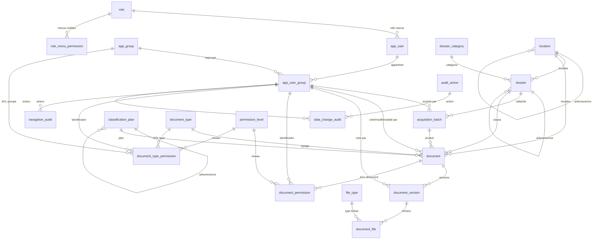
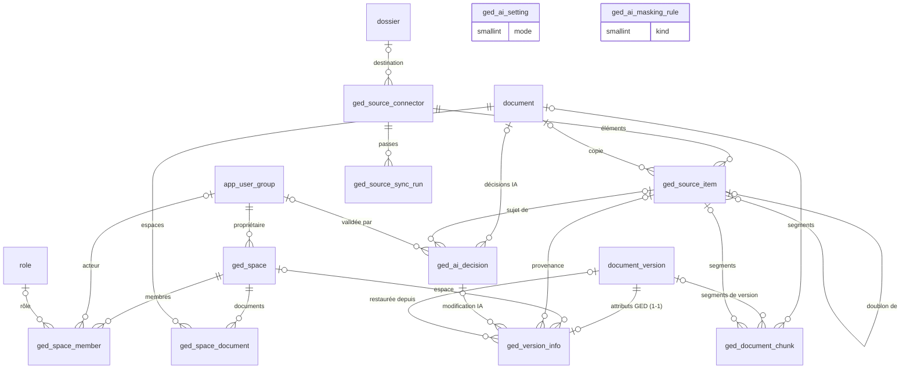
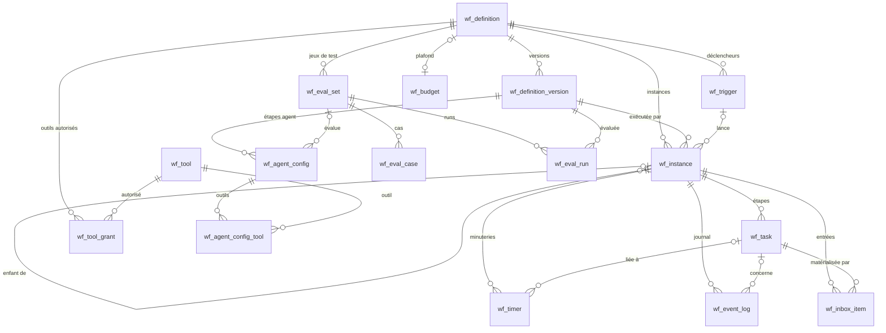

# Modèle de base de données — DocuPro / Archivage par QR

> Document généré à partir du schéma Prisma réel
> (`packages/db/prisma/models/*.prisma`) et des contraintes en SQL brut
> (`prisma/migrations/.../migration.sql`, `prisma/sql/analytics.sql`, `prisma/sql/ged.sql`).
> Source de vérité : les fichiers `.prisma`. La migration `init` est un instantané
> du 2026-06-11 ; les évolutions ultérieures (`role`, `role_menu_permission`,
> `app_user.role_id`, `analytics_target`) ont été appliquées via `prisma db push`.
> La GED IA (11 tables, extension `vector`) est livrée par la migration
> `20261120120000_add_ged_ia_foundations` (cf. §8).

## 1. Généralités & stack technique

| Élément | Valeur |
| --- | --- |
| SGBD | PostgreSQL 16 avec extension **pgvector** (`pgvector/pgvector:pg16` en dev, requise par la GED IA) |
| ORM | Prisma 6 (schéma multi-fichiers, GA Prisma 6) |
| Datasource | `DATABASE_URL` (env) |
| Base applicative | Postgres `:5432` / `DocuPro` (compose : user `archivage`) |
| Horodatage | UTC, type `TIMESTAMPTZ(0)` (précision seconde) |
| Convention de nommage | tables/colonnes `snake_case` ; modèles/champs Prisma `camelCase` via `@map` |
| Conventions index/contraintes | unique partiel `ux_*`, CHECK `ck_*`, index `ix_*` |

### Stack technique

**Monorepo & outillage** — TypeScript `5.7`, monorepo **pnpm `9.15` + Turborepo `2.3`**
(workspaces `apps/*` + `packages/*`), Node `>=20`, ESLint `9` / Prettier `3`.

| Couche | Application / Package | Stack principale |
| --- | --- | --- |
| Frontend | `apps/web` (`@archivage/web`) | **Next.js 15** + **React 19**, **Ant Design 5** (`antd`, `@ant-design/icons`, `@ant-design/nextjs-registry`, patch React 19), **Tailwind CSS 3.4**, `@ant-design/plots 2` (dashboards), `motion`, `lucide-react`, `geist` |
| Backend API | `apps/api` (`@archivage/api`) | **NestJS 11** (REST : `common`/`core`/`config`/`platform-express`), **Prisma Client 6**, auth **JWT** (`@nestjs/jwt`, `passport-jwt`) + **bcrypt**, validation **Zod**, file de jobs **BullMQ 5** + `ioredis`, upload `multer`, logs **Pino** (`nestjs-pino`) |
| Worker async | `apps/worker` (`@archivage/worker`) | **BullMQ 5** + `ioredis`, ingestion par lot ; PDF (`pdf-lib`, `pdfjs-dist`), QR (`zxing-wasm`), OCR (`tesseract.js`), Pino, `tsx` en dev |
| Accès données | `packages/db` (`@archivage/db`) | Schéma Prisma (multi-fichiers), migrations, seed, client typé PostgreSQL ; extension **pgvector** ≥ 0.5 (type `vector`, index HNSW) pour la GED IA |
| QR | `packages/qr` (`@archivage/qr`) | Génération `qrcode`, lecture/validation `zxing-wasm` (contrat `DOCUPRO|1|INTERCALAIRE|cat|id`) |
| PDF | `packages/pdf` (`@archivage/pdf`) | Composition intercalaires A4 + split (`pdf-lib`), rasterisation (`pdfjs-dist`, `@napi-rs/canvas`) |
| OCR | `packages/ocr` (`@archivage/ocr`) | Couche texte PDF d'abord, repli **Tesseract** (`tesseract.js`, fra/eng) |
| Exports P3 | `packages/exports` (`@archivage/exports`) | **ExcelJS** (xlsx), **docx**, **fast-csv** (csv), **PDFKit** (pdf) |
| Stockage | `packages/storage` (`@archivage/storage`) | `FileStore` + impl. disque local (`{file_id}{extension}` sous `ARCHIVES`) |
| Types / UI / Config | `packages/{types,ui,config}` | Types partagés, primitives UI, configs ESLint/TS communes |

**Infrastructure (Docker Compose)** — `pgvector/pgvector:pg16` (`:5432`, base `DocuPro` ; l'image `postgres:16-alpine` n'embarque pas l'extension `vector`)
et `redis:7-alpine` (`:6379`, support BullMQ). Les services api/worker/web tournent en
local via `pnpm dev` (leurs Dockerfiles arriveront dans une phase ultérieure).

> 100 % bibliothèques OSS — aucune dépendance propriétaire ; cette stack JS/TS
> remplace la proposition .NET initiale du PRD (cf. `research.md`).

### Découpage par domaine (35 tables)

| Domaine | Fichier | Tables |
| --- | --- | --- |
| Cœur métier | `core.prisma` | `acquisition_batch`, `document`, `document_version`, `document_file` |
| Référentiel / Paramétrage | `referentials.prisma` | `document_type`, `classification_plan`, `location`, `dossier_category`, `dossier`, `dossier_exit_motive`, `file_type`, `intercalaire_category` |
| Sécurité | `security.prisma` | `app_user`, `role`, `role_menu_permission`, `app_group`, `app_user_group`, `permission_level`, `document_type_permission`, `document_permission` |
| Audit / Journal | `audit.prisma` | `audit_action`, `navigation_audit`, `data_change_audit` |
| Analytique | `analytics.prisma` | `analytics_target` |
| GED IA | `models/ged.prisma` | `ged_ai_setting`, `ged_ai_masking_rule`, `ged_ai_decision`, `ged_source_connector`, `ged_source_sync_run`, `ged_source_item`, `ged_document_chunk`, `ged_space`, `ged_space_member`, `ged_space_document`, `ged_version_info` (11 tables) |

## 2. Diagramme entité-association

> `analytics_target` et `dossier_exit_motive` et `intercalaire_category` sont
> autonomes (pas de clé étrangère sortante structurante) — voir §7 et §4.

## 3. Cœur métier (`core.prisma`)

### `acquisition_batch` — lot d'acquisition (scan)

| Colonne | Type | Contraintes | Notes |
| --- | --- | --- | --- |
| `batch_id` | `SERIAL` | **PK** | |
| `batch_guid` | `UUID` | **UNIQUE**, def. `gen_random_uuid()` | |
| `dossier_id` | `INTEGER` | FK → `dossier` (SET NULL) | indexé |
| `scanned_by` | `INTEGER` | FK → `app_user_group` (SET NULL) | |
| `scan_date` | `TIMESTAMPTZ(0)` | def. `now()` | indexé |
| `source_label` | `VARCHAR(255)` | | |
| `file_count` | `INTEGER` | def. 0 | |
| `document_count` | `INTEGER` | def. 0 | |
| `status` | `SMALLINT` | def. 0, **CHECK `ck_batch_status` ∈ (0,1,2)** | 0=ouvert, 1=terminé, 2=échec |
| `created_at` | `TIMESTAMPTZ(0)` | def. `now()` | |

### `document` — document archivé

| Colonne | Type | Contraintes | Notes |
| --- | --- | --- | --- |
| `document_id` | `SERIAL` | **PK** | |
| `label` | `VARCHAR(500)` | NOT NULL | |
| `document_type_id` | `INTEGER` | FK → `document_type` (SET NULL) | indexé |
| `plan_id` | `INTEGER` | FK → `classification_plan` (SET NULL) | indexé |
| `location_id` | `INTEGER` | FK → `location` (SET NULL) | indexé |
| `dossier_id` | `INTEGER` | FK → `dossier` (SET NULL) | indexé |
| `batch_id` | `INTEGER` | FK → `acquisition_batch` (SET NULL) | indexé |
| `cote` | `VARCHAR(50)` | | |
| `document_date` | `DATE` | | date métier (FR-036), indexé |
| `archive_year` | `INTEGER` | | |
| `is_archived` | `BOOLEAN` | def. false | false = en attente QA, true = validé |
| `is_frozen` | `BOOLEAN` | def. false | indexé `(is_archived, is_frozen)` |
| `overview` | `TEXT` | | |
| `validated_by` | `INTEGER` | FK → `app_user_group` (SET NULL) | |
| `validated_at` | `TIMESTAMPTZ(0)` | | |
| `workflow_instance_id` | `INTEGER` | | |
| `workflow_task_id` | `INTEGER` | | |
| `created_by` | `INTEGER` | FK → `app_user_group` (SET NULL) | indexé (analytique) |
| `created_at` | `TIMESTAMPTZ(0)` | def. `now()` | indexé (analytique) |
| `modified_by` | `INTEGER` | FK → `app_user_group` (SET NULL) | |
| `modified_at` | `TIMESTAMPTZ(0)` | | |

### `document_version` — version de document

| Colonne | Type | Contraintes | Notes |
| --- | --- | --- | --- |
| `document_version_id` | `SERIAL` | **PK** | |
| `document_id` | `INTEGER` | NOT NULL, FK → `document` (**CASCADE**) | indexé |
| `version_number` | `INTEGER` | def. 1 | **UNIQUE (`document_id`, `version_number`)** |
| `is_current` | `BOOLEAN` | def. true | **unique partiel `ux_document_version_current` WHERE `is_current`** (une seule version courante / document, FR-024) |
| `is_validated` | `BOOLEAN` | def. false | |
| `comment` | `TEXT` | | |
| `created_by` | `INTEGER` | FK → `app_user_group` (SET NULL) | |
| `created_at` | `TIMESTAMPTZ(0)` | def. `now()` | |

### `document_file` — fichier binaire d'une version

| Colonne | Type | Contraintes | Notes |
| --- | --- | --- | --- |
| `file_id` | `SERIAL` | **PK** | |
| `document_version_id` | `INTEGER` | NOT NULL, FK → `document_version` (**CASCADE**) | indexé |
| `file_type_id` | `INTEGER` | NOT NULL, FK → `file_type` (RESTRICT) | |
| `original_name` | `VARCHAR(500)` | | |
| `file_extension` | `VARCHAR(16)` | NOT NULL | |
| `byte_length` | `BIGINT` | | |
| `page_count` | `INTEGER` | | |
| `ocr_text` | `TEXT` | | recherche plein-texte P3 → **index GIN `ix_document_file_ocr_tsv`** sur `to_tsvector('french', coalesce(ocr_text,''))` |
| `redaction` | `TEXT` | | |
| `pdf_owner` | `VARCHAR(256)` | | |
| `pdf_password` | `VARCHAR(256)` | | |
| `sort_order` | `INTEGER` | def. 0 | |
| `created_at` | `TIMESTAMPTZ(0)` | def. `now()` | |

## 4. Référentiel / Paramétrage (`referentials.prisma`)

### `document_type` — type de document
| Colonne | Type | Contraintes | Notes |
| --- | --- | --- | --- |
| `document_type_id` | `SERIAL` | **PK** | |
| `label` | `VARCHAR(500)` | NOT NULL | **unique partiel `ux_document_type_label_active` WHERE `is_active`** (anti-doublon FR-009/FR-032) |
| `code` | `VARCHAR(50)` | | |
| `is_active` | `BOOLEAN` | def. true | |

### `classification_plan` — plan de classement (arbre)
| Colonne | Type | Contraintes | Notes |
| --- | --- | --- | --- |
| `plan_id` | `SERIAL` | **PK** | |
| `parent_id` | `INTEGER` | FK → `classification_plan` (SET NULL) | arbre, indexé |
| `label` | `TEXT` | NOT NULL | |
| `code` | `VARCHAR(50)` | | |
| `is_public` | `BOOLEAN` | def. false | |
| `depth` | `INTEGER` | def. 0 | |
| `path` | `VARCHAR(900)` | NOT NULL | indexé |
| `is_active` | `BOOLEAN` | def. true | |

### `location` — localisation physique (arbre)
| Colonne | Type | Contraintes | Notes |
| --- | --- | --- | --- |
| `location_id` | `SERIAL` | **PK** | |
| `parent_id` | `INTEGER` | FK → `location` (SET NULL) | arbre, indexé |
| `label` | `VARCHAR(500)` | NOT NULL | |
| `code` | `VARCHAR(50)` | | |
| `depth` | `INTEGER` | def. 0 | |
| `path` | `VARCHAR(900)` | NOT NULL | indexé |
| `is_active` | `BOOLEAN` | def. true | |

### `dossier_category` — catégorie de dossier
| Colonne | Type | Contraintes |
| --- | --- | --- |
| `dossier_category_id` | `SERIAL` | **PK** |
| `label` | `VARCHAR(100)` | NOT NULL |
| `is_active` | `BOOLEAN` | def. true |

### `dossier` — dossier (arbre)
| Colonne | Type | Contraintes | Notes |
| --- | --- | --- | --- |
| `dossier_id` | `SERIAL` | **PK** | |
| `parent_id` | `INTEGER` | FK → `dossier` (SET NULL) | arbre, indexé |
| `label` | `VARCHAR(500)` | NOT NULL | **unique partiel `ux_dossier_label_active` WHERE `is_active`** |
| `code` | `VARCHAR(50)` | | |
| `dossier_category_id` | `INTEGER` | FK → `dossier_category` (SET NULL) | |
| `location_id` | `INTEGER` | FK → `location` (SET NULL) | |
| `service_code_suffix` | `VARCHAR(50)` | | |
| `depth` | `INTEGER` | def. 0 | |
| `path` | `VARCHAR(900)` | NOT NULL | indexé |
| `is_active` | `BOOLEAN` | def. true | |
| `created_at` | `TIMESTAMPTZ(0)` | def. `now()` | |

### `dossier_exit_motive` — motif de sortie de dossier
| Colonne | Type | Contraintes |
| --- | --- | --- |
| `exit_motive_id` | `SERIAL` | **PK** |
| `label` | `VARCHAR(150)` | NOT NULL |
| `is_active` | `BOOLEAN` | def. true |

### `file_type` — type de fichier autorisé
| Colonne | Type | Contraintes |
| --- | --- | --- |
| `file_type_id` | `SERIAL` | **PK** |
| `extension` | `VARCHAR(16)` | **UNIQUE** |
| `friendly_name` | `VARCHAR(100)` | NOT NULL |
| `max_size_bytes` | `BIGINT` | def. 0 |
| `icon` | `VARCHAR(100)` | def. `''` |
| `is_media` | `BOOLEAN` | def. false |
| `is_active` | `BOOLEAN` | def. true |

### `intercalaire_category` — catégorie d'intercalaire (segmentation QR)
| Colonne | Type | Contraintes |
| --- | --- | --- |
| `intercalaire_category_id` | `SERIAL` | **PK** |
| `category_code` | `VARCHAR(20)` | **UNIQUE** |
| `target_table` | `VARCHAR(128)` | |
| `target_column` | `VARCHAR(64)` | |
| `is_blank` | `BOOLEAN` | def. false |
| `is_ingest_handled` | `BOOLEAN` | def. true |
| `label` | `VARCHAR(100)` | NOT NULL |

## 5. Sécurité (`security.prisma`)

### `app_user` — utilisateur
| Colonne | Type | Contraintes | Notes |
| --- | --- | --- | --- |
| `user_id` | `SERIAL` | **PK** | |
| `username` | `VARCHAR(400)` | **UNIQUE** | |
| `first_name` | `VARCHAR(50)` | NOT NULL | |
| `last_name` | `VARCHAR(50)` | NOT NULL | |
| `full_name` | `VARCHAR(101)` | | colonne **générée STORED** (raw SQL), exposée en lecture seule |
| `email` | `VARCHAR(200)` | | |
| `phone` | `VARCHAR(50)` | | |
| `password_hash` | `VARCHAR(256)` | | bcrypt (FR-034) |
| `must_change_pwd` | `BOOLEAN` | def. false | |
| `service_id` | `INTEGER` | | |
| `matricule` | `VARCHAR(50)` | | |
| `is_disabled` | `BOOLEAN` | def. false | |
| `is_admin` | `BOOLEAN` | def. false | l'admin contourne l'ACL (D-17) |
| `role_id` | `INTEGER` | FK → `role` | RBAC menus sidebar (null = aucun menu hors accueil) |
| `created_at` | `TIMESTAMPTZ(0)` | def. `now()` | |

### `role` — rôle d'accès aux menus (RBAC sidebar)
| Colonne | Type | Contraintes | Notes |
| --- | --- | --- | --- |
| `role_id` | `SERIAL` | **PK** | |
| `name` | `VARCHAR(200)` | NOT NULL | |
| `description` | `VARCHAR(400)` | | |
| `is_active` | `BOOLEAN` | def. true | |
| `is_system` | `BOOLEAN` | def. false | rôle système : toutes permissions, non supprimable |
| `created_at` | `TIMESTAMPTZ(0)` | def. `now()` | |

### `role_menu_permission` — menus visibles d'un rôle
| Colonne | Type | Contraintes | Notes |
| --- | --- | --- | --- |
| `role_menu_permission_id` | `SERIAL` | **PK** | |
| `role_id` | `INTEGER` | NOT NULL, FK → `role` (**CASCADE**) | indexé |
| `menu_key` | `VARCHAR(200)` | NOT NULL | **UNIQUE (`role_id`, `menu_key`)** ; clé de route (ex. `/admin/users`) |

### `app_group` — groupe
| Colonne | Type | Contraintes |
| --- | --- | --- |
| `group_id` | `SERIAL` | **PK** |
| `name` | `VARCHAR(200)` | NOT NULL |
| `is_active` | `BOOLEAN` | def. true |

### `app_user_group` — appartenance utilisateur ↔ groupe (pivot ACL)
| Colonne | Type | Contraintes | Notes |
| --- | --- | --- | --- |
| `user_group_id` | `SERIAL` | **PK** | identité « acteur » référencée par tout le métier/audit |
| `user_id` | `INTEGER` | NOT NULL, FK → `app_user` (**CASCADE**) | indexé |
| `group_id` | `INTEGER` | NOT NULL, FK → `app_group` (RESTRICT) | indexé |
| `is_default` | `BOOLEAN` | def. true | **UNIQUE (`user_id`, `group_id`)** |

### `permission_level` — niveau de permission (valeurs de domaine)
| Colonne | Type | Contraintes | Notes |
| --- | --- | --- | --- |
| `permission_level_id` | `INTEGER` | **PK** (non auto-incrément) | valeurs de domaine |
| `name` | `VARCHAR(50)` | NOT NULL | |

### `document_type_permission` — ACL par type de document
| Colonne | Type | Contraintes | Notes |
| --- | --- | --- | --- |
| `document_type_permission_id` | `SERIAL` | **PK** | |
| `document_type_id` | `INTEGER` | NOT NULL, FK → `document_type` (**CASCADE**) | indexé |
| `permission_level_id` | `INTEGER` | NOT NULL, FK → `permission_level` (RESTRICT) | |
| `group_id` | `INTEGER` | FK → `app_group` (SET NULL) | **CHECK `ck_dtp_grantee`** : exactement un de `group_id`/`user_group_id` non nul |
| `user_group_id` | `INTEGER` | FK → `app_user_group` (SET NULL) | |

### `document_permission` — ACL par document
| Colonne | Type | Contraintes | Notes |
| --- | --- | --- | --- |
| `document_permission_id` | `SERIAL` | **PK** | |
| `document_id` | `INTEGER` | NOT NULL, FK → `document` (**CASCADE**) | indexé `(document_id, user_group_id)` |
| `permission_level_id` | `INTEGER` | NOT NULL, FK → `permission_level` (RESTRICT) | |
| `user_group_id` | `INTEGER` | NOT NULL, FK → `app_user_group` (RESTRICT) | |
| `granted_by` | `INTEGER` | (pas de FK — PRD) | |
| `granted_at` | `TIMESTAMPTZ(0)` | def. `now()` | **UNIQUE (`document_id`, `user_group_id`, `permission_level_id`)** |

## 6. Audit / Journal (`audit.prisma`)

### `audit_action` — référentiel d'actions auditées
| Colonne | Type | Contraintes |
| --- | --- | --- |
| `audit_action_id` | `SERIAL` | **PK** |
| `description` | `VARCHAR(500)` | NOT NULL |

### `navigation_audit` — journal de navigation
| Colonne | Type | Contraintes | Notes |
| --- | --- | --- | --- |
| `audit_id` | `BIGSERIAL` | **PK** | |
| `user_group_id` | `INTEGER` | FK → `app_user_group` (SET NULL) | indexé `(user_group_id, activity_at)` |
| `activity` | `TEXT` | | |
| `url` | `VARCHAR(2000)` | | |
| `menu_id` | `INTEGER` | | |
| `activity_at` | `TIMESTAMPTZ(0)` | def. `now()` | indexé |
| `actor_full_name` | `VARCHAR(200)` | | snapshot acteur |
| `actor_role` | `VARCHAR(200)` | | |
| `actor_service` | `VARCHAR(400)` | | |
| `ip_address` | `VARCHAR(64)` | | |
| `machine_name` | `VARCHAR(128)` | | |

### `data_change_audit` — journal des changements de données
| Colonne | Type | Contraintes | Notes |
| --- | --- | --- | --- |
| `data_change_audit_id` | `BIGSERIAL` | **PK** | |
| `user_group_id` | `INTEGER` | FK → `app_user_group` (SET NULL) | indexé `(user_group_id, changed_at)` |
| `audit_action_id` | `INTEGER` | FK → `audit_action` (SET NULL) | |
| `changed_at` | `TIMESTAMPTZ(0)` | def. `now()` | |
| `object_ref` | `VARCHAR(256)` | | indexé |
| `old_value` | `TEXT` | | |
| `new_value` | `TEXT` | | |

## 7. Analytique (`analytics.prisma`)

Couche **additive, en lecture seule** : aucune table métier n'est modifiée. Objets
SQL bruts appliqués via `prisma db execute --file prisma/sql/analytics.sql`.

### `analytics_target` — cible chiffrée d'archivage (KPI « objectif vs réalisé »)
| Colonne | Type | Contraintes | Notes |
| --- | --- | --- | --- |
| `target_id` | `SERIAL` | **PK** | |
| `scope` | `VARCHAR(20)` | def. `'global'`, **CHECK `ck_target_scope` ∈ (global, programme, type)** | |
| `scope_ref_id` | `INTEGER` | | `dossier_id` (programme) ou `document_type_id` (type) ; null si global |
| `period_kind` | `VARCHAR(10)` | **CHECK `ck_target_period_kind` ∈ (month, quarter, year)** | |
| `period_start` | `DATE` | borne basse inclusive | indexé |
| `metric` | `VARCHAR(20)` | def. `'documents'`, **CHECK `ck_target_metric` ∈ (documents, pages)** | |
| `target_value` | `INTEGER` | **CHECK `ck_target_value_positive` ≥ 0** | |
| `note` | `VARCHAR(255)` | | |
| `created_by` | `INTEGER` | (pas de FK — journal léger) | |
| `created_at` | `TIMESTAMPTZ(0)` | def. `now()` | |
| `updated_at` | `TIMESTAMPTZ(0)` | `@updatedAt` | |

**Unicité :**
- composite `ux_target_scope_period` (`scope`, `scope_ref_id`, `period_kind`, `period_start`, `metric`) ;
- partielle `ux_target_global_period` (`period_kind`, `period_start`, `metric`) `WHERE scope = 'global'` (couvre le cas `scope_ref_id` NULL).

**Index analytiques additifs** (sur tables existantes, `prisma/sql/analytics.sql`) :
`ix_document_created_at`, `ix_document_created_by`, et index partiels d'anomalies
de complétude `ix_document_missing_type` / `ix_document_missing_dossier` /
`ix_document_missing_date` (`WHERE … IS NULL`).

## 8. GED IA — fondations de données

La GED IA ajoute **11 tables** au schéma, livrées en une seule migration additive
(`20261120120000_add_ged_ia_foundations`). Modèles : `packages/db/prisma/models/ged.prisma` ;
contraintes en SQL brut : `packages/db/prisma/sql/ged.sql` (copie identique dans la migration,
ré-exécutable). Aucune table existante n'est modifiée : `document_version` est réutilisée telle
quelle (cf. « Écarts assumés »).

Le chantier repose sur cinq principes de données :

- **IA au choix du client** : locale, cloud (avec masquage obligatoire) ou désactivée. Installation
  mono-tenant (une installation = un client) : la configuration IA est donc une **ligne unique**
  (`ged_ai_setting`), livrée avec l'IA désactivée.
- **Connecteurs de sources** (copie, indexation en place, synchro) avec **provenance** (origine,
  auteur, dates, droits d'origine) et **dédoublonnage par empreinte SHA-256**.
- **Recherche sémantique pgvector**, filtrée par les droits : segments et embeddings
  `vector(1024)`, index HNSW en distance cosinus. Un segment ne sort jamais d'une requête sans que
  l'appelant ait le droit sur son document.
- **Espaces et versions** : espaces privé, partage, collaboration et publication ; attributs GED
  de chaque version.
- **Traçabilité IA** : chaque décision de l'IA est journalisée (`ged_ai_decision`), avec masquage,
  empreinte de l'entrée et validation humaine.

Conventions : les états sont des `SMALLINT` contrôlés par des `CHECK ck_*` (pas d'énumération
Prisma) ; les acteurs métier pointent vers `app_user_group` ; les traces d'édition (`added_by`,
`created_by`, `updated_by`, `requested_by`) n'ont pas de clé étrangère. Les valeurs d'états sont
listées sous chaque table.

### Diagramme

> `ged_ai_setting` et `ged_ai_masking_rule` sont autonomes : la règle de masquage s'applique à
> tout texte envoyé à un fournisseur cloud, sans lien de clé avec les autres tables.

### `ged_ai_setting` — configuration IA du client (ligne unique)

| Colonne | Type | Contraintes | Notes |
| --- | --- | --- | --- |
| `ged_ai_setting_id` | `INTEGER` | **PK**, def. `1`, **CHECK `ck_ged_ai_setting_singleton`** (= 1) | ligne unique |
| `mode` | `SMALLINT` | def. 0, **CHECK `ck_ged_ai_setting_mode`** ∈ (0,1,2) | 0=désactivée, 1=locale, 2=cloud |
| `provider` | `VARCHAR(50)` | | `ollama`, `vllm`, `openai`… clé libre, validée par l'API |
| `model` | `VARCHAR(200)` | | modèle génératif (classement, extraction, résumé, questions-réponses) |
| `embedding_model` | `VARCHAR(200)` | | modèle d'embedding de la recherche sémantique |
| `embedding_dimension` | `INTEGER` | def. 1024, **CHECK `ck_ged_ai_setting_dimension`** | doit valoir 1024 (cf. « Écarts assumés ») |
| `endpoint` | `VARCHAR(500)` | | adresse du service d'IA |
| `api_key_ref` | `VARCHAR(200)` | | **référence** (variable d'environnement ou coffre), jamais la clé |
| `masking_enabled` | `BOOLEAN` | def. true, **CHECK `ck_ged_ai_setting_cloud_masking`** | doit valoir true en mode cloud |
| `auto_apply_threshold` | `DECIMAL(4,3)` | **CHECK `ck_ged_ai_setting_threshold`** (NULL ou ∈ [0,1]) | NULL = jamais d'application automatique |
| `timeout_seconds` | `INTEGER` | def. 60, couvert par `ck_ged_ai_setting_dimension` (> 0) | délai d'appel au modèle |
| `updated_at` | `TIMESTAMPTZ(0)` | NOT NULL, def. `now()` | `@updatedAt` (Prisma) |
| `updated_by` | `INTEGER` | | sans FK (trace d'édition) |

**Ligne par défaut** : `ged_ai_setting_id` = 1, `mode` = 0 (IA désactivée). Aucun appel et aucune
donnée sortante tant que le client n'a pas choisi.

### `ged_ai_masking_rule` — règle de masquage avant envoi

| Colonne | Type | Contraintes | Notes |
| --- | --- | --- | --- |
| `ged_ai_masking_rule_id` | `SERIAL` | **PK** | |
| `label` | `VARCHAR(200)` | NOT NULL | |
| `kind` | `SMALLINT` | NOT NULL, def. 0, **CHECK `ck_ged_ai_masking_rule_kind`** ∈ (0,1,2) | 0=expression régulière, 1=mot ou expression exacte, 2=entité prédéfinie |
| `pattern` | `TEXT` | NOT NULL | pour `kind` = 2 : code de l'entité (`iban`, `email`, `phone`, `nir`, `card`…) |
| `replacement` | `VARCHAR(100)` | NOT NULL, def. `'[MASQUÉ]'` | texte substitué au motif trouvé |
| `is_active` | `BOOLEAN` | NOT NULL, def. true | |
| `sort_order` | `INTEGER` | NOT NULL, def. 0 | ordre d'application |
| `created_at` | `TIMESTAMPTZ(0)` | NOT NULL, def. `now()` | |

**Index :** `(is_active, sort_order)`.

### `ged_ai_decision` — décision ou proposition de l'IA (journal)

| Colonne | Type | Contraintes | Notes |
| --- | --- | --- | --- |
| `ged_ai_decision_id` | `BIGSERIAL` | **PK** | |
| `document_id` | `INTEGER` | FK → `document` (SET NULL) | indexé ; la trace survit au document |
| `source_item_id` | `BIGINT` | FK → `ged_source_item` (SET NULL) | indexé |
| `task` | `SMALLINT` | NOT NULL, **CHECK `ck_ged_ai_decision_task`** ∈ [0,7] | voir valeurs ci-dessous |
| `mode` | `SMALLINT` | NOT NULL, **CHECK `ck_ged_ai_decision_mode`** ∈ (1,2) | mode IA en vigueur, figé à la décision (jamais 0) |
| `provider` | `VARCHAR(50)` | | |
| `model` | `VARCHAR(200)` | NOT NULL | |
| `prompt_version` | `VARCHAR(50)` | | version du gabarit de requête, pour rejouer |
| `input_excerpt` | `TEXT` | | texte **masqué et tronqué** |
| `input_hash` | `VARCHAR(64)` | **CHECK `ck_ged_ai_decision_input_hash`** (NULL ou SHA-256 hex) | SHA-256 du texte réellement envoyé |
| `input_masked` | `BOOLEAN` | NOT NULL, def. false | true si le masquage a été appliqué |
| `output` | `JSONB` | | sortie brute de l'IA |
| `confidence` | `DECIMAL(4,3)` | **CHECK `ck_ged_ai_decision_confidence`** (NULL ou ∈ [0,1]) | NULL si le modèle ne fournit pas de score |
| `status` | `SMALLINT` | NOT NULL, def. 0, **CHECK `ck_ged_ai_decision_status`** ∈ [0,4] | voir valeurs ci-dessous |
| `validated_by` | `INTEGER` | FK → `app_user_group` (SET NULL), **CHECK `ck_ged_ai_decision_validation`** | si renseigné, `validated_at` doit l'être |
| `validated_at` | `TIMESTAMPTZ(0)` | | date de validation ; peut rester seule (la suppression du validateur remet `validated_by` à NULL sans effacer la date) |
| `requested_by` | `INTEGER` | | auteur de la demande, sans FK (journal) |
| `prompt_tokens` | `INTEGER` | | |
| `completion_tokens` | `INTEGER` | | |
| `duration_ms` | `INTEGER` | | |
| `error_message` | `TEXT` | | |
| `created_at` | `TIMESTAMPTZ(0)` | NOT NULL, def. `now()` | |

**Index :** `(document_id, created_at)`, `(source_item_id)`, `(status, task)`, `(created_at)`.

**Valeurs :**
- `task` : 0 classement, 1 extraction de métadonnées, 2 résumé, 3 type de document, 4 réponse à une
  question (RAG), 5 similarité / doublon, 6 correction OCR, 7 autre.
- `mode` : 1 locale, 2 cloud.
- `status` : 0 proposée (attend validation), 1 validée, 2 rejetée, 3 appliquée automatiquement
  (confiance ≥ seuil), 4 en erreur.

### `ged_source_connector` — connecteur vers une source externe

| Colonne | Type | Contraintes | Notes |
| --- | --- | --- | --- |
| `ged_source_connector_id` | `SERIAL` | **PK** | |
| `label` | `VARCHAR(200)` | NOT NULL | |
| `connector_type` | `VARCHAR(40)` | NOT NULL, **CHECK `ck_ged_source_connector_type`** (`^[a-z0-9_]+$`) | clé libre (`filesystem`, `sharepoint`, `gdrive`, `imap`…) validée par l'API ; indexé |
| `mode` | `SMALLINT` | NOT NULL, def. 0, **CHECK `ck_ged_source_connector_mode`** ∈ (0,1,2) | voir valeurs ci-dessous |
| `status` | `SMALLINT` | NOT NULL, def. 0, **CHECK `ck_ged_source_connector_status`** ∈ [0,3] | voir valeurs ci-dessous ; indexé `(is_active, status)` |
| `config` | `JSONB` | | paramétrage non secret (racine, filtres, dossier distant) |
| `credentials_enc` | `TEXT` | **CHECK `ck_ged_source_connector_credentials`** | jetons OAuth **chiffrés par l'application** (AES-GCM, base64) |
| `credentials_key_id` | `VARCHAR(100)` | | identifiant de la clé de chiffrement (rotation) |
| `credentials_ref` | `VARCHAR(200)` | | **référence** à un coffre externe ; jamais avec `credentials_enc` |
| `credentials_expires_at` | `TIMESTAMPTZ(0)` | | expiration de l'autorisation, si la source en fournit une |
| `change_token` | `TEXT` | | jeton de reprise de la source (delta link, page token, curseur) |
| `sync_interval_minutes` | `INTEGER` | **CHECK `ck_ged_source_connector_interval`** (NULL ou > 0) | NULL = synchro manuelle uniquement |
| `target_dossier_id` | `INTEGER` | FK → `dossier` (SET NULL) | dossier de destination des copies et synchros |
| `last_sync_at` | `TIMESTAMPTZ(0)` | | |
| `last_success_at` | `TIMESTAMPTZ(0)` | | |
| `last_error` | `TEXT` | | |
| `is_active` | `BOOLEAN` | NOT NULL, def. true | |
| `created_by` | `INTEGER` | | sans FK (trace de création) |
| `created_at` | `TIMESTAMPTZ(0)` | NOT NULL, def. `now()` | |
| `updated_at` | `TIMESTAMPTZ(0)` | NOT NULL, def. `now()` | `@updatedAt` (Prisma) |

**Index :** `(connector_type)`, `(is_active, status)`.

**Valeurs :**
- `mode` : 0 copie (binaire importé dans le coffre), 1 indexation en place (seuls texte et
  embeddings sont gardés), 2 synchro (copie tenue à jour avec la source).
- `status` : 0 inactif, 1 actif, 2 en erreur, 3 autorisation expirée (OAuth à renouveler).

### `ged_source_sync_run` — passe de synchronisation

| Colonne | Type | Contraintes | Notes |
| --- | --- | --- | --- |
| `ged_source_sync_run_id` | `BIGSERIAL` | **PK** | |
| `connector_id` | `INTEGER` | NOT NULL, FK → `ged_source_connector` (**CASCADE**) | indexé `(connector_id, started_at)` |
| `status` | `SMALLINT` | NOT NULL, def. 0, **CHECK `ck_ged_source_sync_run_status`** ∈ [0,3] | voir valeurs ci-dessous |
| `started_at` | `TIMESTAMPTZ(0)` | NOT NULL, def. `now()` | |
| `finished_at` | `TIMESTAMPTZ(0)` | | |
| `items_seen` | `INTEGER` | NOT NULL, def. 0 | compteurs de la passe |
| `items_created` | `INTEGER` | NOT NULL, def. 0 | |
| `items_updated` | `INTEGER` | NOT NULL, def. 0 | |
| `items_deleted` | `INTEGER` | NOT NULL, def. 0 | |
| `items_duplicate` | `INTEGER` | NOT NULL, def. 0 | |
| `items_failed` | `INTEGER` | NOT NULL, def. 0 | |
| `change_token_before` | `TEXT` | | jeton avant la passe |
| `change_token_after` | `TEXT` | | jeton après la passe |
| `error_message` | `TEXT` | | |

**Valeurs de `status`** : 0 en cours, 1 réussie, 2 partielle (erreurs sur certains éléments), 3 échouée.

### `ged_source_item` — élément d'une source (provenance)

| Colonne | Type | Contraintes | Notes |
| --- | --- | --- | --- |
| `ged_source_item_id` | `BIGSERIAL` | **PK** | |
| `connector_id` | `INTEGER` | NOT NULL, FK → `ged_source_connector` (**CASCADE**) | **UNIQUE (`connector_id`, `external_id`)** ; indexé `(connector_id, state)` |
| `external_id` | `VARCHAR(500)` | NOT NULL | identifiant dans la source (id de fichier, chemin, UID de message) |
| `origin_url` | `TEXT` | | provenance |
| `origin_path` | `TEXT` | | provenance |
| `name` | `VARCHAR(500)` | NOT NULL | |
| `mime_type` | `VARCHAR(200)` | | |
| `byte_length` | `BIGINT` | | |
| `origin_author` | `VARCHAR(300)` | | auteur d'origine |
| `origin_created_at` | `TIMESTAMPTZ(0)` | | date de création d'origine |
| `origin_modified_at` | `TIMESTAMPTZ(0)` | | date de modification d'origine |
| `content_hash` | `VARCHAR(64)` | **CHECK `ck_ged_source_item_hash`** (NULL ou SHA-256 hex) ; indexé | clé de dédoublonnage ; NULL tant que le binaire n'a pas été lu |
| `remote_version` | `VARCHAR(200)` | | marqueur de version côté source (ETag, révision) |
| `origin_acl` | `JSONB` | | droits d'origine, conservés pour audit |
| `origin_metadata` | `JSONB` | | autres métadonnées propres au connecteur |
| `state` | `SMALLINT` | NOT NULL, def. 0, **CHECK `ck_ged_source_item_state`** ∈ [0,6] | voir valeurs ci-dessous |
| `document_id` | `INTEGER` | FK → `document` (SET NULL) ; indexé | renseigné seulement en copie / synchro |
| `duplicate_of_id` | `BIGINT` | FK → `ged_source_item` (SET NULL) ; indexé ; **CHECK `ck_ged_source_item_not_own_duplicate`** | premier élément de même contenu |
| `error_message` | `TEXT` | | |
| `first_seen_at` | `TIMESTAMPTZ(0)` | NOT NULL, def. `now()` | |
| `last_seen_at` | `TIMESTAMPTZ(0)` | NOT NULL, def. `now()` | |
| `indexed_at` | `TIMESTAMPTZ(0)` | | |

**Dédoublonnage :** deux éléments de même `content_hash` désignent le même contenu, quelle que soit
la source. Le second est enregistré et pointe vers le premier (`duplicate_of_id`) au lieu de créer
un second document. L'index sur `content_hash` n'est pas unique (cf. « Écarts assumés »).

**Index :** `(content_hash)`, `(document_id)`, `(duplicate_of_id)`, `(connector_id, state)`.

**Valeurs de `state`** : 0 découvert, 1 copié, 2 indexé en place, 3 modifié à la source (à
resynchroniser), 4 supprimé à la source, 5 en erreur, 6 doublon.

### `ged_document_chunk` — segment indexé et embedding

| Colonne | Type | Contraintes | Notes |
| --- | --- | --- | --- |
| `ged_document_chunk_id` | `BIGSERIAL` | **PK** | |
| `document_id` | `INTEGER` | FK → `document` (**CASCADE**) ; indexé | |
| `document_version_id` | `INTEGER` | FK → `document_version` (**CASCADE**) ; indexé | segments d'une version (périmés à la ré-indexation) |
| `source_item_id` | `BIGINT` | FK → `ged_source_item` (**CASCADE**) ; indexé | |
| `chunk_index` | `INTEGER` | NOT NULL, **CHECK `ck_ged_document_chunk_values`** (≥ 0) | rang du segment |
| `content` | `TEXT` | NOT NULL | texte du segment |
| `content_hash` | `VARCHAR(64)` | NOT NULL, **CHECK `ck_ged_document_chunk_values`** (SHA-256 hex) | |
| `token_count` | `INTEGER` | **CHECK `ck_ged_document_chunk_values`** (NULL ou ≥ 0) | |
| `page_from` | `INTEGER` | **CHECK `ck_ged_document_chunk_values`** | première page |
| `page_to` | `INTEGER` | **CHECK `ck_ged_document_chunk_values`** (≥ `page_from`) | dernière page |
| `embedding` | `vector(1024)` | NOT NULL, **index HNSW `ix_ged_chunk_embedding_hnsw`** | géré en SQL brut (`$queryRaw` / `$executeRaw`) |
| `embedding_model` | `VARCHAR(200)` | NOT NULL | modèle ayant produit `embedding` : deux modèles ne sont pas comparables |
| `created_at` | `TIMESTAMPTZ(0)` | NOT NULL, def. `now()` | |

**Rattachement :** **CHECK `ck_ged_document_chunk_owner`** — `document_id` ou `source_item_id`
renseigné (au moins l'un des deux).

**Unicité :**
- `ux_ged_chunk_document` (`document_id`, `chunk_index`, `embedding_model`) `WHERE document_id IS NOT NULL` ;
- `ux_ged_chunk_source_item` (`source_item_id`, `chunk_index`, `embedding_model`) `WHERE source_item_id IS NOT NULL`.

**Index :** `(document_id)`, `(document_version_id)`, `(source_item_id)` ; HNSW
`ix_ged_chunk_embedding_hnsw` (`vector_cosine_ops`, `m` = 16, `ef_construction` = 64). Les droits ne
sont pas dupliqués ici : la recherche joint `document` et ses permissions avant de renvoyer un segment.

### `ged_space` — espace de travail documentaire

| Colonne | Type | Contraintes | Notes |
| --- | --- | --- | --- |
| `ged_space_id` | `SERIAL` | **PK** | |
| `label` | `VARCHAR(200)` | NOT NULL | |
| `description` | `TEXT` | | |
| `kind` | `SMALLINT` | NOT NULL, **CHECK `ck_ged_space_kind`** ∈ [0,3] | voir valeurs ci-dessous ; indexé `(kind, is_active)` |
| `owner_user_group_id` | `INTEGER` | NOT NULL, FK → `app_user_group` (**RESTRICT**) | indexé |
| `publication_slug` | `VARCHAR(120)` | **UNIQUE**, **CHECK `ck_ged_space_publication`** | identifiant public (URL stable) ; seulement pour une publication |
| `published_at` | `TIMESTAMPTZ(0)` | | |
| `is_active` | `BOOLEAN` | NOT NULL, def. true | |
| `created_at` | `TIMESTAMPTZ(0)` | NOT NULL, def. `now()` | |
| `updated_at` | `TIMESTAMPTZ(0)` | NOT NULL, def. `now()` | `@updatedAt` (Prisma) |

**Valeurs de `kind`** : 0 privé (propriétaire seul), 1 partage (lecture par des membres), 2
collaboration (contribution par des membres), 3 publication (diffusé, éventuellement hors
authentification). Un espace regroupe des documents sans les déplacer : le classement (dossier,
plan) reste celui du document.

### `ged_space_member` — membre d'un espace

| Colonne | Type | Contraintes | Notes |
| --- | --- | --- | --- |
| `ged_space_member_id` | `SERIAL` | **PK** | |
| `space_id` | `INTEGER` | NOT NULL, FK → `ged_space` (**CASCADE**) ; indexé | |
| `user_group_id` | `INTEGER` | FK → `app_user_group` (**CASCADE**) ; indexé | acteur |
| `role_id` | `INTEGER` | FK → `role` (**CASCADE**) ; indexé | rôle |
| `permission` | `SMALLINT` | NOT NULL, def. 0, **CHECK `ck_ged_space_member_permission`** ∈ [0,2] | voir valeurs ci-dessous |
| `added_by` | `INTEGER` | | sans FK (trace) |
| `added_at` | `TIMESTAMPTZ(0)` | NOT NULL, def. `now()` | |

**Contraintes :**
- **CHECK `ck_ged_space_member_grantee`** : exactement un des deux, `user_group_id` ou `role_id`,
  est renseigné (`(user_group_id IS NULL) <> (role_id IS NULL)`).
- **Unicité :** `ux_ged_space_member_user` (`space_id`, `user_group_id`) `WHERE user_group_id IS NOT NULL`
  et `ux_ged_space_member_role` (`space_id`, `role_id`) `WHERE role_id IS NOT NULL` : un acteur, ou un
  rôle, n'apparaît qu'une fois par espace.

**Valeurs de `permission`** : 0 lecture, 1 contribution, 2 gestion (membres, paramètres).

### `ged_space_document` — document rattaché à un espace

| Colonne | Type | Contraintes | Notes |
| --- | --- | --- | --- |
| `space_id` | `INTEGER` | **PK** (composite), NOT NULL, FK → `ged_space` (**CASCADE**) | |
| `document_id` | `INTEGER` | **PK** (composite), NOT NULL, FK → `document` (**CASCADE**) ; indexé | |
| `added_by` | `INTEGER` | | sans FK (trace) |
| `added_at` | `TIMESTAMPTZ(0)` | NOT NULL, def. `now()` | |

**Clé primaire composite :** `(space_id, document_id)`.

### `ged_version_info` — attributs GED d'une version

| Colonne | Type | Contraintes | Notes |
| --- | --- | --- | --- |
| `ged_version_info_id` | `SERIAL` | **PK** | |
| `document_version_id` | `INTEGER` | NOT NULL, **UNIQUE**, FK → `document_version` (**CASCADE**) | relation 1-1 avec `document_version` |
| `space_id` | `INTEGER` | FK → `ged_space` (**SET NULL**) ; indexé | |
| `content_hash` | `VARCHAR(64)` | **CHECK `ck_ged_version_info_hash`** (NULL ou SHA-256 hex) ; indexé | SHA-256 du contenu de cette version |
| `change_kind` | `SMALLINT` | NOT NULL, def. 0, **CHECK `ck_ged_version_info_change_kind`** ∈ [0,4] | voir valeurs ci-dessous |
| `change_summary` | `TEXT` | | |
| `source_item_id` | `BIGINT` | FK → `ged_source_item` (**SET NULL**) | provenance |
| `ai_decision_id` | `BIGINT` | FK → `ged_ai_decision` (**SET NULL**) | renseigné si `change_kind` = 4 |
| `restored_from_version_id` | `INTEGER` | FK → `document_version` (**SET NULL**), **CHECK `ck_ged_version_info_restore`** | version restaurée ; seulement si `change_kind` = 3 |
| `created_at` | `TIMESTAMPTZ(0)` | NOT NULL, def. `now()` | |

**Valeurs de `change_kind`** : 0 création, 1 modification, 2 synchro depuis la source, 3
restauration d'une version antérieure, 4 modification par l'IA.

### Écarts assumés

- **`document_version` existe déjà et n'est pas modifiée.** Ses attributs propres à la GED
  (empreinte, nature du changement, provenance, décision IA à l'origine) vivent dans
  `ged_version_info`, en relation 1-1.
- **Dimension d'embedding figée à 1024** (`vector(1024)`, ex. bge-m3 ou multilingual-e5-large) :
  pgvector n'indexe en HNSW que des colonnes de dimension fixe. Le CHECK
  `ck_ged_ai_setting_dimension` ne garantit pas la cohérence entre `embedding_dimension` et
  `vector(1024)` : c'est à l'application de la vérifier. Changer de modèle d'une autre dimension
  demande une nouvelle migration et une ré-indexation.
- **Aucun secret en clair.** Jetons OAuth chiffrés par l'application (`credentials_enc`) ou simple
  référence à un coffre (`credentials_ref`) ; clé d'API cloud par référence (`api_key_ref`).
- **Masquage obligatoire en cloud** : CHECK `ck_ged_ai_setting_cloud_masking`. Aucune donnée ne part
  en clair vers un fournisseur externe.
- **Dédoublonnage SHA-256 sans contrainte unique.** `ged_source_item.content_hash` n'est pas unique
  (index non unique) : le doublon doit pouvoir être enregistré pour garder sa provenance, il pointe
  vers le premier élément via `duplicate_of_id`.

## 9. Contraintes en SQL brut (non exprimables en Prisma)

| Objet | Type | Cible | Règle |
| --- | --- | --- | --- |
| `ux_document_version_current` | unique partiel | `document_version(document_id) WHERE is_current` | une seule version courante par document (FR-024) |
| `ux_document_type_label_active` | unique partiel | `document_type(label) WHERE is_active` | anti-doublon libellés actifs (FR-009/FR-032) |
| `ux_dossier_label_active` | unique partiel | `dossier(label) WHERE is_active` | anti-doublon libellés actifs |
| `ck_batch_status` | CHECK | `acquisition_batch.status` | ∈ (0,1,2) |
| `ck_dtp_grantee` | CHECK | `document_type_permission` | `(group_id IS NULL) <> (user_group_id IS NULL)` |
| `ix_document_file_ocr_tsv` | index GIN | `document_file` | `to_tsvector('french', coalesce(ocr_text,''))` — recherche plein-texte |
| `app_user.full_name` | colonne générée STORED | `app_user` | concaténation nom/prénom, lecture seule |
| `ck_target_*`, `ux_target_global_period` | CHECK / unique partiel | `analytics_target` | voir §7 |
| `vector` | extension | base | `CREATE EXTENSION IF NOT EXISTS vector` ; pgvector ≥ 0.5 (HNSW), image `pgvector/pgvector:pg16` en dev (§8) |
| `ck_ged_ai_setting_singleton` | CHECK | `ged_ai_setting(ged_ai_setting_id)` | ligne unique : id = 1 |
| `ck_ged_ai_setting_mode` | CHECK | `ged_ai_setting.mode` | ∈ (0,1,2) |
| `ck_ged_ai_setting_cloud_masking` | CHECK | `ged_ai_setting` | mode 2 (cloud) ⇒ `masking_enabled` = true |
| `ck_ged_ai_setting_threshold` | CHECK | `ged_ai_setting.auto_apply_threshold` | NULL ou ∈ [0,1] |
| `ck_ged_ai_setting_dimension` | CHECK | `ged_ai_setting` | `embedding_dimension` > 0 et `timeout_seconds` > 0 ; ne garantit pas la cohérence avec `vector(1024)` |
| Ligne par défaut `ged_ai_setting` | INSERT | `ged_ai_setting` | `(ged_ai_setting_id, mode)` = `(1, 0)` : IA désactivée ; `ON CONFLICT DO NOTHING` |
| `ck_ged_ai_masking_rule_kind` | CHECK | `ged_ai_masking_rule.kind` | ∈ (0,1,2) |
| `ck_ged_ai_decision_task` | CHECK | `ged_ai_decision.task` | ∈ [0,7] |
| `ck_ged_ai_decision_mode` | CHECK | `ged_ai_decision.mode` | ∈ (1,2) : une décision suppose que l'IA a tourné |
| `ck_ged_ai_decision_status` | CHECK | `ged_ai_decision.status` | ∈ [0,4] |
| `ck_ged_ai_decision_confidence` | CHECK | `ged_ai_decision.confidence` | NULL ou ∈ [0,1] |
| `ck_ged_ai_decision_validation` | CHECK | `ged_ai_decision(validated_by, validated_at)` | `validated_by IS NULL OR validated_at IS NOT NULL` : un validateur suppose une date ; une date seule est admise, car la FK `ON DELETE SET NULL` garde la date si le compte validateur est supprimé |
| `ck_ged_ai_decision_input_hash` | CHECK | `ged_ai_decision.input_hash` | NULL ou SHA-256 hex minuscule (64 car.) |
| `ck_ged_source_connector_type` | CHECK | `ged_source_connector.connector_type` | `^[a-z0-9_]+$` |
| `ck_ged_source_connector_mode` | CHECK | `ged_source_connector.mode` | ∈ (0,1,2) |
| `ck_ged_source_connector_status` | CHECK | `ged_source_connector.status` | ∈ [0,3] |
| `ck_ged_source_connector_interval` | CHECK | `ged_source_connector.sync_interval_minutes` | NULL ou > 0 |
| `ck_ged_source_connector_credentials` | CHECK | `ged_source_connector(credentials_enc, credentials_ref)` | pas les deux à la fois : chiffré par l'application OU référence de coffre |
| `ck_ged_source_sync_run_status` | CHECK | `ged_source_sync_run.status` | ∈ [0,3] |
| `ck_ged_source_item_state` | CHECK | `ged_source_item.state` | ∈ [0,6] |
| `ck_ged_source_item_hash` | CHECK | `ged_source_item.content_hash` | NULL ou SHA-256 hex minuscule (64 car.) |
| `ck_ged_source_item_not_own_duplicate` | CHECK | `ged_source_item.duplicate_of_id` | ≠ `ged_source_item_id` |
| `ck_ged_document_chunk_owner` | CHECK | `ged_document_chunk` | `document_id` ou `source_item_id` renseigné |
| `ck_ged_document_chunk_values` | CHECK | `ged_document_chunk` | `chunk_index` ≥ 0, `token_count` ≥ 0, `page_to` ≥ `page_from`, `content_hash` SHA-256 hex |
| `ux_ged_chunk_document` | unique partiel | `ged_document_chunk(document_id, chunk_index, embedding_model) WHERE document_id IS NOT NULL` | un segment par rang et par modèle, pour un document |
| `ux_ged_chunk_source_item` | unique partiel | `ged_document_chunk(source_item_id, chunk_index, embedding_model) WHERE source_item_id IS NOT NULL` | idem pour un élément de source |
| `ix_ged_chunk_embedding_hnsw` | index HNSW | `ged_document_chunk(embedding)` `vector_cosine_ops` | `m` = 16, `ef_construction` = 64 ; recherche cosinus (`<=>`) ; avec pgvector ≥ 0.8, `SET hnsw.iterative_scan = relaxed_order` |
| `ck_ged_space_kind` | CHECK | `ged_space.kind` | ∈ [0,3] |
| `ck_ged_space_publication` | CHECK | `ged_space(publication_slug)` | NULL, ou `kind` = 3 et slug `^[a-z0-9][a-z0-9-]*$` |
| `ck_ged_space_member_grantee` | CHECK | `ged_space_member(user_group_id, role_id)` | exactement un des deux renseigné : `(user_group_id IS NULL) <> (role_id IS NULL)` |
| `ck_ged_space_member_permission` | CHECK | `ged_space_member.permission` | ∈ [0,2] |
| `ux_ged_space_member_user` | unique partiel | `ged_space_member(space_id, user_group_id) WHERE user_group_id IS NOT NULL` | un acteur n'apparaît qu'une fois par espace |
| `ux_ged_space_member_role` | unique partiel | `ged_space_member(space_id, role_id) WHERE role_id IS NOT NULL` | un rôle n'apparaît qu'une fois par espace |
| `ck_ged_version_info_change_kind` | CHECK | `ged_version_info.change_kind` | ∈ [0,4] |
| `ck_ged_version_info_hash` | CHECK | `ged_version_info.content_hash` | NULL ou SHA-256 hex minuscule (64 car.) |
| `ck_ged_version_info_restore` | CHECK | `ged_version_info(restored_from_version_id, change_kind)` | NULL, ou `change_kind` = 3 (restauration) |

## 10. Docu-Flow — fondations de données du workflow

Le moteur de workflow Docu-Flow ajoute **16 tables** préfixées `wf_`, livrées en une seule migration additive
(`20261121120000_add_workflow_foundations`). Modèles : `packages/db/prisma/models/wf.prisma` ; contraintes en
SQL brut : `packages/db/prisma/sql/wf.sql`, copié à l'identique dans la migration (section « SQL brut »),
ré-exécutable. **Aucune table existante n'est modifiée** et aucune clé étrangère ne pointe vers une table
existante. Les lots suivants (moteur, agents, déclencheurs, interface) n'ajoutent aucun modèle à ce schéma.

Principes :

- **Mono-tenant** : une installation = un client. Le plafond de coût « par client » est donc la ligne
  globale de `wf_budget` (`definition_id` NULL).
- **États en `SMALLINT` + `CHECK`** (pas d'énumération Prisma). Le miroir TypeScript est
  `packages/types/src/wf-enums.ts`.
- **Familles ouvertes** (type d'événement, type d'objet lié, clé d'outil) : chaînes `[a-z0-9_.]+`,
  contrôlées par `CHECK`.
- **Acteurs** : colonnes `INTEGER` **sans clé étrangère** vers `app_user_group`, `app_group` ou `role`.
  Les liens internes entre tables `wf_*` sont de vraies clés étrangères en `RESTRICT`, sauf exceptions
  indiquées table par table.
- **Journal append-only** : `wf_event_log` refuse UPDATE, DELETE et TRUNCATE. Une correction est un
  nouvel événement qui référence l'événement corrigé.

### Diagramme

### `wf_definition` — workflow nommé (en-tête)

Le graphe d'étapes vit dans `wf_definition_version`. `is_low_risk` est un marquage explicite par un
administrateur : sans lui, aucune étape agent ne peut être `autonome`.

| Colonne | Type | Contraintes | Notes |
| --- | --- | --- | --- |
| `wf_definition_id` | `SERIAL` | **PK** | |
| `name` | `VARCHAR(200)` | NOT NULL, **CHECK `ck_wf_definition_name`** (non vide) | unique parmi les workflows non archivés (`ux_wf_definition_name_active`) |
| `description` | `TEXT` | | |
| `status` | `SMALLINT` | NOT NULL, def. 0, **CHECK `ck_wf_definition_status`** ∈ [0,2] | 0 brouillon, 1 publié, 2 archivé ; indexé |
| `source` | `SMALLINT` | NOT NULL, def. 0, **CHECK `ck_wf_definition_source`** ∈ (0,1) | 0 manuel, 1 langage naturel |
| `is_low_risk` | `BOOLEAN` | NOT NULL, def. false, **CHECK `ck_wf_definition_low_risk`** | vrai ⇒ `low_risk_marked_at` renseigné ; déclencheur `wf_definition_low_risk_guard` |
| `low_risk_marked_by` | `INTEGER` | | sans FK (trace) |
| `low_risk_marked_at` | `TIMESTAMPTZ(0)` | | |
| `created_by` | `INTEGER` | | sans FK (trace) |
| `created_at` | `TIMESTAMPTZ(0)` | NOT NULL, def. `now()` | |
| `updated_at` | `TIMESTAMPTZ(0)` | NOT NULL, def. `now()` | `@updatedAt` (Prisma) |

### `wf_definition_version` — version d'un workflow

Une version publiée est **immuable** (déclencheur `wf_definition_version_immutable`, critère `published_at` non nul, y compris archivée) ; sa configuration agent est figée aussi (`wf_agent_config_frozen`). Les instances se
rattachent à une version précise : publier une version neuve n'altère pas les instances en cours.

| Colonne | Type | Contraintes | Notes |
| --- | --- | --- | --- |
| `wf_definition_version_id` | `SERIAL` | **PK** | |
| `definition_id` | `INTEGER` | NOT NULL, FK → `wf_definition` (**RESTRICT**) | |
| `version_number` | `INTEGER` | NOT NULL, **CHECK `ck_wf_definition_version_number`** (> 0) | unique par `(definition_id, version_number)` |
| `status` | `SMALLINT` | NOT NULL, def. 0, **CHECK `ck_wf_definition_version_status`** ∈ [0,2] | 0 brouillon, 1 publiée (immuable), 2 archivée |
| `graph` | `JSONB` | NOT NULL, **CHECK `ck_wf_definition_version_graph`** (objet) | graphe d'étapes, voir `WfGraph` (`packages/types/src/wf-graph.ts`) |
| `graph_hash` | `VARCHAR(64)` | **CHECK `ck_wf_definition_version_hash`** (NULL ou SHA-256 hex minuscule) | empreinte du graphe canonique |
| `source_prompt` | `TEXT` | | description en langage naturel d'origine |
| `change_note` | `VARCHAR(500)` | | |
| `published_by` | `INTEGER` | | sans FK (trace) |
| `published_at` | `TIMESTAMPTZ(0)` | **CHECK `ck_wf_definition_version_published`** | obligatoire si publiée ; date seule admise si le publicateur disparaît |
| `created_by` | `INTEGER` | | sans FK (trace) |
| `created_at` | `TIMESTAMPTZ(0)` | NOT NULL, def. `now()` | |

**Unicité :** `(definition_id, version_number)` ; une seule version publiée par workflow via
`ux_wf_definition_version_published` (partiel, `WHERE status = 1`).

### `wf_instance` — exécution d'une version

Une instance n'est jamais supprimée : elle se termine (2, 3, 4) ou se suspend. Objet lié polymorphe :
`subject_type` (clé ouverte) + `subject_id`.

| Colonne | Type | Contraintes | Notes |
| --- | --- | --- | --- |
| `wf_instance_id` | `BIGSERIAL` | **PK** | |
| `definition_id` | `INTEGER` | NOT NULL, FK → `wf_definition` (**RESTRICT**) ; indexé | |
| `definition_version_id` | `INTEGER` | NOT NULL, FK → `wf_definition_version` (**RESTRICT**) ; indexé | version figée de l'exécution |
| `status` | `SMALLINT` | NOT NULL, def. 0, **CHECK `ck_wf_instance_status`** ∈ [0,5] | 0 en cours, 1 en attente, 2 terminée, 3 échouée, 4 annulée, 5 suspendue |
| `context` | `JSONB` | NOT NULL, def. `'{}'`, **CHECK `ck_wf_instance_context`** (objet) | |
| `started_by` | `INTEGER` | NOT NULL | sans FK : `user_group_id` dont les droits s'appliquent à toute l'exécution |
| `trigger_id` | `INTEGER` | FK → `wf_trigger` (**SET NULL**) ; indexé | déclencheur d'origine, si encore connu |
| `parent_instance_id` | `BIGINT` | FK → `wf_instance` (**RESTRICT**) ; indexé ; **CHECK `ck_wf_instance_not_own_parent`** | sous-instance |
| `subject_type` | `VARCHAR(50)` | **CHECK `ck_wf_instance_subject`** (couple cohérent, `^[a-z0-9_.]+$`) | `mail`, `document`, `dossier`… |
| `subject_id` | `BIGINT` | **CHECK `ck_wf_instance_subject`** | indexé avec `subject_type` |
| `idempotency_key` | `VARCHAR(200)` | | unique avec `definition_id` (`ux_wf_instance_idempotency`) |
| `due_at` | `TIMESTAMPTZ(0)` | | |
| `error_message` | `TEXT` | | |
| `row_version` | `INTEGER` | NOT NULL, def. 0 | verrou optimiste du moteur |
| `started_at` | `TIMESTAMPTZ(0)` | NOT NULL, def. `now()` | |
| `finished_at` | `TIMESTAMPTZ(0)` | **CHECK `ck_wf_instance_finished`** | renseignée ssi statut 2, 3 ou 4 |
| `updated_at` | `TIMESTAMPTZ(0)` | NOT NULL, def. `now()` | `@updatedAt` (Prisma) |

**Index :** `(status, due_at)`, `(started_by, status)`, `(subject_type, subject_id)`,
`(definition_id, status)`, `(definition_version_id)`, `(trigger_id)`, `(parent_instance_id)` ; partiel
`ix_wf_instance_open` `(started_at)` `WHERE status IN (0, 1, 5)` (reprise après redémarrage).

### `wf_task` — passage dans une étape

Une ligne par passage dans une étape du graphe. Au plus un bénéficiaire parmi utilisateur, groupe ou rôle ;
aucun = tâche système ou agent.

| Colonne | Type | Contraintes | Notes |
| --- | --- | --- | --- |
| `wf_task_id` | `BIGSERIAL` | **PK** | |
| `instance_id` | `BIGINT` | NOT NULL, FK → `wf_instance` (**RESTRICT**) ; indexé | |
| `step_key` | `VARCHAR(100)` | NOT NULL | clé de l'étape dans le graphe |
| `task_type` | `SMALLINT` | NOT NULL, **CHECK `ck_wf_task_type`** ∈ [0,6] | 0 formulaire, 1 génération, 2 checklist, 3 affectation, 4 validation, 5 décision, 6 agent |
| `status` | `SMALLINT` | NOT NULL, def. 0, **CHECK `ck_wf_task_status`** ∈ [0,5] | 0 à faire, 1 en cours, 2 terminée, 3 annulée, 4 expirée, 5 échouée |
| `title` | `VARCHAR(300)` | NOT NULL | |
| `instructions` | `TEXT` | | |
| `priority` | `SMALLINT` | NOT NULL, def. 1, **CHECK `ck_wf_task_priority`** ∈ [0,2] | 0 basse, 1 normale, 2 haute |
| `assignee_user_group_id` | `INTEGER` | sans FK | bénéficiaire utilisateur |
| `assignee_group_id` | `INTEGER` | sans FK | `app_group.group_id` |
| `assignee_role_id` | `INTEGER` | sans FK | |
| `due_at` | `TIMESTAMPTZ(0)` | | |
| `attempt` | `INTEGER` | NOT NULL, def. 1, **CHECK `ck_wf_task_attempt`** (≥ 1) | n° de passage (boucles, relances) |
| `input` | `JSONB` | | |
| `result` | `JSONB` | | saisie, décision ou sortie produite |
| `started_at` | `TIMESTAMPTZ(0)` | | |
| `completed_at` | `TIMESTAMPTZ(0)` | **CHECK `ck_wf_task_completed`** | obligatoire si terminée ; date seule admise |
| `completed_by` | `INTEGER` | sans FK (trace) | |
| `created_at` | `TIMESTAMPTZ(0)` | NOT NULL, def. `now()` | |
| `updated_at` | `TIMESTAMPTZ(0)` | NOT NULL, def. `now()` | `@updatedAt` (Prisma) |

**Contraintes :** **CHECK `ck_wf_task_assignee`** (au plus un bénéficiaire) ; **unique**
`(instance_id, step_key, attempt)`.

**Index :** `(status, due_at)`, `(assignee_user_group_id, status)`, `(assignee_group_id, status)`,
`(assignee_role_id, status)`, `(instance_id, status)` ; partiel `ix_wf_task_open_due` `(due_at)`
`WHERE status IN (0, 1) AND due_at IS NOT NULL`.

### `wf_timer` — minuterie durable

Une ligne en base, pas un `setTimeout` : le moteur relit `status = 0 AND fire_at <= now()`. Une relance
récurrente se ré-arme par une nouvelle ligne une fois la précédente déclenchée.

| Colonne | Type | Contraintes | Notes |
| --- | --- | --- | --- |
| `wf_timer_id` | `BIGSERIAL` | **PK** | |
| `instance_id` | `BIGINT` | NOT NULL, FK → `wf_instance` (**RESTRICT**) ; indexé | |
| `task_id` | `BIGINT` | FK → `wf_task` (**RESTRICT**) ; indexé | optionnelle |
| `step_key` | `VARCHAR(100)` | NOT NULL | |
| `kind` | `SMALLINT` | NOT NULL, **CHECK `ck_wf_timer_kind`** ∈ [0,3] | 0 attente, 1 relance, 2 échéance, 3 reprise |
| `status` | `SMALLINT` | NOT NULL, def. 0, **CHECK `ck_wf_timer_status`** ∈ [0,2] | 0 active, 1 déclenchée, 2 annulée |
| `fire_at` | `TIMESTAMPTZ(0)` | NOT NULL | échéance de déclenchement |
| `fired_at` | `TIMESTAMPTZ(0)` | **CHECK `ck_wf_timer_fired`** | renseignée ssi statut 1 |
| `attempts` | `INTEGER` | NOT NULL, def. 0, **CHECK `ck_wf_timer_attempts`** (≥ 0) | |
| `payload` | `JSONB` | | |
| `locked_by` | `VARCHAR(100)` | **CHECK `ck_wf_timer_lease`** | bail d'un worker |
| `locked_until` | `TIMESTAMPTZ(0)` | **CHECK `ck_wf_timer_lease`** | `locked_by` et `locked_until` vont ensemble |
| `created_at` | `TIMESTAMPTZ(0)` | NOT NULL, def. `now()` | |

**Unicité :** `ux_wf_timer_active` `(instance_id, step_key, kind)` `WHERE status = 0` : une seule
minuterie active par instance, étape et nature.
**Index :** `(status, fire_at)`, `(instance_id, status)`, `(task_id)`, et partiel `ix_wf_timer_due`
`(fire_at)` `WHERE status = 0`.

### `wf_event_log` — journal append-only

Une ligne = « qui a décidé quoi, sur quelle instruction, à partir de quelles sources, avec quelle
confiance, validé par qui et quand ». **Aucune modification ni suppression** : déclencheurs
`wf_event_log_no_update`, `wf_event_log_no_delete`, `wf_event_log_no_truncate`.

| Colonne | Type | Contraintes | Notes |
| --- | --- | --- | --- |
| `wf_event_log_id` | `BIGSERIAL` | **PK** | |
| `instance_id` | `BIGINT` | NOT NULL, FK → `wf_instance` (**RESTRICT**) ; indexé | |
| `task_id` | `BIGINT` | FK → `wf_task` (**RESTRICT**) ; indexé | optionnelle |
| `step_key` | `VARCHAR(100)` | | |
| `event_type` | `VARCHAR(80)` | NOT NULL, **CHECK `ck_wf_event_log_type`** (`^[a-z0-9_.]+$`) | clé ouverte : `instance.started`, `task.created`, `agent.proposed`, `correction`… (catalogue : `wf-events.ts`) |
| `actor_kind` | `SMALLINT` | NOT NULL, def. 0, **CHECK `ck_wf_event_log_actor_kind`** ∈ [0,2] | 0 système, 1 utilisateur, 2 agent |
| `actor_user_group_id` | `INTEGER` | **CHECK `ck_wf_event_log_actor`** | sans FK ; obligatoire si `actor_kind` = 1 |
| `instruction` | `TEXT` | | prompt masqué et tronqué par l'appelant |
| `sources` | `JSONB` | | `[{ kind, id, label, excerpt? }]` |
| `decision` | `JSONB` | | décision, proposition ou sortie |
| `explanation` | `TEXT` | | pourquoi la proposition |
| `confidence` | `DECIMAL(4,3)` | **CHECK `ck_wf_event_log_confidence`** (NULL ou ∈ [0,1]) | |
| `autonomy_level` | `SMALLINT` | **CHECK `ck_wf_event_log_autonomy`** (NULL ou ∈ [0,2]) | niveau en vigueur au moment de l'événement, figé |
| `model` | `VARCHAR(200)` | | |
| `ai_decision_id` | `BIGINT` | sans FK | lien vers `ged_ai_decision` quand l'appel IA y est journalisé |
| `prompt_tokens` | `INTEGER` | **CHECK `ck_wf_event_log_values`** (≥ 0) | |
| `completion_tokens` | `INTEGER` | **CHECK `ck_wf_event_log_values`** (≥ 0) | |
| `cost_amount` | `DECIMAL(14,4)` | **CHECK `ck_wf_event_log_values`** (≥ 0) | |
| `validated_by` | `INTEGER` | **CHECK `ck_wf_event_log_validation`** ; sans FK | |
| `validated_at` | `TIMESTAMPTZ(0)` | **CHECK `ck_wf_event_log_validation`** | obligatoire si `validated_by` renseigné |
| `corrects_event_id` | `BIGINT` | **CHECK `ck_wf_event_log_values`** (≠ `wf_event_log_id`) | événement corrigé ; sans FK (un `ON DELETE` serait refusé) |
| `occurred_at` | `TIMESTAMPTZ(0)` | NOT NULL, def. `now()` | |

**Index :** `(instance_id, occurred_at)`, `(task_id)`, `(event_type, occurred_at)`, `(occurred_at)`.

### `wf_trigger` — déclencheur par événement

Démarre une instance de la version publiée de `definition_id`. `run_as_user_group_id` est l'utilisateur
dont les droits s'appliquent aux instances créées (jamais « tout-puissant » par défaut).

| Colonne | Type | Contraintes | Notes |
| --- | --- | --- | --- |
| `wf_trigger_id` | `SERIAL` | **PK** | |
| `definition_id` | `INTEGER` | NOT NULL, FK → `wf_definition` (**RESTRICT**) ; indexé | |
| `name` | `VARCHAR(200)` | NOT NULL | |
| `event_type` | `VARCHAR(80)` | NOT NULL, **CHECK `ck_wf_trigger_event_type`** (`^[a-z0-9_.]+$`) | `mail.arrived`, `document.deposited`, `deadline.reached`, `threshold.crossed` |
| `conditions` | `JSONB` | NOT NULL, def. `'{}'`, **CHECK `ck_wf_trigger_conditions`** (objet) | filtre évalué par le moteur |
| `run_as_user_group_id` | `INTEGER` | NOT NULL | sans FK |
| `is_active` | `BOOLEAN` | NOT NULL, def. true | |
| `last_fired_at` | `TIMESTAMPTZ(0)` | | |
| `created_by` | `INTEGER` | | sans FK (trace) |
| `created_at` | `TIMESTAMPTZ(0)` | NOT NULL, def. `now()` | |
| `updated_at` | `TIMESTAMPTZ(0)` | NOT NULL, def. `now()` | `@updatedAt` (Prisma) |

**Index :** `(event_type, is_active)`, `(definition_id)`.

### `wf_tool` — registre des outils d'agent

| Colonne | Type | Contraintes | Notes |
| --- | --- | --- | --- |
| `wf_tool_id` | `SERIAL` | **PK** | |
| `tool_key` | `VARCHAR(100)` | NOT NULL, **UNIQUE**, **CHECK `ck_wf_tool_key`** (`^[a-z0-9_.]+$`) | identifiant stable |
| `label` | `VARCHAR(200)` | NOT NULL | |
| `description` | `TEXT` | | |
| `side_effect` | `SMALLINT` | NOT NULL, def. 0, **CHECK `ck_wf_tool_side_effect`** ∈ [0,2] | 0 lecture, 1 écriture réversible, 2 externe ou irréversible |
| `requires_validation` | `BOOLEAN` | NOT NULL, def. false, **CHECK `ck_wf_tool_irreversible_validated`** | `side_effect` = 2 ⇒ vrai, quel que soit le niveau d'autonomie |
| `input_schema` | `JSONB` | **CHECK `ck_wf_tool_input_schema`** (NULL ou objet) | |
| `is_enabled` | `BOOLEAN` | NOT NULL, def. true | |
| `created_at` | `TIMESTAMPTZ(0)` | NOT NULL, def. `now()` | |

### `wf_tool_grant` — outil autorisé pour un workflow

Liste blanche : sans ligne, l'outil est interdit pour ce workflow.

| Colonne | Type | Contraintes | Notes |
| --- | --- | --- | --- |
| `wf_tool_grant_id` | `SERIAL` | **PK** | |
| `definition_id` | `INTEGER` | NOT NULL, FK → `wf_definition` (**RESTRICT**) | |
| `tool_id` | `INTEGER` | NOT NULL, FK → `wf_tool` (**RESTRICT**) ; indexé | |
| `max_calls_per_instance` | `INTEGER` | **CHECK `ck_wf_tool_grant_max_calls`** (NULL ou > 0) | NULL = illimité dans le budget |
| `granted_by` | `INTEGER` | | sans FK (trace) |
| `granted_at` | `TIMESTAMPTZ(0)` | NOT NULL, def. `now()` | |

**Unicité :** `(definition_id, tool_id)`.

### `wf_agent_config` — configuration d'une étape agent

`autonomy_level` : 0 suggère, 1 agit avec validation, 2 autonome ; défaut 0, le plus prudent. Le niveau 2
est refusé par le déclencheur `wf_agent_config_autonomy_guard` sans workflow faible risque ni run
d'évaluation réussi pour cette version.

| Colonne | Type | Contraintes | Notes |
| --- | --- | --- | --- |
| `wf_agent_config_id` | `SERIAL` | **PK** | |
| `definition_version_id` | `INTEGER` | NOT NULL, FK → `wf_definition_version` (**RESTRICT**) | |
| `step_key` | `VARCHAR(100)` | NOT NULL | unique par version |
| `objective` | `TEXT` | NOT NULL | |
| `autonomy_level` | `SMALLINT` | NOT NULL, def. 0, **CHECK `ck_wf_agent_config_autonomy`** ∈ [0,2] ; **CHECK `ck_wf_agent_config_autonomous_eval`** | 2 ⇒ `eval_set_id` renseigné ; déclencheur `wf_agent_config_autonomy_guard` |
| `confidence_threshold` | `DECIMAL(4,3)` | NOT NULL, def. 0.800, **CHECK `ck_wf_agent_config_threshold`** ∈ [0,1] | sous ce seuil, la proposition va à un humain |
| `model` | `VARCHAR(200)` | | NULL = modèle de `ged_ai_setting` |
| `max_steps` | `INTEGER` | NOT NULL, def. 10, **CHECK `ck_wf_agent_config_limits`** ∈ [1,50] | |
| `max_cost_per_run` | `DECIMAL(14,4)` | **CHECK `ck_wf_agent_config_limits`** (NULL ou ≥ 0) | plafond de coût d'une exécution de l'étape |
| `timeout_seconds` | `INTEGER` | NOT NULL, def. 120, **CHECK `ck_wf_agent_config_limits`** (> 0) | |
| `eval_set_id` | `INTEGER` | FK → `wf_eval_set` (**SET NULL**) ; indexé | jeu d'évaluation lié |
| `created_at` | `TIMESTAMPTZ(0)` | NOT NULL, def. `now()` | |
| `updated_at` | `TIMESTAMPTZ(0)` | NOT NULL, def. `now()` | `@updatedAt` (Prisma) |

**Unicité :** `(definition_version_id, step_key)`.

### `wf_agent_config_tool` — outils autorisés pour une étape agent

Sous-ensemble des `wf_tool_grant` du workflow. La cohérence avec les grants est vérifiée par l'application
à la publication, pas par SQL.

| Colonne | Type | Contraintes | Notes |
| --- | --- | --- | --- |
| `agent_config_id` | `INTEGER` | **PK** (composite), NOT NULL, FK → `wf_agent_config` (**CASCADE**) | |
| `tool_id` | `INTEGER` | **PK** (composite), NOT NULL, FK → `wf_tool` (**RESTRICT**) ; indexé | |

**Clé primaire composite :** `(agent_config_id, tool_id)`.

### `wf_budget` — plafond de coût et arrêt d'urgence

Une ligne **globale** (`definition_id` NULL = plafond du client) et au plus une ligne par workflow. La ligne
globale par défaut est livrée sans plafond (voir §10 « Contraintes SQL brut »).

| Colonne | Type | Contraintes | Notes |
| --- | --- | --- | --- |
| `wf_budget_id` | `SERIAL` | **PK** | |
| `definition_id` | `INTEGER` | **UNIQUE**, FK → `wf_definition` (**RESTRICT**) | NULL = ligne globale (`ux_wf_budget_global`) |
| `period_kind` | `SMALLINT` | NOT NULL, def. 0, **CHECK `ck_wf_budget_period_kind`** ∈ [0,2] | 0 mensuel, 1 journalier, 2 cumulé |
| `period_start` | `DATE` | NOT NULL, def. `now()` | remise à zéro de `consumed_amount` quand elle change |
| `cap_amount` | `DECIMAL(14,4)` | **CHECK `ck_wf_budget_amounts`** (NULL ou ≥ 0) | NULL = pas de plafond |
| `consumed_amount` | `DECIMAL(14,4)` | NOT NULL, def. 0, **CHECK `ck_wf_budget_amounts`** (≥ 0) | |
| `consumed_tokens` | `BIGINT` | NOT NULL, def. 0, **CHECK `ck_wf_budget_amounts`** (≥ 0) | |
| `alert_threshold` | `DECIMAL(4,3)` | NOT NULL, def. 0.800, **CHECK `ck_wf_budget_alert`** ∈ [0,1] | seuil d'alerte (fraction du plafond) |
| `currency` | `VARCHAR(3)` | NOT NULL, def. `'XOF'`, **CHECK `ck_wf_budget_currency`** (`^[A-Z]{3}$`) | une seule devise par installation |
| `emergency_stop` | `BOOLEAN` | NOT NULL, def. false, **CHECK `ck_wf_budget_emergency`** | vrai ⇒ `emergency_stop_at` renseigné |
| `emergency_stop_at` | `TIMESTAMPTZ(0)` | | |
| `emergency_stop_by` | `INTEGER` | | sans FK (trace) |
| `emergency_stop_reason` | `VARCHAR(500)` | | |
| `updated_at` | `TIMESTAMPTZ(0)` | NOT NULL, def. `now()` | `@updatedAt` (Prisma) |
| `updated_by` | `INTEGER` | | sans FK (trace) |

### `wf_eval_set` — jeu de test d'une étape agent

`step_key` NULL = jeu sur le workflow entier.

| Colonne | Type | Contraintes | Notes |
| --- | --- | --- | --- |
| `wf_eval_set_id` | `SERIAL` | **PK** | |
| `definition_id` | `INTEGER` | NOT NULL, FK → `wf_definition` (**RESTRICT**) ; indexé | |
| `step_key` | `VARCHAR(100)` | | NULL = workflow entier |
| `name` | `VARCHAR(200)` | NOT NULL | |
| `description` | `TEXT` | | |
| `min_accuracy` | `DECIMAL(4,3)` | NOT NULL, def. 0.900, **CHECK `ck_wf_eval_set_accuracy`** ∈ [0,1] | précision minimale pour qu'un run soit réussi |
| `is_active` | `BOOLEAN` | NOT NULL, def. true | |
| `created_by` | `INTEGER` | | sans FK (trace) |
| `created_at` | `TIMESTAMPTZ(0)` | NOT NULL, def. `now()` | |
| `updated_at` | `TIMESTAMPTZ(0)` | NOT NULL, def. `now()` | `@updatedAt` (Prisma) |

### `wf_eval_case` — cas de test

| Colonne | Type | Contraintes | Notes |
| --- | --- | --- | --- |
| `wf_eval_case_id` | `SERIAL` | **PK** | |
| `eval_set_id` | `INTEGER` | NOT NULL, FK → `wf_eval_set` (**CASCADE**) ; indexé `(eval_set_id, sort_order)` | |
| `label` | `VARCHAR(300)` | NOT NULL | |
| `input` | `JSONB` | NOT NULL | |
| `expected` | `JSONB` | NOT NULL | sortie attendue |
| `weight` | `INTEGER` | NOT NULL, def. 1, **CHECK `ck_wf_eval_case_weight`** (> 0) | indicatif (affichage, priorité) : la précision d'un run n'est pas pondérée |
| `sort_order` | `INTEGER` | NOT NULL, def. 0 | |
| `is_active` | `BOOLEAN` | NOT NULL, def. true | |

### `wf_eval_run` — exécution d'un jeu sur une version

Un run terminé est figé (déclencheur `wf_eval_run_finished_immutable`) : la preuve qui justifie une
autonomie ne peut ni être modifiée ni supprimée. `required_accuracy` fige le seuil au lancement.

| Colonne | Type | Contraintes | Notes |
| --- | --- | --- | --- |
| `wf_eval_run_id` | `BIGSERIAL` | **PK** | |
| `eval_set_id` | `INTEGER` | NOT NULL, FK → `wf_eval_set` (**RESTRICT**) ; indexé | |
| `definition_version_id` | `INTEGER` | NOT NULL, FK → `wf_definition_version` (**RESTRICT**) ; indexé | |
| `status` | `SMALLINT` | NOT NULL, def. 0, **CHECK `ck_wf_eval_run_status`** ∈ [0,2] | 0 en cours, 1 terminé, 2 en erreur |
| `total_cases` | `INTEGER` | NOT NULL, def. 0, **CHECK `ck_wf_eval_run_counts`** (≥ 0) | |
| `passed_cases` | `INTEGER` | NOT NULL, def. 0, **CHECK `ck_wf_eval_run_counts`** (∈ [0, `total_cases`]) | |
| `accuracy` | `DECIMAL(4,3)` | **CHECK `ck_wf_eval_run_accuracy`** (NULL ou ∈ [0,1]) | |
| `required_accuracy` | `DECIMAL(4,3)` | NOT NULL, **CHECK `ck_wf_eval_run_accuracy`** (∈ [0,1]) | seuil figé au lancement |
| `passed` | `BOOLEAN` | NOT NULL, def. false, **CHECK `ck_wf_eval_run_passed`** | vrai ⇒ terminé, `total_cases` > 0 et `accuracy` ≥ `required_accuracy` ; `ck_wf_eval_run_accuracy_consistent` : `accuracy` = `passed_cases` / `total_cases` (± 0,0005) pour tout run terminé |
| `model` | `VARCHAR(200)` | | |
| `results` | `JSONB` | | détail par cas |
| `cost_amount` | `DECIMAL(14,4)` | | sans CHECK SQL |
| `error_message` | `TEXT` | | |
| `run_by` | `INTEGER` | | sans FK (trace) |
| `started_at` | `TIMESTAMPTZ(0)` | NOT NULL, def. `now()` | |
| `finished_at` | `TIMESTAMPTZ(0)` | **CHECK `ck_wf_eval_run_finished`** | renseignée ssi statut ≠ 0 |

**Index :** `(eval_set_id, definition_version_id, passed)`, `(definition_version_id)`.

### `wf_inbox_item` — boîte de tâches unifiée

Tâches humaines et validations demandées par un agent. Pour une validation d'agent, la proposition et son
explication sont obligatoires : un humain ne valide jamais sans voir le contenu et le raisonnement.

| Colonne | Type | Contraintes | Notes |
| --- | --- | --- | --- |
| `wf_inbox_item_id` | `BIGSERIAL` | **PK** | |
| `task_id` | `BIGINT` | NOT NULL, FK → `wf_task` (**RESTRICT**) ; indexé | |
| `instance_id` | `BIGINT` | NOT NULL, FK → `wf_instance` (**RESTRICT**) ; indexé | |
| `kind` | `SMALLINT` | NOT NULL, def. 0, **CHECK `ck_wf_inbox_item_kind`** ∈ [0,1] | 0 tâche humaine, 1 validation d'agent |
| `status` | `SMALLINT` | NOT NULL, def. 0, **CHECK `ck_wf_inbox_item_status`** ∈ [0,5] | 0 ouverte, 1 prise en charge, 2 traitée, 3 rejetée, 4 expirée, 5 annulée |
| `priority` | `SMALLINT` | NOT NULL, def. 1, **CHECK `ck_wf_inbox_item_priority`** ∈ [0,2] | 0 basse, 1 normale, 2 haute |
| `title` | `VARCHAR(300)` | NOT NULL | |
| `summary` | `TEXT` | | |
| `proposal` | `JSONB` | **CHECK `ck_wf_inbox_item_proposal`** | obligatoire si `kind` = 1 |
| `explanation` | `TEXT` | **CHECK `ck_wf_inbox_item_proposal`** (non vide si `kind` = 1) | obligatoire si `kind` = 1 |
| `sources` | `JSONB` | | |
| `confidence` | `DECIMAL(4,3)` | **CHECK `ck_wf_inbox_item_confidence`** (NULL ou ∈ [0,1]) | |
| `agent_event_id` | `BIGINT` | sans FK | événement `agent.proposed` à l'origine de la demande |
| `assignee_user_group_id` | `INTEGER` | **CHECK `ck_wf_inbox_item_assignee`** ; sans FK | copie de la tâche, indexée pour la boîte |
| `assignee_group_id` | `INTEGER` | **CHECK `ck_wf_inbox_item_assignee`** ; sans FK | |
| `assignee_role_id` | `INTEGER` | **CHECK `ck_wf_inbox_item_assignee`** ; sans FK | |
| `due_at` | `TIMESTAMPTZ(0)` | | |
| `claimed_by` | `INTEGER` | sans FK | |
| `claimed_at` | `TIMESTAMPTZ(0)` | **CHECK `ck_wf_inbox_item_resolution`** | obligatoire si `claimed_by` renseigné |
| `resolved_by` | `INTEGER` | sans FK | |
| `resolved_at` | `TIMESTAMPTZ(0)` | **CHECK `ck_wf_inbox_item_resolution`** | obligatoire si statut 2 ou 3, et si `resolved_by` renseigné |
| `resolution` | `JSONB` | | `{ outcome: 'accepted' \| 'modified' \| 'rejected', … }` |
| `resolution_comment` | `TEXT` | | |
| `created_at` | `TIMESTAMPTZ(0)` | NOT NULL, def. `now()` | |
| `updated_at` | `TIMESTAMPTZ(0)` | NOT NULL, def. `now()` | `@updatedAt` (Prisma) |

**Unicité :** `ux_wf_inbox_item_open` `(task_id, kind)` `WHERE status IN (0, 1)` : une seule entrée
ouverte par tâche et par nature.
**Index :** `(status, due_at)`, `(assignee_user_group_id, status)`, `(assignee_group_id, status)`,
`(assignee_role_id, status)`, `(task_id)`, `(instance_id)` ; partiel `ix_wf_inbox_item_open_user`
`(assignee_user_group_id, due_at)` `WHERE status IN (0, 1)` (boîte personnelle).

### Écarts assumés

- **Aucune clé étrangère vers les tables existantes** (`app_user_group`, `app_group`, `role`, `document`,
  `dossier`, `mail`, `ged_ai_decision`, `ged_source_item`). Prisma exige le champ inverse sur le modèle
  cible, ce qui obligerait à modifier `security.prisma` ou `core.prisma`, hors périmètre du lot. Les
  acteurs et les objets liés sont donc des colonnes sans FK ; l'intégrité est garantie par l'application.
- **Journal append-only sans `ON DELETE SET NULL` ni `CASCADE`.** Ces actions seraient refusées par le
  déclencheur. Les acteurs et `ai_decision_id` sont sans FK : la trace survit aux comptes. L'instance et
  la tâche d'un événement sont en `RESTRICT`.
- **Instances jamais supprimées.** Les FK du cœur (définition, version, instance, tâche) sont en
  `RESTRICT` : une instance se termine, s'annule ou se suspend, elle ne se supprime pas. Seul
  `wf_instance.trigger_id` passe en `SET NULL` : il perd le lien vers le déclencheur, l'instance reste.
- **Limite : le propriétaire de la base peut retirer les déclencheurs** (`DROP TRIGGER`, `ALTER TABLE …
  DISABLE TRIGGER`). L'append-only est une barrière applicative forte, pas une preuve cryptographique.
- **Autonomie « autonome » garantie par déclencheur**, et non par `CHECK` : un `CHECK` ne peut pas lire
  `wf_definition.is_low_risk` ni `wf_eval_run`, qui sont dans d'autres tables.

### Contraintes SQL brut du workflow

Source : `packages/db/prisma/sql/wf.sql` (copie identique dans la migration).

| Objet | Type | Cible | Règle |
| --- | --- | --- | --- |
| `ck_wf_definition_status` | CHECK | `wf_definition.status` | ∈ [0,2] |
| `ck_wf_definition_source` | CHECK | `wf_definition.source` | ∈ (0,1) |
| `ck_wf_definition_name` | CHECK | `wf_definition.name` | non vide après `btrim` |
| `ck_wf_definition_low_risk` | CHECK | `wf_definition(is_low_risk, low_risk_marked_at)` | faible risque ⇒ date de marquage |
| `ck_wf_definition_version_status` | CHECK | `wf_definition_version.status` | ∈ [0,2] |
| `ck_wf_definition_version_number` | CHECK | `wf_definition_version.version_number` | > 0 |
| `ck_wf_definition_version_graph` | CHECK | `wf_definition_version.graph` | objet JSON |
| `ck_wf_definition_version_hash` | CHECK | `wf_definition_version.graph_hash` | NULL ou SHA-256 hex minuscule |
| `ck_wf_definition_version_published` | CHECK | `wf_definition_version(status, published_at, published_by)` | publiée ⇒ date de publication ; publicateur ⇒ date |
| `ck_wf_instance_status` | CHECK | `wf_instance.status` | ∈ [0,5] |
| `ck_wf_instance_finished` | CHECK | `wf_instance(status, finished_at)` | statut 2, 3 ou 4 ⇔ date de fin |
| `ck_wf_instance_subject` | CHECK | `wf_instance(subject_type, subject_id)` | type et identifiant ensemble ; type `^[a-z0-9_.]+$` |
| `ck_wf_instance_context` | CHECK | `wf_instance.context` | objet JSON |
| `ck_wf_instance_not_own_parent` | CHECK | `wf_instance(parent_instance_id)` | ≠ `wf_instance_id` |
| `ck_wf_task_type` | CHECK | `wf_task.task_type` | ∈ [0,6] |
| `ck_wf_task_status` | CHECK | `wf_task.status` | ∈ [0,5] |
| `ck_wf_task_priority` | CHECK | `wf_task.priority` | ∈ [0,2] |
| `ck_wf_task_attempt` | CHECK | `wf_task.attempt` | ≥ 1 |
| `ck_wf_task_assignee` | CHECK | `wf_task(assignee_user_group_id, assignee_group_id, assignee_role_id)` | au plus un bénéficiaire |
| `ck_wf_task_completed` | CHECK | `wf_task(status, completed_at, completed_by)` | terminée ⇒ date de fin ; exécutant ⇒ date |
| `ck_wf_timer_kind` | CHECK | `wf_timer.kind` | ∈ [0,3] |
| `ck_wf_timer_status` | CHECK | `wf_timer.status` | ∈ [0,2] |
| `ck_wf_timer_fired` | CHECK | `wf_timer(status, fired_at)` | statut 1 ⇔ date de déclenchement |
| `ck_wf_timer_lease` | CHECK | `wf_timer(locked_by, locked_until)` | bail : les deux NULL, ou les deux renseignés |
| `ck_wf_timer_attempts` | CHECK | `wf_timer.attempts` | ≥ 0 |
| `ck_wf_event_log_type` | CHECK | `wf_event_log.event_type` | `^[a-z0-9_.]+$` |
| `ck_wf_event_log_actor_kind` | CHECK | `wf_event_log.actor_kind` | ∈ [0,2] |
| `ck_wf_event_log_actor` | CHECK | `wf_event_log(actor_kind, actor_user_group_id)` | acteur utilisateur ⇒ identifiant renseigné |
| `ck_wf_event_log_autonomy` | CHECK | `wf_event_log.autonomy_level` | NULL ou ∈ [0,2] |
| `ck_wf_event_log_confidence` | CHECK | `wf_event_log.confidence` | NULL ou ∈ [0,1] |
| `ck_wf_event_log_validation` | CHECK | `wf_event_log(validated_by, validated_at)` | validateur ⇒ date de validation |
| `ck_wf_event_log_values` | CHECK | `wf_event_log(prompt_tokens, completion_tokens, cost_amount, corrects_event_id)` | valeurs ≥ 0 ; un événement ne corrige pas lui-même |
| `ck_wf_trigger_event_type` | CHECK | `wf_trigger.event_type` | `^[a-z0-9_.]+$` |
| `ck_wf_trigger_conditions` | CHECK | `wf_trigger.conditions` | objet JSON |
| `ck_wf_tool_key` | CHECK | `wf_tool.tool_key` | `^[a-z0-9_.]+$` |
| `ck_wf_tool_side_effect` | CHECK | `wf_tool.side_effect` | ∈ [0,2] |
| `ck_wf_tool_irreversible_validated` | CHECK | `wf_tool(side_effect, requires_validation)` | `side_effect` = 2 ⇒ validation requise |
| `ck_wf_tool_input_schema` | CHECK | `wf_tool.input_schema` | NULL ou objet JSON |
| `ck_wf_tool_grant_max_calls` | CHECK | `wf_tool_grant.max_calls_per_instance` | NULL ou > 0 |
| `ck_wf_agent_config_autonomy` | CHECK | `wf_agent_config.autonomy_level` | ∈ [0,2] |
| `ck_wf_agent_config_threshold` | CHECK | `wf_agent_config.confidence_threshold` | ∈ [0,1] |
| `ck_wf_agent_config_limits` | CHECK | `wf_agent_config(max_steps, timeout_seconds, max_cost_per_run)` | `max_steps` ∈ [1,50] ; `timeout_seconds` > 0 ; coût NULL ou ≥ 0 |
| `ck_wf_agent_config_autonomous_eval` | CHECK | `wf_agent_config(autonomy_level, eval_set_id)` | autonome ⇒ `eval_set_id` renseigné (le run réussi est vérifié par déclencheur) |
| `ck_wf_budget_period_kind` | CHECK | `wf_budget.period_kind` | ∈ [0,2] |
| `ck_wf_budget_amounts` | CHECK | `wf_budget(cap_amount, consumed_amount, consumed_tokens)` | plafond NULL ou ≥ 0 ; consommés ≥ 0 |
| `ck_wf_budget_alert` | CHECK | `wf_budget.alert_threshold` | ∈ [0,1] |
| `ck_wf_budget_currency` | CHECK | `wf_budget.currency` | forme `^[A-Z]{3}$` (la liste ISO 4217 n'est pas contrôlée) |
| `ck_wf_budget_emergency` | CHECK | `wf_budget(emergency_stop, emergency_stop_at)` | arrêt actif ⇒ date d'activation |
| `ck_wf_eval_set_accuracy` | CHECK | `wf_eval_set.min_accuracy` | ∈ [0,1] |
| `ck_wf_eval_case_weight` | CHECK | `wf_eval_case.weight` | > 0 |
| `ck_wf_eval_run_status` | CHECK | `wf_eval_run.status` | ∈ [0,2] |
| `ck_wf_eval_run_counts` | CHECK | `wf_eval_run(total_cases, passed_cases)` | `total_cases` ≥ 0 ; `passed_cases` ∈ [0, `total_cases`] |
| `ck_wf_eval_run_accuracy` | CHECK | `wf_eval_run(accuracy, required_accuracy)` | précision NULL ou ∈ [0,1] ; seuil ∈ [0,1] |
| `ck_wf_eval_run_passed` | CHECK | `wf_eval_run(passed, status, accuracy, required_accuracy)` | réussi ⇒ run terminé et précision ≥ seuil |
| `ck_wf_eval_run_accuracy_consistent` | CHECK | `wf_eval_run(status, total_cases, passed_cases, accuracy)` | run terminé ⇒ `total_cases` > 0 et `accuracy` = `passed_cases` / `total_cases` à 0,0005 près |
| `ck_wf_eval_run_finished` | CHECK | `wf_eval_run(status, finished_at)` | statut ≠ 0 ⇔ date de fin |
| `ck_wf_inbox_item_kind` | CHECK | `wf_inbox_item.kind` | ∈ [0,1] |
| `ck_wf_inbox_item_status` | CHECK | `wf_inbox_item.status` | ∈ [0,5] |
| `ck_wf_inbox_item_priority` | CHECK | `wf_inbox_item.priority` | ∈ [0,2] |
| `ck_wf_inbox_item_assignee` | CHECK | `wf_inbox_item(assignee_user_group_id, assignee_group_id, assignee_role_id)` | au plus un bénéficiaire |
| `ck_wf_inbox_item_proposal` | CHECK | `wf_inbox_item(kind, proposal, explanation)` | validation d'agent ⇒ proposition et explication non vide |
| `ck_wf_inbox_item_confidence` | CHECK | `wf_inbox_item.confidence` | NULL ou ∈ [0,1] |
| `ck_wf_inbox_item_resolution` | CHECK | `wf_inbox_item(status, resolved_at, resolved_by, claimed_by, claimed_at)` | traitée ou rejetée ⇒ date de résolution ; résolveur ou preneur ⇒ date |
| `ux_wf_definition_name_active` | unique partiel | `wf_definition(lower(name)) WHERE status <> 2` | un nom par workflow non archivé, insensible à la casse |
| `ux_wf_definition_version_published` | unique partiel | `wf_definition_version(definition_id) WHERE status = 1` | une seule version publiée par workflow |
| `ux_wf_instance_idempotency` | unique partiel | `wf_instance(definition_id, idempotency_key) WHERE idempotency_key IS NOT NULL` | un événement ne crée pas deux instances du même workflow |
| `ux_wf_timer_active` | unique partiel | `wf_timer(instance_id, step_key, kind) WHERE status = 0` | une minuterie active par instance, étape et nature |
| `ux_wf_budget_global` | unique partiel | `wf_budget((true)) WHERE definition_id IS NULL` | une seule ligne globale (plafond du client) |
| `ux_wf_inbox_item_open` | unique partiel | `wf_inbox_item(task_id, kind) WHERE status IN (0, 1)` | une entrée ouverte par tâche et par nature |
| `ix_wf_instance_open` | index partiel | `wf_instance(started_at) WHERE status IN (0, 1, 5)` | reprise après redémarrage |
| `ix_wf_task_open_due` | index partiel | `wf_task(due_at) WHERE status IN (0, 1) AND due_at IS NOT NULL` | tâches ouvertes à échéance |
| `ix_wf_timer_due` | index partiel | `wf_timer(fire_at) WHERE status = 0` | balayage des minuteries échues |
| `ix_wf_inbox_item_open_user` | index partiel | `wf_inbox_item(assignee_user_group_id, due_at) WHERE status IN (0, 1)` | boîte personnelle |
| `wf_event_log_no_update` | déclencheur | `wf_event_log`, BEFORE UPDATE, par ligne | refuse toute modification (`wf_event_log_append_only()`) |
| `wf_event_log_no_delete` | déclencheur | `wf_event_log`, BEFORE DELETE, par ligne | refuse toute suppression (`wf_event_log_append_only()`) |
| `wf_event_log_no_truncate` | déclencheur | `wf_event_log`, BEFORE TRUNCATE, par instruction | refuse la troncature (`wf_event_log_append_only()`) |
| `wf_agent_config_autonomy_guard` | déclencheur | `wf_agent_config`, BEFORE INSERT OR UPDATE, par ligne | niveau 2 accepté seulement si la définition est faible risque ET un run réussi existe pour ce jeu (actif, du même workflow) et cette version, avec `total_cases` > 0 et `required_accuracy` ≥ `min_accuracy` actuel du jeu |
| `wf_definition_low_risk_guard` | déclencheur | `wf_definition`, BEFORE UPDATE OF `is_low_risk`, par ligne | retrait du marquage refusé tant qu'une étape agent autonome existe |
| `wf_definition_version_immutable` | déclencheur | `wf_definition_version`, BEFORE UPDATE OR DELETE, par ligne | dès que `published_at` est renseigné : graphe, hash, prompt source, `definition_id`, `version_number`, `published_at`, `published_by` figés ; aucun retour de statut (2 -> 1 ou 0, 1 -> 0) ; suppression refusée ; seul 1 -> 2 est permis |
| `wf_agent_config_frozen` | déclencheur | `wf_agent_config`, BEFORE INSERT OR UPDATE OR DELETE, par ligne | refuse toute écriture sur la configuration d'une version publiée (créer les configurations sur le brouillon, avant publication) |
| `wf_agent_config_tool_frozen` | déclencheur | `wf_agent_config_tool`, BEFORE INSERT OR UPDATE OR DELETE, par ligne | idem pour les outils d'une étape agent (version déduite de `agent_config_id`) |
| `wf_eval_run_finished_immutable` | déclencheur | `wf_eval_run`, BEFORE UPDATE OR DELETE, par ligne | run terminé figé : ni modification ni suppression |
| Ligne budgétaire globale | INSERT | `wf_budget` | `period_kind` = 0, `definition_id` NULL, pas de plafond (`cap_amount` NULL), arrêt d'urgence inactif, devise `XOF` ; `ON CONFLICT DO NOTHING` |

---
*Fin du document.*
